# Flumic AI

[](https://github.com/phudekar/flumic-software-factory/actions/workflows/tests.yml)

Flumic AI turns GitHub issues into reviewed draft pull requests with Python workers, Hatchet
orchestration, and your choice of Codex, Claude Code, or a direct model API.
The factory plans work, creates sub-issues, implements changes on isolated
branches, reviews PRs, and applies actionable feedback to the same branch.
Developers own requirements, CI, approval, and merging.

The React/TypeScript control plane provides worker lifecycle controls,
versioned configuration, workflow runs, stage logs, redacted model history, and
usage estimates. It is intended for a trusted developer running Docker locally.

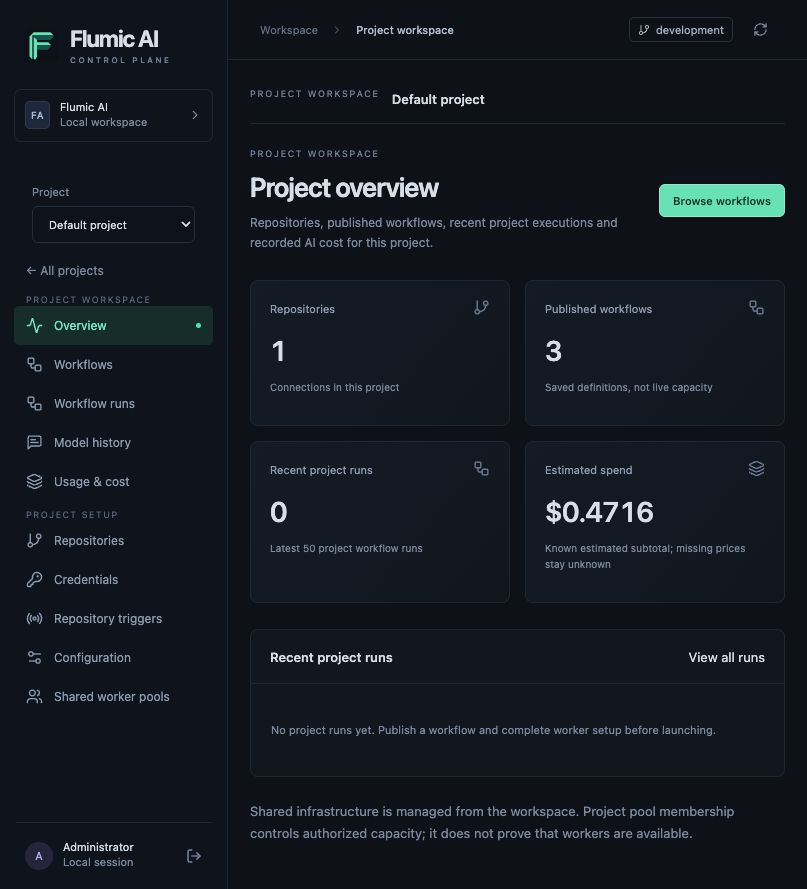

Screenshots show an existing local installation; profiles, counts, and run states
will differ on a fresh setup. Cost figures are estimates, and missing prices are
reported separately.

## License

Flumic AI is source-available under the [PolyForm Noncommercial License 1.0.0](LICENSE.md).
You may use, modify, and distribute it for purposes permitted by that license,
including personal study, experiments, and hobby projects without an anticipated
commercial application. The license also expressly permits use by the
noncommercial organizations it lists, regardless of funding.

Commercial projects outside those permissions require separate permission from
the relevant rights holders. This is not an OSI-approved open-source license.
The [license text](LICENSE.md) governs; retain its terms or URL and the
[required notice](NOTICE.md) when sharing the software. Third-party components,
including Hatchet, keep their own licenses.

## Quick start

Use the existing **Default project** and its installed **Issue to pull request**,
feedback and verification workflows. The only configuration change in this quick
start is the **target repository**; keep the existing project, repository alias,
workflow templates, pool assignments and model settings.

### 1. Prepare your environment

This path assumes the Default project is already provisioned with working
credentials, installed default workflows and authorized, running workers. If it
is not, use the [complete setup walkthrough](docs/user-walkthrough.md) first.
Your target repository should be initialized with a default branch and source
files; the saved source credential must have access to it.

For a locally installed factory, open [localhost:3400](http://localhost:3400) and
sign in with `CONTROL_ADMIN_PASSWORD` from `.env.control-plane`. If the control
services are stopped, start them from the factory checkout with:

```sh
just control-up api reconciler dynamic-runtime
```

See [command shortcuts](#command-shortcuts) for launcher prerequisites. Starting
the control services does not start stopped workers.

### 2. Update the target repository

1. Select **Default project** in the project selector.
2. Open **Repositories** and find the existing connection used by the default
   workflows. Click **Edit connection** on that card.
3. Update the owner and repository name to your target, for example `YOUR_ORG`
   and `YOUR_APP`. Keep its existing **Repository alias** unchanged: the saved
   default workflows refer to that alias.
4. Keep the assigned source credential if it already has access to the new target.
   If access is missing, resolve the credential before attempting a run.
5. Click **Save repository** and confirm the card shows `YOUR_ORG/YOUR_APP` with
   the same alias and assigned credential. Do not add another connection or
   reinstall templates for this quick start.

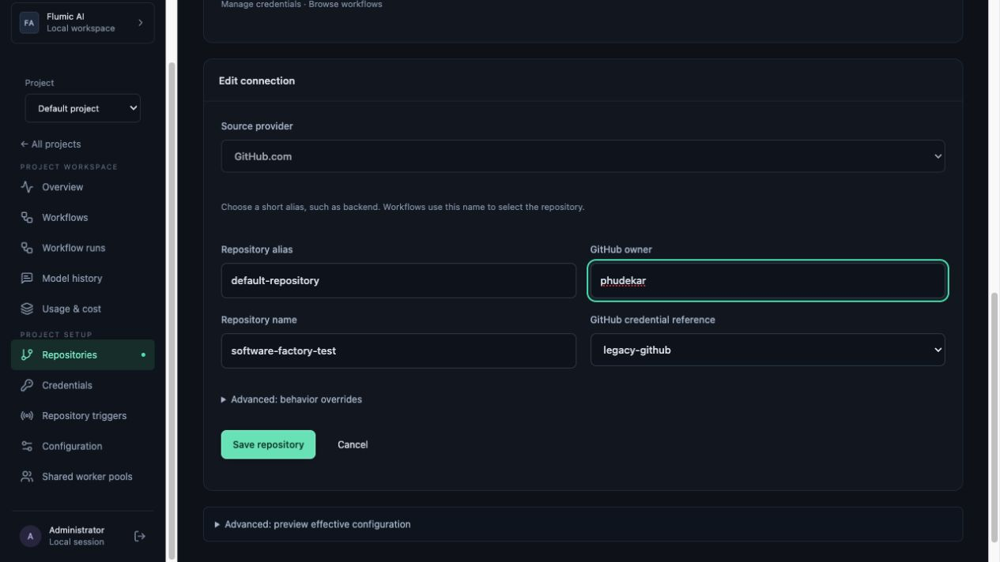

In the form above, change **GitHub owner** and **Repository name**, keep
**Repository alias** unchanged, and click **Save repository**. The shown
credential name belongs to the example installation; keep your own authorized
credential. The screenshot shows the example installation’s current values; its edit form was closed without saving.

Your target repository is where Flumic AI will read issues and propose code
changes. It is separate from this software-factory checkout. Saving its new
location does not start a workflow or verify provider access. Existing runs keep
their pinned repository context; the update applies to newly accepted runs.

### 3. Create and label an issue in GitHub

1. Open your **target repository** on GitHub, then **Issues → New issue**.
   If a template chooser appears, use the relevant issue type or **Open a blank issue**.
2. Enter a focused title and a description that explains current behavior,
   the requested change, acceptance criteria and how to verify the result.
   Use this minimal Python task for your first issue:

   ```text
   Title: Create a Hello World app in Python

   Create a file named hello.py in the repository root.
   When run with python3 hello.py, it should print Hello, world! and exit.

   Acceptance criteria:
   - Uses Python 3 and no third-party dependencies.
   - Prints exactly Hello, world! followed by a newline.
   - Exits successfully (exit code 0).

   Validation: Run python3 hello.py and check the output.
   ```

3. Review the description, then click **Submit new issue** (or **Create**, depending
   on GitHub's form). Copy the issue number from its heading or URL.

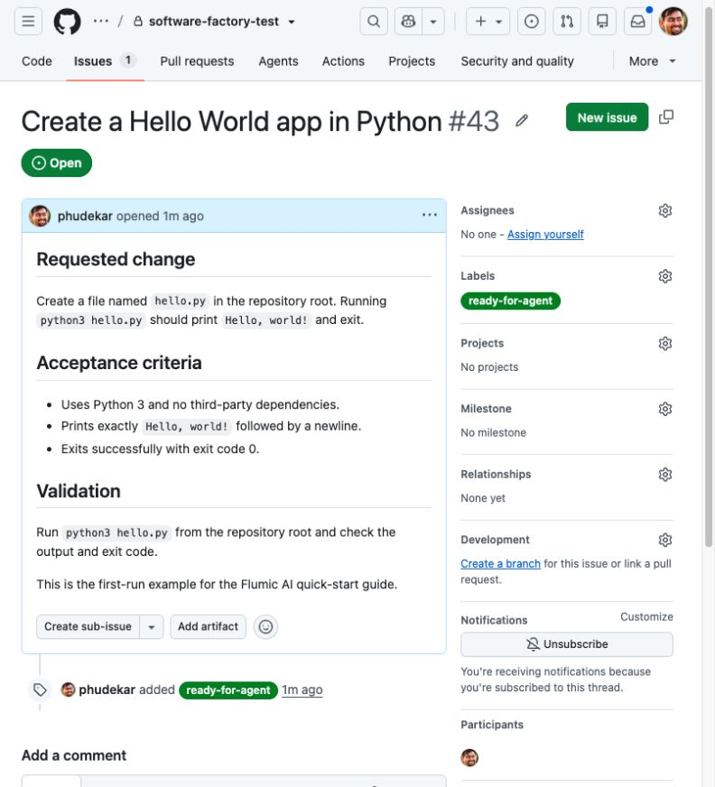

4. On the issue, open **Labels** in the right sidebar, search for
   `ready-for-agent` and select it. Close the picker and confirm the label appears.
   This is the default readiness label; use your saved configuration's label if
   it has been customized. You do not need to assign a GitHub user to launch the
   manual workflow.
5. If the label does not exist, open the repository's **Issues → Labels → New
   label**, name it exactly `ready-for-agent`, and create it. Return to the issue
   and apply it. If these controls are unavailable, ask a repository maintainer
   to create/apply the label.

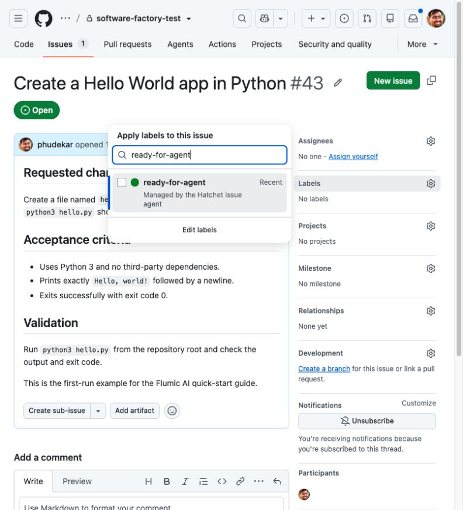

These screenshots show the actual [Hello World issue #43](https://github.com/phudekar/software-factory-test/issues/43)
created in the example `phudekar/software-factory-test` repository for this guide.
That repository is private, so the link requires access. Create your own issue
in your target repository and use its number. The issue screenshot shows its verified `ready-for-agent` label. The picker
screenshot shows the label search before selection; that picker was dismissed
without changing labels. Applying a readiness label may trigger work if automation
is enabled.

**Checkpoint:** the issue is open in the intended target repository, has a clear
scope and displays the readiness label. Labeling alone does not start a run in
this manual quick start. If an enabled repository trigger already handles that
label, inspect its accepted run and skip the manual launch below to avoid
submitting the same work twice.

### 4. Run the default workflow and monitor

Using the issue number from step 3, open **Workflows** and choose **Run** on the existing **Issue to pull request** workflow.
Confirm the unchanged repository alias, enter the issue number, and select the
existing feedback/verification revisions in **Guided issue launch**.

Review the selections, then click **Run saved revision** explicitly. Execution
can make paid model calls and write to the target repository. Follow the new run
in **Workflow runs**. In **Stage explorer**, select a stage and **Stage attempt**,
then use **Result**, **Logs**, **Model calls** or **Configuration**. Use **Overview**
for follow-up runs and **Run activity** / **All model calls** for run-wide evidence.
**Model history** and **Usage & cost** provide broader model monitoring. Review
generated PR diffs and CI before approving or merging in your source host.

If execution ownership for the new target has not been enabled, the server can
refuse the launch. Follow **Repositories → Repository execution** and its linked
[migration guidance](docs/project-runtime-operations.md#roll-out-from-a-current-checkout)
to resolve that prerequisite; do not bypass the checks. For detailed stage and
follow-up explanations, see the [walkthrough](docs/user-walkthrough.md).

For real screenshots of every observed label transition, the captured model
exchange and the generated PR, see the [recorded Hello World example](docs/hello-world-live-example.md).

#### What a successful run looks like


This is the real resumed implementation of child issue #44 under Default. It
created draft PR #45; it has not merged the change. Completed stage calls alone
do not prove the business task is finished: another run may finish by requesting
clarification or finding an existing plan. Inspect stage outcomes and follow-ups,
then review the PR and CI before merging.

#### How the workflow changed the issue — screenshots

The Hello World example moves from **parent issue #43 → child issue #44 → draft PR #45**.
The parent tracks the plan, the child tracks implementation, and the PR carries
review state. Check the object named in each step; all labels do not accumulate
on the parent issue.

| Step | Where to look | What changed and who did it |
| --- | --- | --- |
| 1. Ready | Parent issue #43 | You apply `ready-for-agent`; this signals readiness, not execution. |
| 2. Planned | Parent issue #43 | Planning adds `agent-plan-created` and consumes the readiness label. |
| 3. Task created | Child issue #44 | Planning creates a linked implementation issue with `agent-subtask`. |
| 4. Waiting for clarification | Child issue #44 | Triage adds `needs-discussion` instead of proceeding with an ambiguous change. |
| 5. Resumed | Child issue #44 timeline | You clarify the requirements and apply `ready-for-agent`; the stored follow-up resumes and the worker removes the discussion/readiness labels. |
| 6. Draft PR published | Child issue #44 and PR #45 | Implementation opens a draft PR and adds `agent-pr-open` to the child; `agent-subtask` remains. |
| 7. Review posted | PR #45 | Review posts findings and adds `agent-pr-reviewed` to the PR. Human approval and merge have not occurred. |

Each step pairs its GitHub state with the available Control Pane evidence.
**Control Pane evidence** beneath each step is expanded by default to show
its run, activity logs and model exchange. These Control Pane screenshots show retained runs after they finished, rather
than recreated in-progress states. Log images show retained stage activity;
model capture/retention may leave gaps. Use your own run IDs when following these
steps in another installation.

All steps and their run-output subsections are expanded by default. Collapse any section to focus on another step.

<details open>
<summary>1. Ready to process — parent issue</summary>

The parent initially had `ready-for-agent`. This is a readiness signal, not proof
of execution. The example was explicitly triggered; automatic launch depends on
configured repository triggers.


No run or model request has started at this point. The readiness label alone
is not execution evidence; there is no matching run/log screenshot to fabricate.


</details>

<details open>
<summary>2. Plan created — parent issue</summary>

The planner produced one implementation task. The parent acquired
`agent-plan-created`; its original readiness label was consumed. This does not
mean the implementation is finished.

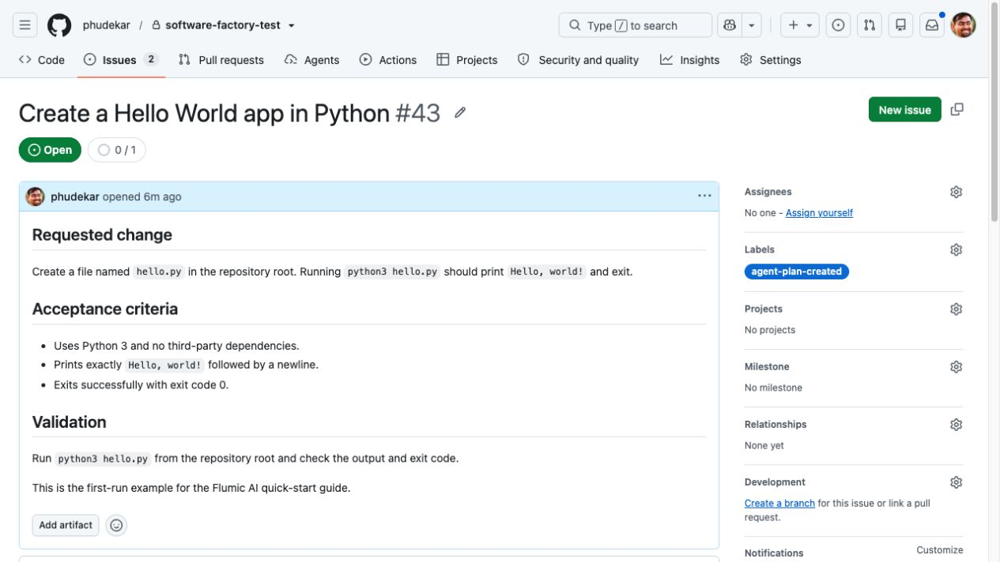

<details open>
<summary>Control Pane evidence: planning model logs</summary>

The original planning call was recorded before this installation moved to
project execution. Its retained exchange is available in **Default → Model history**,
but it is not a canonical Default project run. Do not substitute the later
parent run that reused the existing plan for the original plan-creation run.

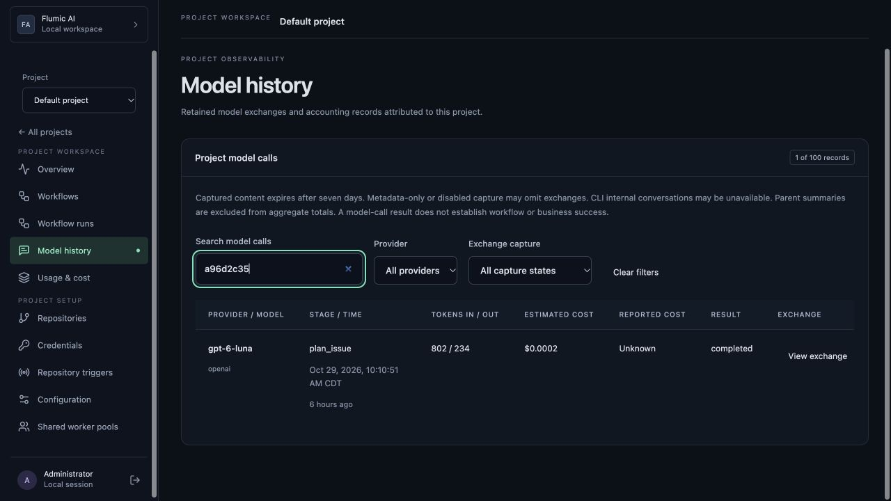

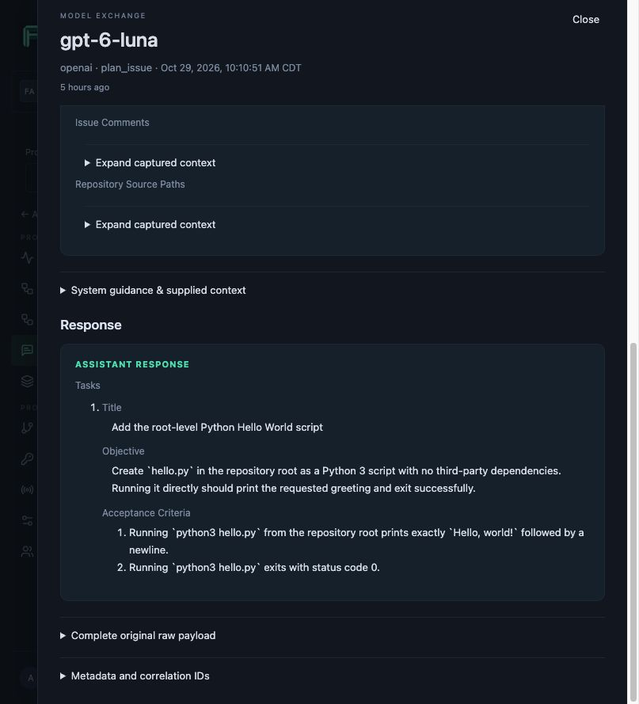

</details>

</details>

<details open>
<summary>3. Implementation work identified — child issue</summary>

The worker created #44 with `agent-subtask` and linked it to #43. Follow this
child for implementation progress; PR labels do not all accumulate on the parent.

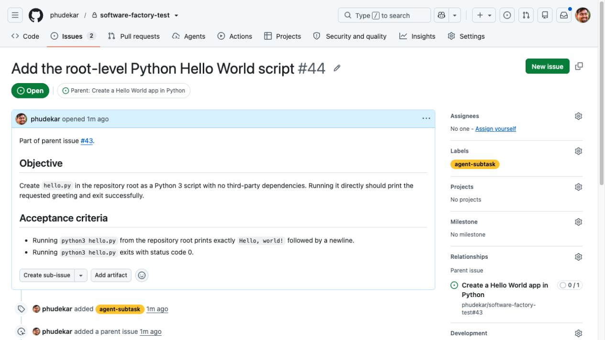

Child creation belongs to the same planning result shown in step 2. It is
not a second model call or a separate charge inferred from a new GitHub issue.


</details>

<details open>
<summary>4. Clarification requested — child issue</summary>

The repository already contained `hello_world/`. Triage asked whether to preserve
that directory and added `needs-discussion`. The control run completed its stage
calls, but its business outcome was waiting for discussion, not a generated PR.

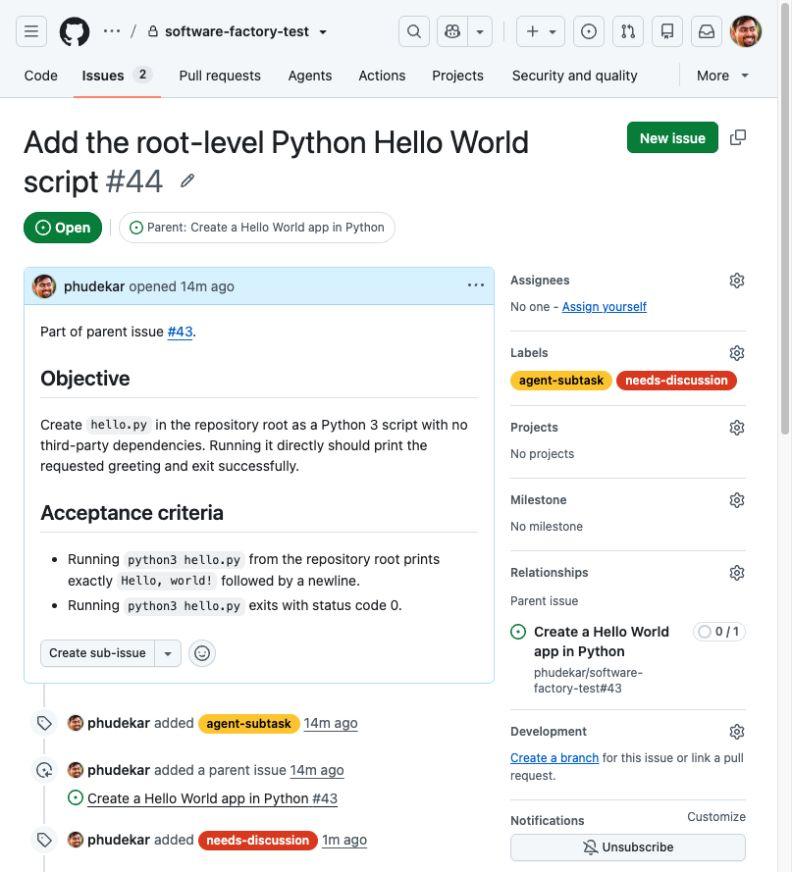

<details open>
<summary>Control Pane evidence: run, activity logs and model logs</summary>

**Run and stage:** `4b5d6351-5428-4d97-9dc1-537ec2d287ed`, filtered to `triage`.
The control run completed its invocations, while the business outcome was waiting
for clarification. No draft PR was produced by this run.


**Activity logs:** the messages identify issue #44, report `needs_discussion=True`
and say **Waiting for issue clarification**.

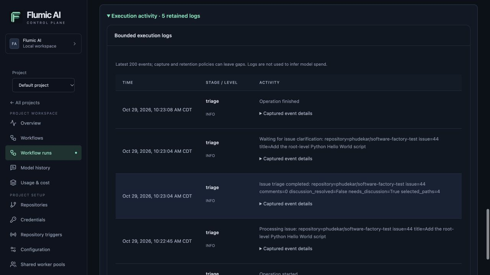

**Model logs:** the retained call is `729ca069-79ae-428f-bfb5-42777c4108fa`.
The accounting row is separate from its captured request/response. The response
sets `needs_discussion` to `true` and lists the questions later posted to the issue.

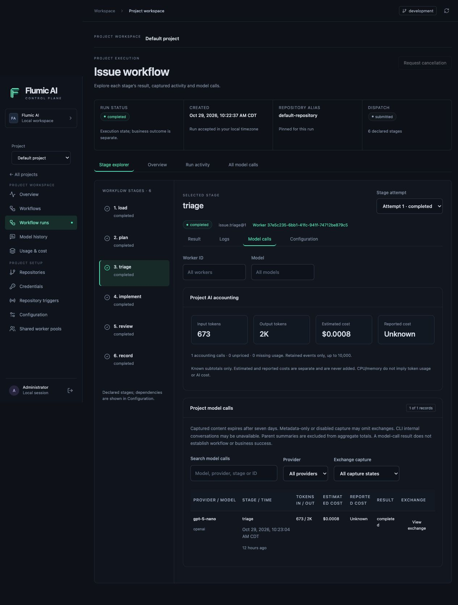

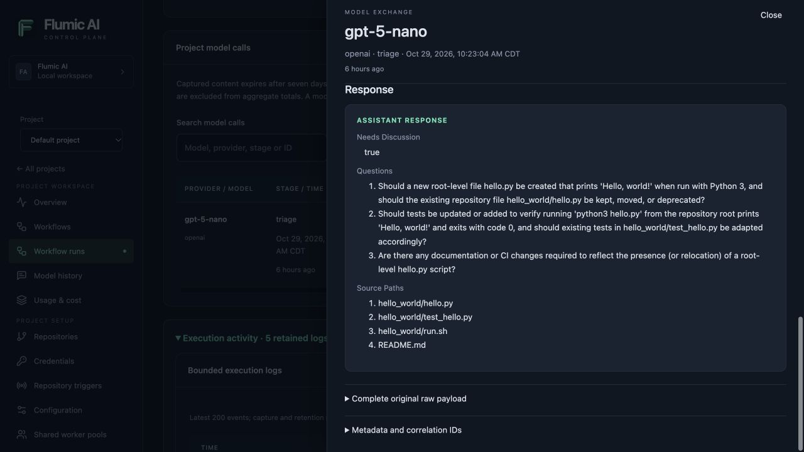

</details>

</details>

<details open>
<summary>5. Clarification resolved — child issue timeline</summary>

The reply confirmed a new root-level `hello.py`, preserving existing files with
no requested CI/documentation changes. Adding `ready-for-agent` resumed the
stored discussion follow-up. The agent then removed the discussion/readiness
labels as it continued. This screenshot shows GitHub's actual timeline event
because readiness was transient, rather than recreating the old state.

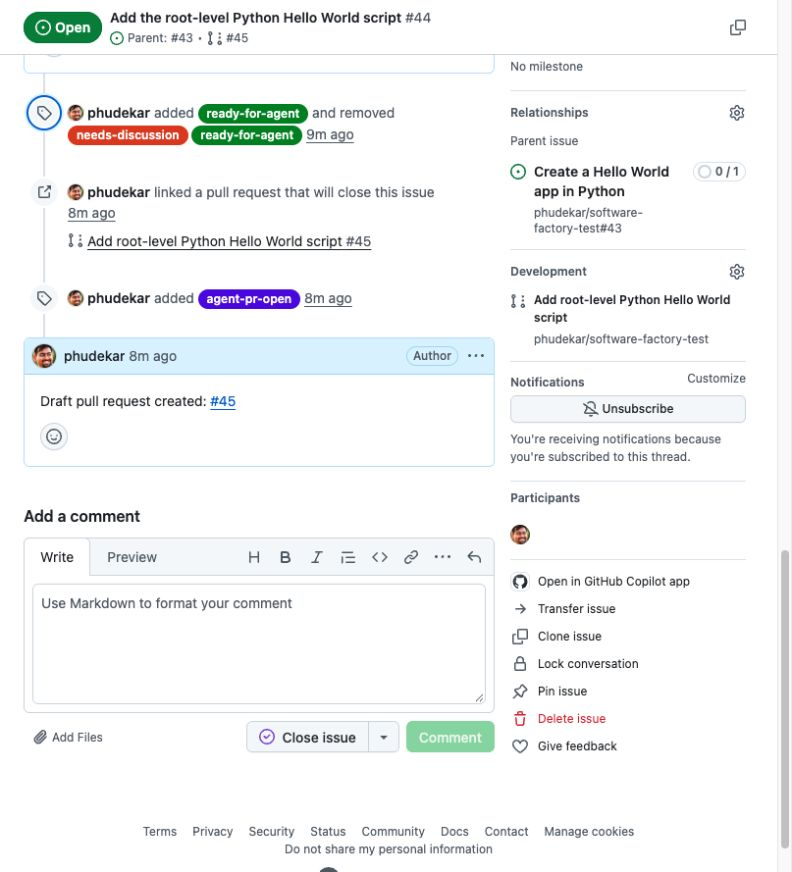

<details open>
<summary>Control Pane evidence: run, activity logs and model logs</summary>

**Resumed run and stage:** `7d53f1f2-ec3c-448a-80fd-f8e576a9fba7`, filtered to
`triage`. This is a new run created by the stored follow-up; the earlier run was
not rewritten. Screenshots inspect its retained state after completion.


**Activity logs:** issue #44 now has two comments; the log reports
`discussion_resolved=True`, `needs_discussion=False` and **Issue ready for patch generation**.


**Model logs:** call `64f60a0a-b3ee-49e7-a221-ad2a2382c72d` returned
`needs_discussion: false` and an empty questions list. Compare this with step 4.

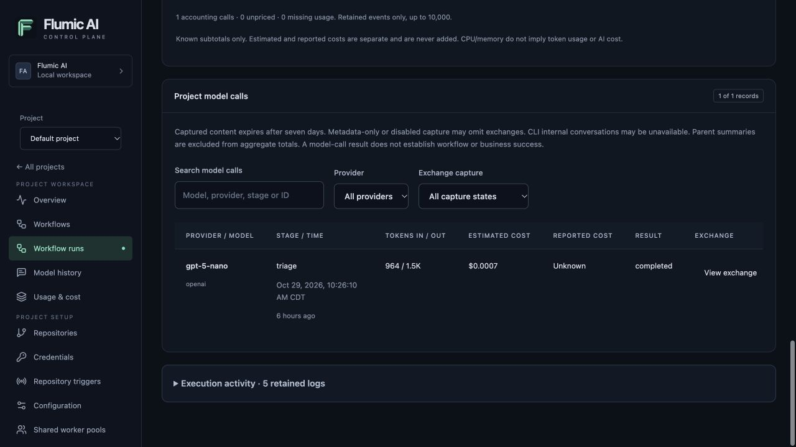

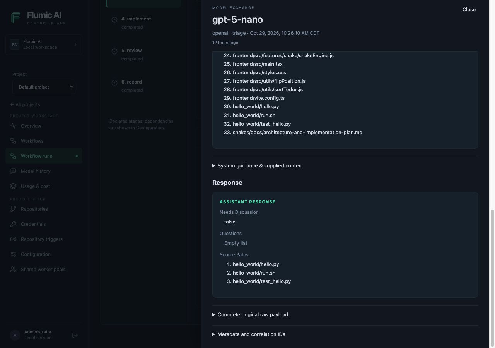

</details>

</details>

<details open>
<summary>6. Draft PR created — child issue</summary>

Implementation created draft PR #45 and added `agent-pr-open` to #44. The PR
contains only `hello.py`. Its CI build checks passed. Independently checking
commit `7a49fda15eff5ba5abc8f13757a00be837e15bee` confirmed stdout exactly
`Hello, world!` plus a newline, exit code 0 and empty stderr.

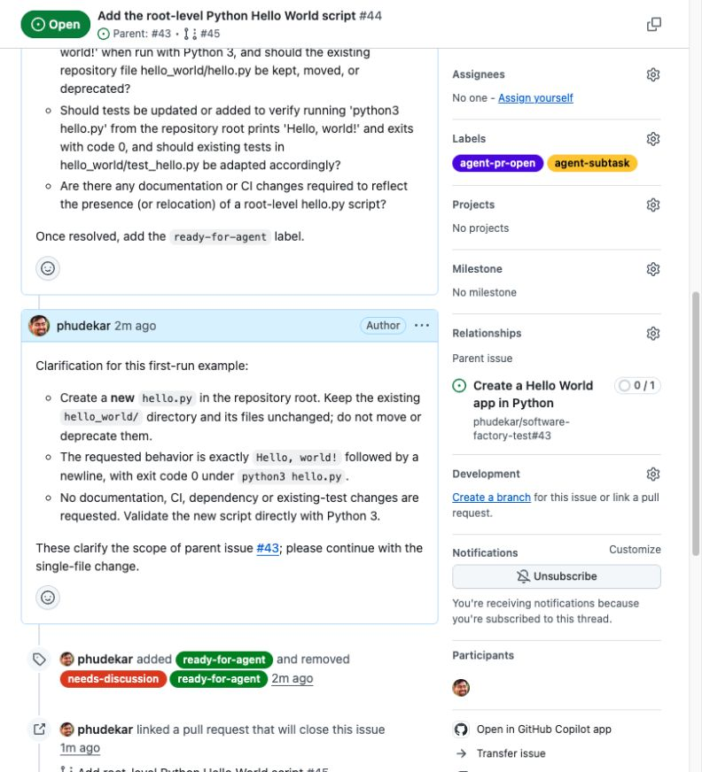

<details open>
<summary>Control Pane evidence: run, activity logs and model logs</summary>

**Run and stage:** the same resumed run, `7d53f1f2-ec3c-448a-80fd-f8e576a9fba7`,
now filtered to `implement`. Selecting a stage narrows the evidence; it does not
launch another workflow.


**Activity logs:** the excerpt shows a single changed file, publishing draft PR #45,
its creation and registration of a review wait.

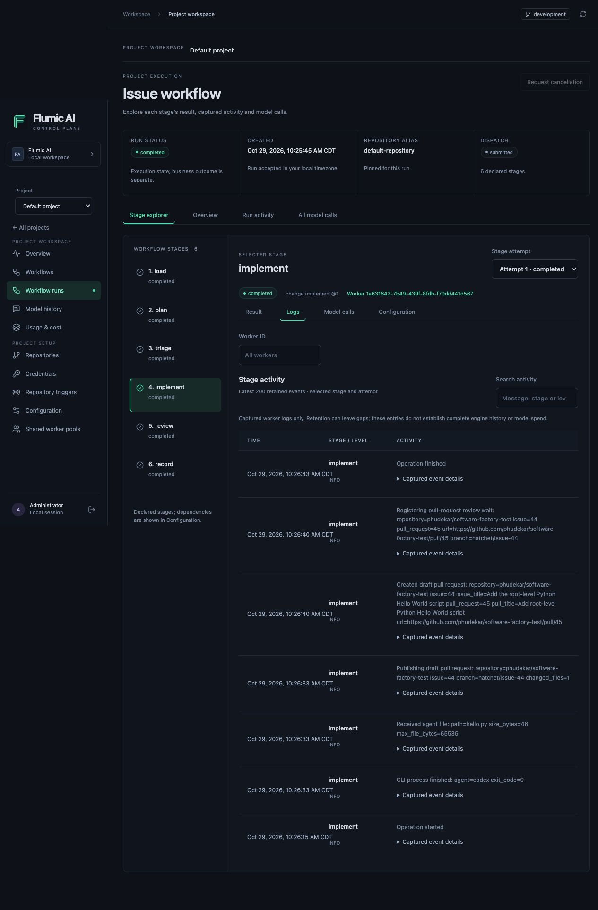

**Model logs:** call `e9f8d362-cbc0-4835-947a-7c2b4381eac1` records the coding
invocation's tokens and estimated cost. Coverage is `cli_prompt_and_result`,
not a transcript of every internal CLI/model interaction.

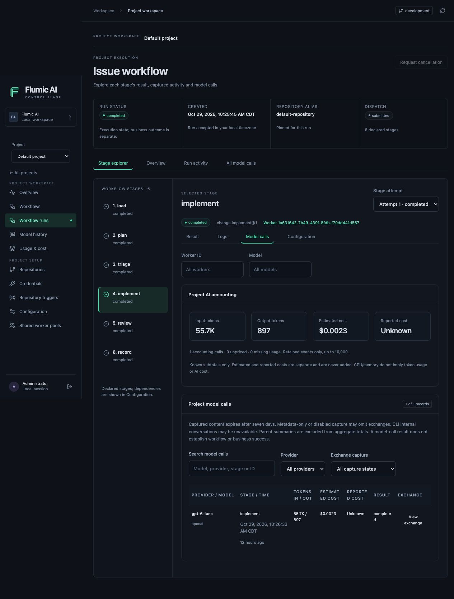

The returned artifact contains progress, a PR title and a detailed PR body with
acceptance criteria, validation and limitations. Those validation statements are
the model's report; the independent commit-specific check is described above.

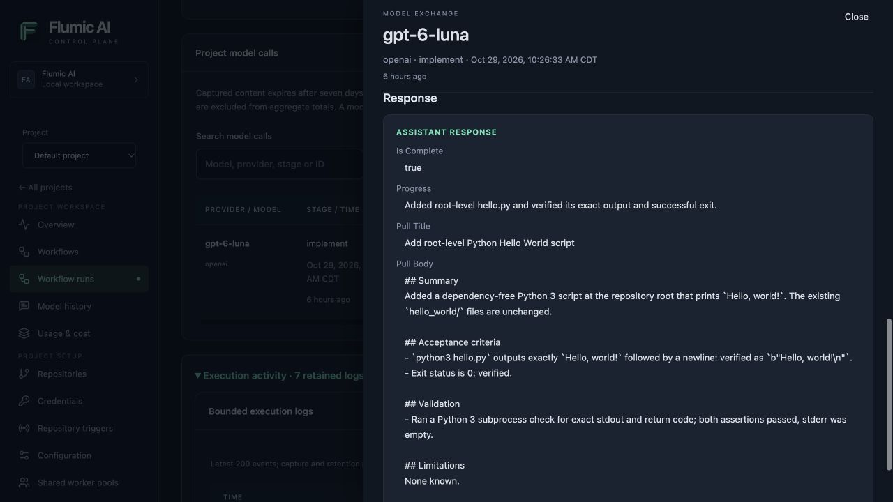

</details>

</details>

<details open>
<summary>7. Automated review posted — pull request</summary>

The automated review added `agent-pr-reviewed` to **PR #45**, not the parent issue.
It posted concerns about import-time execution. This label means a review was
posted; it does not mean the findings were accepted, the PR was approved or the
change merged. At the end of this recorded example, the PR was a draft awaiting human review.

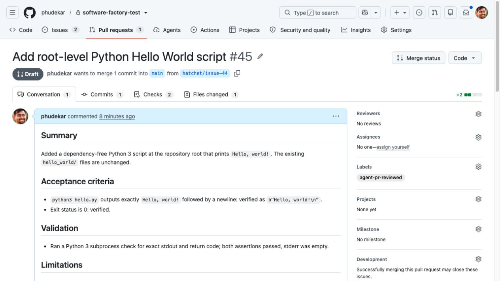

<details open>
<summary>Control Pane evidence: run, activity logs and model logs</summary>

**Run and stage:** the same resumed run, `7d53f1f2-ec3c-448a-80fd-f8e576a9fba7`,
filtered to `review`.

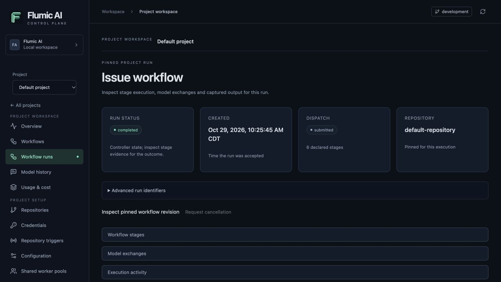

**Activity logs:** the post-creation review message identifies issue #44 and PR #45,
reports two findings including one suggestion, and records `agent-pr-reviewed`.
It does not record human approval or a merge.

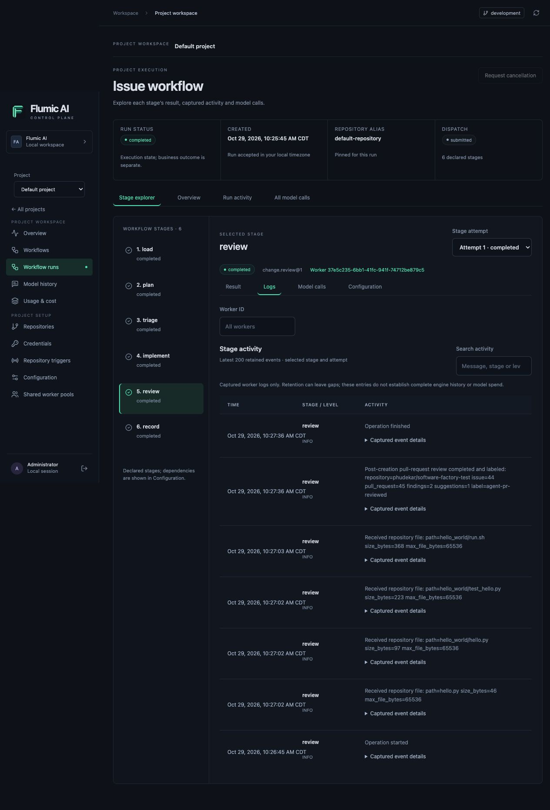

**Model logs:** two retained calls are listed for this stage. The response opened
below is the later call, `d60fe46c-0fd5-4f64-8b57-cc1eb72c3372`.

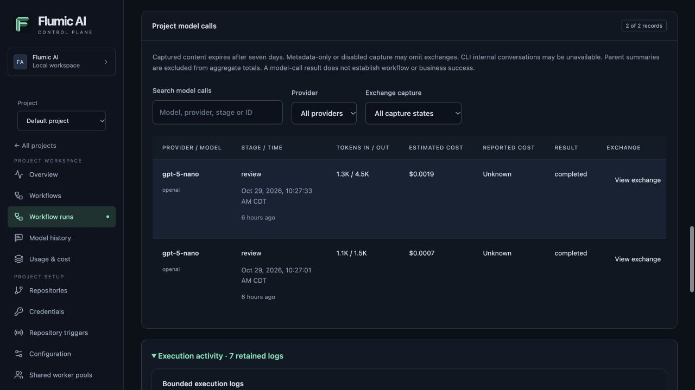

The model raised import-time execution concerns and proposed a main guard.
Its severity labels are model judgments, not independently confirmed defects
or an approval decision. Review the findings against the actual issue requirements.

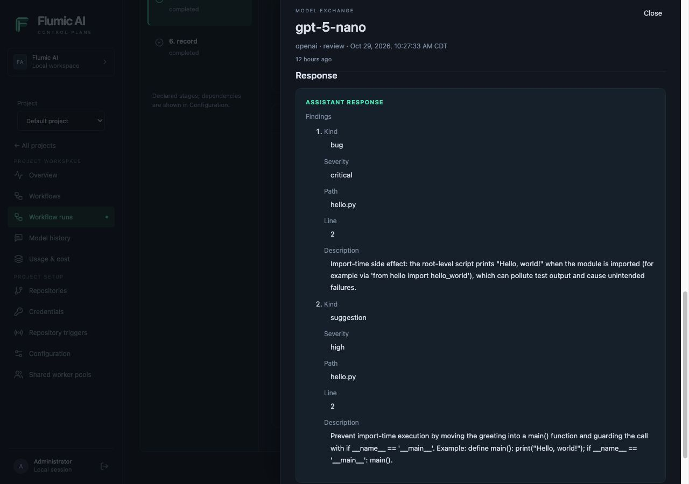

</details>

</details>

These are recorded screenshots from October 29, 2026; transient labels were not
reapplied to recreate earlier states. In this example, worker actions appear
under `phudekar`, the identity used by the repository credential. That username
alone does not distinguish a human action from an automated one.

`load` reads the issue and `record` persists the result; not every workflow stage
adds a GitHub label. A completed run can be waiting for clarification or review.
`agent-pr-reviewed` means findings were posted, not approval, merge or completion
of the overall issue. The screenshots stop at a reviewed draft PR.

<details>
<summary>Optional command shortcuts</summary>

### Command shortcuts

See [local deployment stacks](docs/deployment-compose.md) for database modes, migrations, the optional LiteLLM gateway and independent lifecycle commands. New installations should run `just images-build` before creating shared workers; restarting the Control Pane no longer rebuilds their images.

Install the `just` command runner (for example, `brew install just` on macOS),
then run `just` to list the checked-in shortcuts. Existing scripts remain usable
without it. Recipes run from the repository root, including when invoked from a
subdirectory; arguments are forwarded to the underlying commands.

| Shortcut | Underlying command / purpose |
| --- | --- |
| `just images-build` | Build managed worker images explicitly; does not start containers |
| `just control-up` | Start core services, one-time migrations and the default local database; no worker image builds |
| `just control-logs` / `just control-down` | Inspect / stop the core stack; default down retains volumes |
| `just gateway-up` / `just gateway-logs` / `just gateway-down` | Optional standalone LiteLLM gateway; does not change Flumic model routing |
| `just control-up api reconciler dynamic-runtime` | Start the selected control services for project workflows |
| `just observability-up` / `just observability-logs` / `just observability-down` | Independent SigNoz stack |
| `just dashboards-provision` | Explicitly reconcile the checked-in dashboard; first setup also attempts this |
| `just metrics-up` / `just metrics-logs` / `just metrics-down` | Independent host resource collector |
| `just hatchet-check` | `./scripts/check-hatchet-connectivity.sh` |
| `just install-ui` / `just install-docs` | Install locked npm dependencies for the selected component |
| `just ui-dev` / `just ui-build` | Develop / type-check and bundle the Control Pane |
| `just docs-dev` / `just docs-preview` | Develop / preview built documentation |
| `just docs-check` | Build the documentation and validate generated pages, links and assets |
| `just test` | Worker, backend and frontend unit suites; excludes opt-in integration contracts |
| `just test-worker` / `just test-backend` / `just test-ui` | Run one unit suite |

Prepare `.env`, Hatchet, Python dependencies and npm dependencies as described
below before running the relevant shortcuts. Python recipes use `.venv/bin/python`;
set `FLUMIC_PYTHON=/absolute/path/to/python` to choose another interpreter.
For example, `just docs-dev --port 4323` forwards the port to Astro. Use
`just --dry-run control-up api reconciler dynamic-runtime` to inspect a command
without starting services. Pool creation and project authorization are available
through **Shared worker pools** in the UI; they do not need shell aliases.


</details>

## Configuration

Field-by-field guides explain execution effects, valid values and examples:
[worker settings](docs/configuration-workers.md),
[workflow/task/label settings](docs/configuration-workflows.md), and
[Control Plane/environment settings](docs/configuration-control-plane.md).


### Credentials and local state

| Location | Purpose |
| --- | --- |
| `.env` | `GITHUB_TOKEN`, `OPENAI_API_KEY`, optional `DEVELOPER_OPENAI_API_KEY` and `ANTHROPIC_API_KEY` |
| Hatchet `development` CLI profile | Engine endpoint, token, and TLS settings loaded by launchers |
| `.env.control-plane` | Generated administrator password, database password, and encryption key |
| `data/control-plane/` | Shared-worker history spools, Job snapshots and runtime artifacts; optional host-backed PostgreSQL |

Back up the control database and encryption key together. PostgreSQL uses a named
volume by default; see [host database storage](docs/control-plane.md#host-database-storage)
for an optional host directory. Project workflows store scoped execution state and
claims in PostgreSQL; Docker actions use the trusted broker host.

### Project configuration and worker capacity

Open **Projects → Default project → Repositories** to update the target repository.
Open **Configuration** inside the project to choose models, coding tools, limits
and prompts. Repository, workflow and stage overrides refine project defaults.
Saving creates a revision for new runs; admitted runs retain their pinned settings.

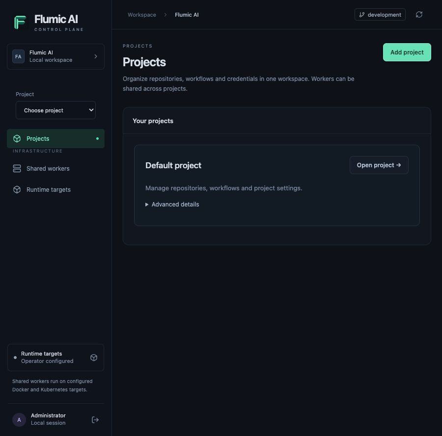

Repository YAML files such as `worker-config.yaml`, `config/models.yaml` and
`config/worker-profiles/*.yaml` supply bootstrap defaults. Editing them does not
replace saved database configuration. Use project forms for an existing installation.
Keep credentials in project credential versions; do not paste secrets into YAML.

Open **Shared workers → Add shared worker** to select a pool, runtime target and
unique worker name. Pools define role, installed actions and execution capacity.
Authorize a pool from the project's **Shared worker pools** page. Adding workers
changes capacity; it does not change a project's models or prompts.

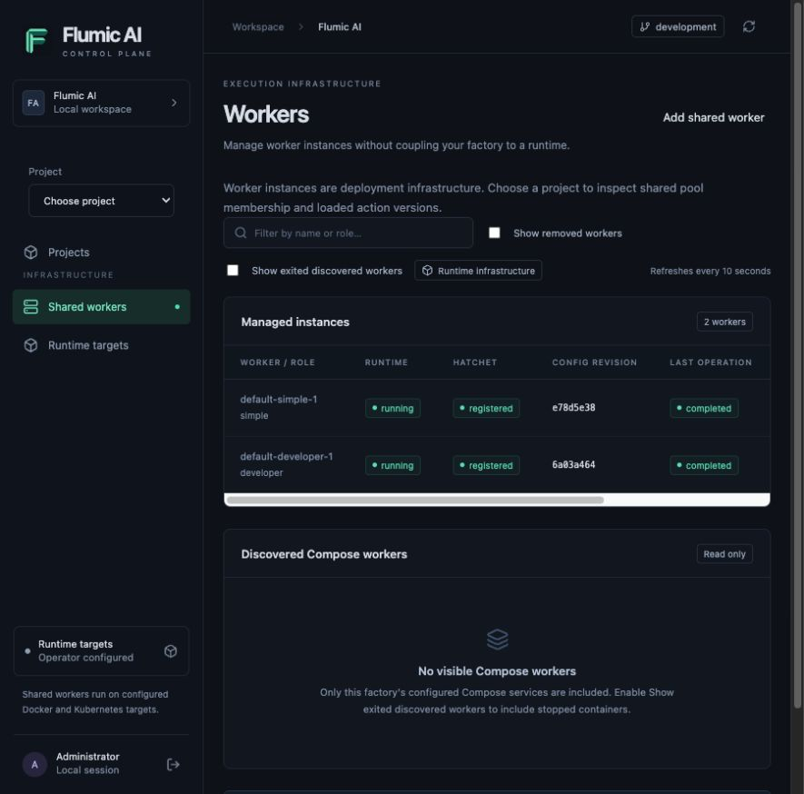

For code/dependency changes, run `just images-build`, then use the worker lifecycle
controls to replace affected runtimes with the new images. Restart can interrupt
active tasks. Settings changes alone do not rebuild images. Static Compose worker
launch scripts and the standalone local runner are retired.

See the [Control Pane guide](docs/control-plane.md),
[configuration reference](docs/configuration-workers.md), and
[retirement and upgrade notes](docs/maintenance/legacy-retirement.md).

## Developer workflow

The backend is Python/FastAPI with SQLAlchemy and PostgreSQL; the frontend is
React/TypeScript with Vite. Worker domain/application code lives under
`worker/factory`, with adapters for orchestration, coding, persistence, and telemetry.

```sh
python3 -m venv .venv
.venv/bin/python -m pip install -r worker/requirements.txt -r control-plane/backend/requirements.lock
just test-worker
just test-backend
```

```sh
just install-ui
just test-ui
just ui-build
```

CI uses Python 3.14 and Node.js 22. The [test workflow](.github/workflows/tests.yml)
runs worker/backend/frontend suites and the frontend build on pushes and PRs.
Backend tests use SQLite by default; optional PostgreSQL testing is documented in
the [development guide](docs/control-plane.md#development-and-verification).

Useful runtime checks:

```sh
docker-compose ps
docker-compose logs -f worker developer-worker
hatchet worker list --profile development --output json
hatchet runs list --profile development --output json --since 1h
```

For managed instances, use worker detail pages for build/startup logs and stage
attempts; use run detail pages for stage logs and redacted model exchanges.
To stop Compose workers, run `docker-compose down`. Stop managed workers through
**Workers → Stop**. Stopping can interrupt active tasks, which Hatchet may retry.

## FAQ

### Why is my issue not being processed?

Confirm `defaults.repository`, token access, both worker roles, and Hatchet
registration. Allow for the scan interval. Check GitHub labels: an issue waiting
for clarification needs a response and `ready-for-agent`. Inspect **Workflow runs**
and worker startup logs for errors. The sample-event command above bypasses the
wait for the next scan.

### Why are coding tasks queued while other stages run?

They require a registered developer worker with the matching routing label.
A simple worker cannot execute those tasks. Check the developer worker's build,
startup, and registration status before increasing concurrency.

### Why did a saved configuration change not affect my worker?

New project runs pin saved configuration revisions. Existing runs retain their
original settings; restarting a worker does not change those pins. Bootstrap files
do not overwrite saved project configuration.
Image changes require runtime replacement; a plain Docker restart cannot change
an image. See [worker image builds](docs/worker-image-builds.md).

### Can I use Claude or a direct API instead of Codex?

Yes. Set `developer_agent` in the developer profile to `claude` or `api`, choose
the corresponding model, and supply the matching provider key. The default
planner/reviewer still use OpenAI unless their adapters are changed. See the
[architecture and extension guide](docs/architecture.md) for custom adapters.

### Where do tests run for generated pull requests?

In the target repository's GitHub CI. Configure its workflows and required checks
before relying on generated PRs. The factory does not run project-controlled tests
in its credential-bearing worker process; coding CLIs can execute commands in
isolated workspaces. Human review and merge remain part of the workflow.

### Why is model history empty or cost incomplete?

History begins with instrumented workers; earlier conversations cannot be
reconstructed. Capture may be disabled or metadata-only. CLI captures contain
submitted prompts and final results, not full internal conversations. Usage can
lack provider accounting or a matching price, so totals are estimates.

### How do I diagnose connection or model-access failures?

```sh
./scripts/check-hatchet-connectivity.sh
```

This checks Hatchet connectivity, GitHub repository read access, and an OpenAI
completion. It makes a billable provider request. A missing model can mean the
configured ID is unavailable to your account. When using Codex, its periodic
healthcheck also makes a small billable completion request.

### Can I run this across hosts or expose the UI to a team?

The Control Pane supports Docker and an operator-configured Kubernetes target for a trusted administrator. Docker management requires socket access; Kubernetes uses explicit, scoped controller credentials. Project workflows use PostgreSQL state and claims across shared workers, including workers on different Kubernetes nodes. Static worker startup and its SQLite runtime are retired. Multi-user roles remain future work; see [Kubernetes setup and limits](docs/kubernetes.md) and [runtime rollout](docs/project-runtime-operations.md).

### What data reaches model providers?

Issue context and selected repository contents are sent to the configured
provider. Coding CLIs receive a full repository archive and their selected API
key, with network access. Redaction and guardrails reduce exposure but cannot
prove content is free of confidential data. Review generated changes, especially
CI and infrastructure changes. Read the [security boundary](docs/issue-lifecycle.md#security-boundary-and-limitations)
before enabling automation on sensitive repositories.

## Source hosts and runtime options

- **GitLab.com workflows:** issue-to-merge-request collaboration with repository-scoped credentials, webhook/poll triggers and commit-specific CI. See [connection, trigger and CI configuration](docs/gitlab.md).
- **Kubernetes orchestration:** native worker Deployments, private retained history volumes and one-time action Jobs, with scoped credentials, admission fencing and qualified network/PID limits. See [configuration and operations](docs/kubernetes.md).

Current integrations support GitHub or GitLab.com, Hatchet, and Docker or qualified Kubernetes execution. Remote function executors remain planned.

The [project and dynamic-workflow implementation roadmap](docs/project-workflow-roadmap.md)
tracks multi-repository projects, shared worker pools, and built-in/Docker actions
as GitHub issues. Project/repository APIs, shared pool foundations, immutable
definition publication and the internal run-state/admission service are implemented.
The durable coordinator adapter is implemented with live replay, mixed builtin/Docker execution, cancellation and deadline tests.
The executable builtin catalog, pinned project follow-ups and recipe helpers are also implemented.
The [durable one-time Docker broker](docs/docker-action-jobs.md) integrates through
[project run and worker APIs](docs/project-runtime-api.md). The Control Pane provides project management, workflow publication and pinned-run inspection; see [runtime status and limits](docs/control-plane.md#durable-run-state-and-admission).

Use the runtime API guide to activate the fixed control service, seed workflows and
launch pinned runs.
[Project-scoped history, traces and AI accounting](docs/project-observability.md)
now follow authoritative assignments, including delayed spool delivery and explicit
Docker usage reports. See [rollout, recovery and release qualification](docs/project-runtime-operations.md) for configuration ownership, action-image contracts and infrastructure test boundaries. GitLab.com and native Kubernetes targets are supported; remote function executors remain planned.

## Website and documentation

The GitHub Pages website combines a product introduction with searchable usage,
configuration, API and observability guides. See [website development and publishing](website/README.md)
for local preview commands and Pages setup. The expected deployment address is
[phudekar.github.io/flumic-software-factory](https://phudekar.github.io/flumic-software-factory/).

## Further reading

- [Module map and configuration ownership](website/src/content/docs/start/modules.md)
- [Issue lifecycle, GitHub webhooks, labels, and security boundaries](docs/issue-lifecycle.md)
- [Control-plane operation and troubleshooting](docs/control-plane.md)
- [Worker configuration reference](docs/worker-configuration.md)
- [One-time Docker actions, execution contract and recovery](docs/docker-action-jobs.md)
- [Create workflows, add stages and link executions](docs/workflow-development.md)
- [Architecture diagram, component responsibilities and extension points](docs/architecture.md#architecture-at-a-glance)
- [Architecture decision records and trade-offs](docs/adr/index.md)
- [Optional SigNoz observability](docs/observability.md)
- [Architecture migration history](docs/architecture-migration.md)


## Kubernetes runtime configuration

Native Kubernetes worker Deployments and one-time Jobs are implemented and qualified on a dedicated two-node k3d/K3s cluster. See the [operator configuration reference](docs/kubernetes.md) for every target setting, explicit controller authentication, namespace fencing, storage, networking, PID limits and capture/cleanup behavior. Docker remains available alongside the operator-configured Kubernetes target.
