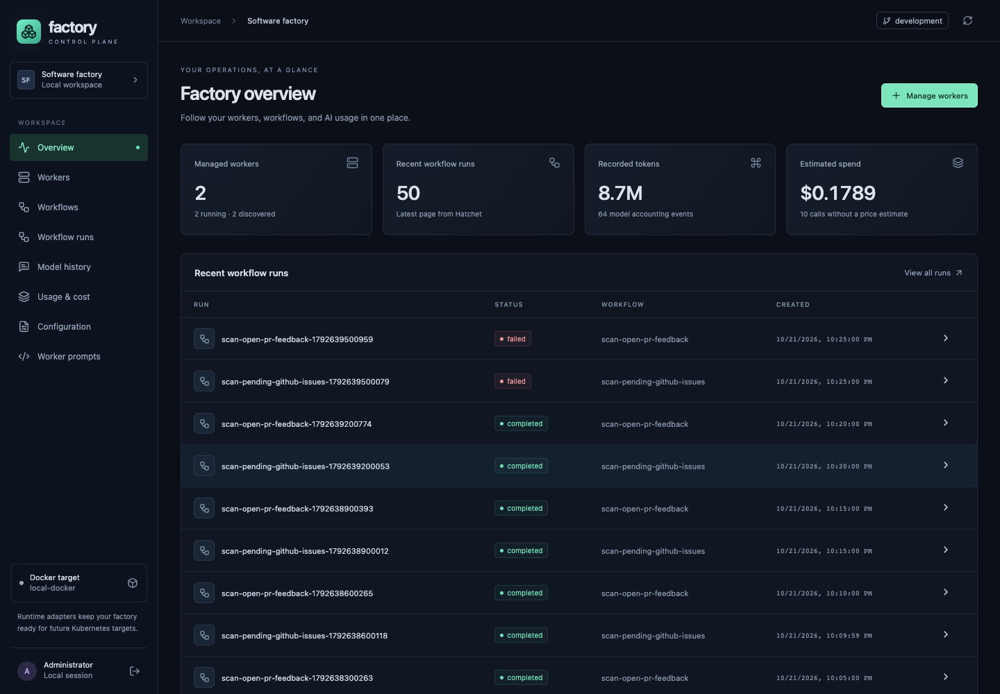
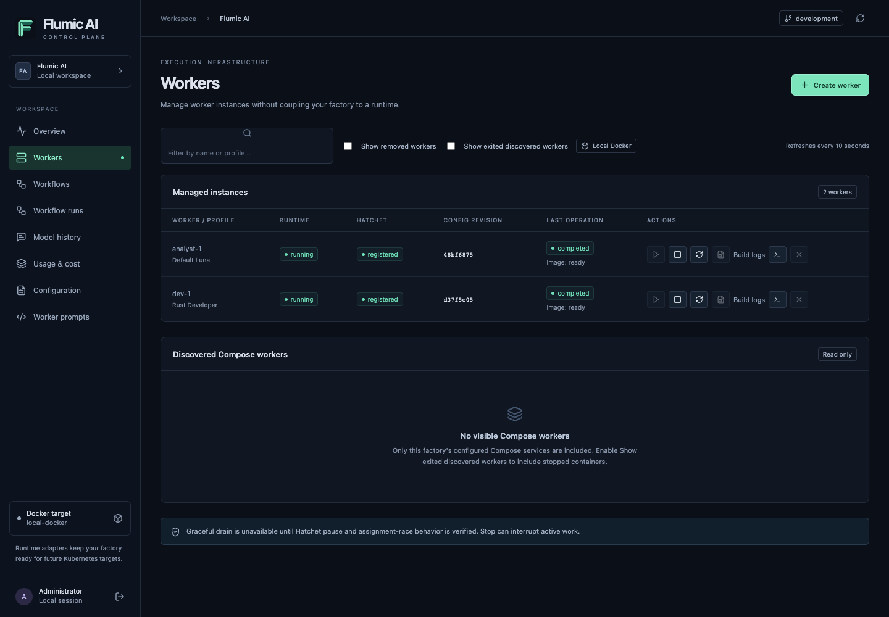
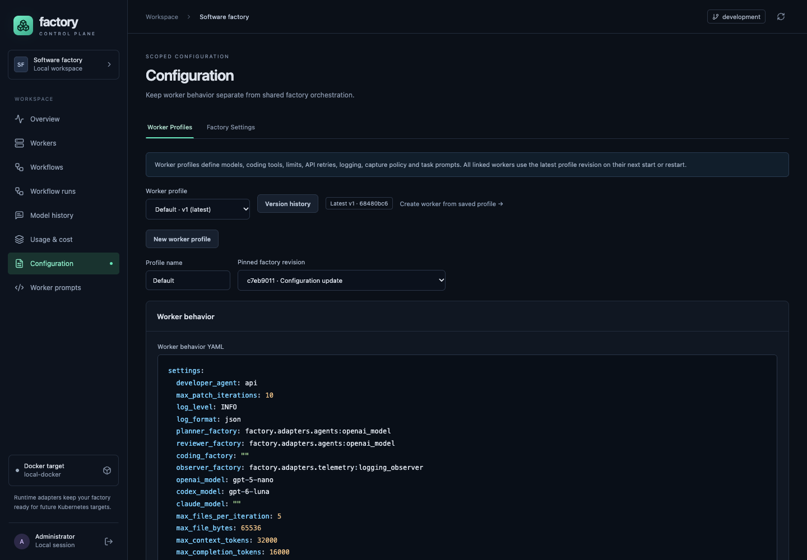

# Flumic AI

[](https://github.com/phudekar/flumic-software-factory/actions/workflows/tests.yml)

Flumic AI turns GitHub issues into reviewed draft pull requests with Python workers, Hatchet
orchestration, and your choice of Codex, Claude Code, or a direct model API.
The factory plans work, creates sub-issues, implements changes on isolated
branches, reviews PRs, and applies actionable feedback to the same branch.
Developers own requirements, CI, approval, and merging.

The React/TypeScript control plane provides worker lifecycle controls,
versioned configuration, workflow runs, stage logs, redacted model history, and
usage estimates. It is intended for a trusted developer running Docker locally.



Screenshots show an existing local installation; profiles, counts, and run states
will differ on a fresh setup. Cost figures are estimates, and missing prices are
reported separately.

## License

Flumic AI is source-available under the [PolyForm Noncommercial License 1.0.0](LICENSE.md).
You may use, modify, and distribute it for purposes permitted by that license,
including personal study, experiments, and hobby projects without an anticipated
commercial application. The license also expressly permits use by the
noncommercial organizations it lists, regardless of funding.

Commercial projects outside those permissions require separate permission from
the relevant rights holders. This is not an OSI-approved open-source license.
The [license text](LICENSE.md) governs; retain its terms or URL and the
[required notice](NOTICE.md) when sharing the software. Third-party components,
including Hatchet, keep their own licenses.

## Quick start

For a complete guided journey, follow the [user walkthrough: project creation to monitoring](docs/user-walkthrough.md), including explicit UI/API steps, example inputs and troubleshooting checkpoints.

Choose your execution path before starting workers:

- **New multi-project installation:** use the [project onboarding guide](website/src/content/docs/start/project-onboarding.md). Projects own repository connections and immutable workflow revisions; shared pools provide execution capacity.
- **Existing profile-based installation:** follow the steps below. These start the legacy issue-to-PR workflows and use shared-host SQLite state.

Do not run both paths against the same repository. Moving an existing repository
requires the explicit [dynamic-mode handover](docs/project-runtime-operations.md#roll-out-from-a-current-checkout).

### Command shortcuts

Install the `just` command runner (for example, `brew install just` on macOS),
then run `just` to list the checked-in shortcuts. Existing scripts remain usable
without it. Recipes run from the repository root, including when invoked from a
subdirectory; arguments are forwarded to the underlying commands.

| Shortcut | Underlying command / purpose |
| --- | --- |
| `just control-up` | `./scripts/start-control-plane.sh` |
| `just control-up api reconciler dynamic-runtime` | Start the selected control services for project workflows |
| `just workers-up` | `./scripts/start-workers.sh -d` — legacy Compose fleet; may make paid calls and repository writes |
| `just observability-up` | `./scripts/start-observability.sh` |
| `just hatchet-check` | `./scripts/check-hatchet-connectivity.sh` |
| `just issue-send 123` | Explicit legacy issue event; may make paid calls and repository writes |
| `just install-ui` / `just install-docs` | Install locked npm dependencies for the selected component |
| `just ui-dev` / `just ui-build` | Develop / type-check and bundle the Control Pane |
| `just docs-dev` / `just docs-preview` | Develop / preview built documentation |
| `just docs-check` | Build the documentation and validate generated pages, links and assets |
| `just test` | Worker, backend and frontend unit suites; excludes opt-in integration contracts |
| `just test-worker` / `just test-backend` / `just test-ui` | Run one unit suite |

Prepare `.env`, Hatchet, Python dependencies and npm dependencies as described
below before running the relevant shortcuts. Python recipes use `.venv/bin/python`;
set `FLUMIC_PYTHON=/absolute/path/to/python` to choose another interpreter.
For example, `just docs-dev --port 4323` forwards the port to Astro. Use
`just --dry-run control-up api reconciler dynamic-runtime` to inspect a command
without starting services. Pool creation and project authorization are available
through **Shared worker pools** in the UI; they do not need shell aliases.

### 1. Prepare your environment

You need:

- Git, Python 3, Docker Engine/Desktop, and the `docker-compose` command used by the launch scripts.
- Hatchet with a reachable instance and a CLI profile named `development`.
- An initialized target GitHub repository with a default branch and source files.
- A fine-grained GitHub token scoped to that repository: Contents, Issues, and
  Pull requests read/write; Checks and Commit statuses read access.
- An OpenAI API key for the default planner/reviewer. Claude coding additionally
  requires an Anthropic key. Configured model IDs must be available to your account.

```sh
git clone https://github.com/phudekar/flumic-software-factory.git
cd flumic-software-factory
cp .env.example .env
```

Edit `.env` with your credentials. Set `defaults.repository` in
`config/runtime.yaml` to `YOUR_ORG/YOUR_REPO` before starting any workers.
Review model choices in `config/models.yaml` and
`config/worker-profiles/developer.yaml` for your provider account.

The launchers load Hatchet credentials from the `development` CLI profile.
Keep `.env` private; do not copy Hatchet tokens into repository configuration.

### 2. Start the control plane

```sh
just control-up
```

Open [localhost:3400](http://localhost:3400). Sign in with
`CONTROL_ADMIN_PASSWORD` from the generated, Git-ignored `.env.control-plane`.
The first build can take several minutes. The launcher builds worker images and
starts the API, PostgreSQL, and reconciler; existing workers are not restarted.

### 3. Start a simple worker and a developer worker

In **Workers → Create worker**, create one instance using the **Default** profile
and another using **Developer**. Creation leaves each container stopped.
Choose **Start** for each, then verify that Runtime is running and Hatchet is
registered. Starting workers enables issue scanning, GitHub writes, and billable
model requests.

Simple workers handle intake, planning, and review; developer workers handle code
changes. Both roles are needed for the complete workflow.



For a Compose-only deployment, use this instead of creating managed instances:

```sh
./scripts/start-workers.sh -d
docker-compose ps
```

Compose workers appear as discovered, read-only instances in the control plane.
Manage their lifecycle through Compose. Avoid starting duplicate fleets
unintentionally.

### 4. Process your first issue

Create a small issue in the configured target repository with clear acceptance
criteria. The default scan runs every five minutes. To submit an existing issue
immediately, replace `123` with its number:

```sh
just issue-send 123
```

Follow **Workflow runs** for stages and logs. If the issue receives
`needs-discussion`, answer the questions in GitHub and add `ready-for-agent`.
The factory decomposes work into sub-issues and opens draft PRs for eligible
implementation tasks. Review the diff and CI results, mark the PR ready, approve,
and merge. Durable waits track review and merge; the factory then verifies the
result and closes the associated issue.

Configure [GitHub webhooks](docs/issue-lifecycle.md#configure-github-webhook-delivery)
for immediate issue and PR-feedback events. Polling remains available for recovery.

## Configuration

Field-by-field guides explain execution effects, valid values and examples:
[worker settings](docs/configuration-workers.md),
[workflow/task/label settings](docs/configuration-workflows.md), and
[Control Plane/environment settings](docs/configuration-control-plane.md).


### Credentials and local state

| Location | Purpose |
| --- | --- |
| `.env` | `GITHUB_TOKEN`, `OPENAI_API_KEY`, optional `DEVELOPER_OPENAI_API_KEY` and `ANTHROPIC_API_KEY` |
| Hatchet `development` CLI profile | Engine endpoint, token, and TLS settings loaded by launchers |
| `.env.control-plane` | Generated administrator password, database password, and encryption key |
| `data/` | Shared factory SQLite state, locks, snapshots, and build logs |

Back up the control database and encryption key together. PostgreSQL uses a named
volume by default; see [host database storage](docs/control-plane.md#host-database-storage)
for an optional host directory. Legacy static workers must share the factory SQLite
state and locks on one host. Project workflows store scoped execution state and
claims in PostgreSQL; Docker actions use the trusted broker host.

### Repository configuration

`worker-config.yaml` includes the following files in order. Later values override
earlier ones; mappings merge recursively and lists/scalars replace earlier values.

| File | Configure |
| --- | --- |
| `config/runtime.yaml` | Target repository, adapters, logging, state, telemetry |
| `config/models.yaml` | Models, context/completion budgets, provider retries and timeouts |
| `config/workflow.yaml` | Scan cron, concurrency, labels, task routing, retries, timeouts, prompts |
| `config/worker-profiles/default.yaml` | Bootstrap simple-worker settings and prompts |
| `config/worker-profiles/developer.yaml` | Bootstrap coding tool, image build, limits, and prompts |

For example, change these existing entries in `config/runtime.yaml`:

```yaml
defaults:
  repository: YOUR_ORG/YOUR_REPO
  log_level: INFO
```

Change scheduling in `config/workflow.yaml`:

```yaml
defaults:
  scan_cron: '*/10 * * * *'
  workflow_concurrency: 3
```

These snippets show entries to edit, not replacements for the complete files.
Cron uses UTC. Restart standalone workers after editing configuration; rebuild
images when changing Python code or dependencies. Credentials belong outside YAML.

### Saved worker profiles in the UI

Open **Configuration → Worker profiles** to select models, choose `codex`,
`claude`, or `api` as the coding backend, set limits, and configure worker images.
Use **Worker prompts** for Markdown instructions. Validate YAML before saving.



Saving appends an immutable revision. Linked workers load the latest profile on
their next start/restart; running processes retain their loaded settings.
**Clone as new profile** creates a separate identity. Bootstrap YAML seeds profiles
only when the store is empty; editing those files does not overwrite saved profiles.
Shared orchestration is edited separately under **Factory settings**.

For CLI coding, use `codex_model` or `claude_model`; direct API requests use
`openai_model`. Task model overrides take precedence. The developer-specific
OpenAI key can separate coding access from planning/review access.

See the [configuration reference](docs/worker-configuration.md),
[bootstrap profile guide](config/worker-profiles/README.md), and
[control-plane guide](docs/control-plane.md) for precedence, image builds,
startup scripts, and revision behavior.

## Developer workflow

The backend is Python/FastAPI with SQLAlchemy and PostgreSQL; the frontend is
React/TypeScript with Vite. Worker domain/application code lives under
`worker/factory`, with adapters for orchestration, coding, persistence, and telemetry.

```sh
python3 -m venv .venv
.venv/bin/python -m pip install -r worker/requirements.txt -r control-plane/backend/requirements.lock
just test-worker
just test-backend
```

```sh
just install-ui
just test-ui
just ui-build
```

CI uses Python 3.14 and Node.js 22. The [test workflow](.github/workflows/tests.yml)
runs worker/backend/frontend suites and the frontend build on pushes and PRs.
Backend tests use SQLite by default; optional PostgreSQL testing is documented in
the [development guide](docs/control-plane.md#development-and-verification).

Useful runtime checks:

```sh
docker-compose ps
docker-compose logs -f worker developer-worker
hatchet worker list --profile development --output json
hatchet runs list --profile development --output json --since 1h
```

For managed instances, use worker detail pages for build/startup logs and stage
attempts; use run detail pages for stage logs and redacted model exchanges.
To stop Compose workers, run `docker-compose down`. Stop managed workers through
**Workers → Stop**. Stopping can interrupt active tasks, which Hatchet may retry.

## FAQ

### Why is my issue not being processed?

Confirm `defaults.repository`, token access, both worker roles, and Hatchet
registration. Allow for the scan interval. Check GitHub labels: an issue waiting
for clarification needs a response and `ready-for-agent`. Inspect **Workflow runs**
and worker startup logs for errors. The sample-event command above bypasses the
wait for the next scan.

### Why are coding tasks queued while other stages run?

They require a registered developer worker with the matching routing label.
A simple worker cannot execute those tasks. Check the developer worker's build,
startup, and registration status before increasing concurrency.

### Why did a saved configuration change not affect my worker?

Managed workers load saved profile revisions on start/restart. Bootstrap files do
not overwrite existing profiles. Compose workers read the mounted YAML on startup.
Image changes require runtime replacement; a plain Docker restart cannot change
an image. See [worker image builds](docs/worker-image-builds.md).

### Can I use Claude or a direct API instead of Codex?

Yes. Set `developer_agent` in the developer profile to `claude` or `api`, choose
the corresponding model, and supply the matching provider key. The default
planner/reviewer still use OpenAI unless their adapters are changed. See the
[architecture and extension guide](docs/architecture.md) for custom adapters.

### Where do tests run for generated pull requests?

In the target repository's GitHub CI. Configure its workflows and required checks
before relying on generated PRs. The factory does not run project-controlled tests
in its credential-bearing worker process; coding CLIs can execute commands in
isolated workspaces. Human review and merge remain part of the workflow.

### Why is model history empty or cost incomplete?

History begins with instrumented workers; earlier conversations cannot be
reconstructed. Capture may be disabled or metadata-only. CLI captures contain
submitted prompts and final results, not full internal conversations. Usage can
lack provider accounting or a matching price, so totals are estimates.

### How do I diagnose connection or model-access failures?

```sh
./scripts/check-hatchet-connectivity.sh
```

This checks Hatchet connectivity, GitHub repository read access, and an OpenAI
completion. It makes a billable provider request. A missing model can mean the
configured ID is unavailable to your account. When using Codex, its periodic
healthcheck also makes a small billable completion request.

### Can I run this across hosts or expose the UI to a team?

The Control Pane supports Docker and an operator-configured Kubernetes target for a trusted administrator. Docker management requires socket access; Kubernetes uses explicit, scoped controller credentials. Project workflows use PostgreSQL state and claims across shared workers, including workers on different Kubernetes nodes. Legacy static workers retain their shared-host SQLite/file locks. Multi-user roles remain future work; see [Kubernetes setup and limits](docs/kubernetes.md) and [runtime rollout](docs/project-runtime-operations.md).

### What data reaches model providers?

Issue context and selected repository contents are sent to the configured
provider. Coding CLIs receive a full repository archive and their selected API
key, with network access. Redaction and guardrails reduce exposure but cannot
prove content is free of confidential data. Review generated changes, especially
CI and infrastructure changes. Read the [security boundary](docs/issue-lifecycle.md#security-boundary-and-limitations)
before enabling automation on sensitive repositories.

## Source hosts and runtime options

- **GitLab.com workflows:** issue-to-merge-request collaboration with repository-scoped credentials, webhook/poll triggers and commit-specific CI. See [connection, trigger and CI configuration](docs/gitlab.md).
- **Kubernetes orchestration:** native worker Deployments, private retained history volumes and one-time action Jobs, with scoped credentials, admission fencing and qualified network/PID limits. See [configuration and operations](docs/kubernetes.md).

Current integrations support GitHub or GitLab.com, Hatchet, and Docker or qualified Kubernetes execution. Remote function executors remain planned.

The [project and dynamic-workflow implementation roadmap](docs/project-workflow-roadmap.md)
tracks multi-repository projects, shared worker pools, and built-in/Docker actions
as GitHub issues. Project/repository APIs, shared pool foundations, immutable
definition publication and the internal run-state/admission service are implemented.
The durable coordinator adapter is implemented with live replay, mixed builtin/Docker execution, cancellation and deadline tests.
The executable builtin catalog, pinned project follow-ups and recipe helpers are also implemented.
The [durable one-time Docker broker](docs/docker-action-jobs.md) integrates through
[project run and worker APIs](docs/project-runtime-api.md). The Control Pane provides project management, workflow publication and pinned-run inspection; see [runtime status and limits](docs/control-plane.md#durable-run-state-and-admission).

Use the runtime API guide to activate the fixed control service, seed workflows and
launch pinned runs.
[Project-scoped history, traces and AI accounting](docs/project-observability.md)
now follow authoritative assignments, including delayed spool delivery and explicit
Docker usage reports. See [rollout, recovery and release qualification](docs/project-runtime-operations.md) for configuration ownership, action-image contracts and infrastructure test boundaries. GitLab.com and native Kubernetes targets are supported; remote function executors remain planned.

## Website and documentation

The GitHub Pages website combines a product introduction with searchable usage,
configuration, API and observability guides. See [website development and publishing](website/README.md)
for local preview commands and Pages setup. The expected deployment address is
[phudekar.github.io/flumic-software-factory](https://phudekar.github.io/flumic-software-factory/).

## Further reading

- [Module map and configuration ownership](website/src/content/docs/start/modules.md)
- [Issue lifecycle, GitHub webhooks, labels, and security boundaries](docs/issue-lifecycle.md)
- [Control-plane operation and troubleshooting](docs/control-plane.md)
- [Worker configuration reference](docs/worker-configuration.md)
- [One-time Docker actions, execution contract and recovery](docs/docker-action-jobs.md)
- [Create workflows, add stages and link executions](docs/workflow-development.md)
- [Architecture diagram, component responsibilities and extension points](docs/architecture.md#architecture-at-a-glance)
- [Architecture decision records and trade-offs](docs/adr/index.md)
- [Optional SigNoz observability](docs/observability.md)
- [Architecture migration history](docs/architecture-migration.md)


## Kubernetes runtime configuration

Native Kubernetes worker Deployments and one-time Jobs are implemented and qualified on a dedicated two-node k3d/K3s cluster. See the [operator configuration reference](docs/kubernetes.md) for every target setting, explicit controller authentication, namespace fencing, storage, networking, PID limits and capture/cleanup behavior. Docker remains available alongside the operator-configured Kubernetes target.
