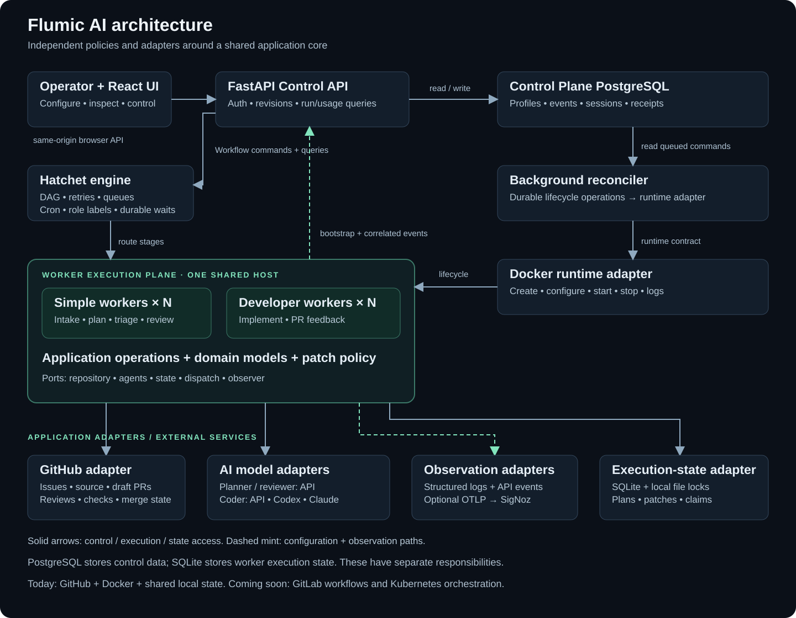

# Flumic AI architecture

The [migration plan](architecture-migration.md) records the original analysis,
sequence, and acceptance criteria. This document describes the implemented
boundaries and operational limits.

## Architecture at a glance



[Open the full-size architecture diagram](images/flumic-architecture.svg).
The diagram groups the implemented system into seven responsibility layers, with
observability spanning them. Arrows represent conceptual dependencies; runtime
management is performed by the Control Plane, not by repository or model adapters.
The application core is shared worker code, not another deployed service.

## Projects, execution and infrastructure are separate scopes

| Scope | Owns | Does not grant |
| --- | --- | --- |
| Project | Multiple repositories, workflow revisions, configuration/grants and execution history | Kubernetes credentials or arbitrary target/Pod configuration |
| Shared worker pool | Authorized project membership, worker role/capabilities and shared execution capacity | Access to every project's credentials or history |
| Runtime target | Operator-approved destination, images, namespaces, networking and storage policy | Permission to rewrite admitted execution snapshots |
| Execution attempt | Pinned project context, target authority, bounded action input/result and correlated usage | The current mutable configuration of another worker or project |

Docker remains available alongside **at most one configured Kubernetes target**.
The historical `docker` workflow-stage identifier is the portable container-action
contract; it does not force Docker execution. Claim validation checks the frozen
stage against the selected target before reserving it. A Docker worker without
bridge support cannot block a capable native worker by claiming native-only work.

## How a change moves through the system

1. **Save and pin behavior.** A project owns repository connections, immutable
   workflow revisions, configuration and grants. New runs pin their inputs and
   context; later edits do not rewrite admitted work. Shared workers receive
   action settings through assignment-authenticated context transport.
2. **Request infrastructure changes.** The authenticated API writes a durable
   lifecycle operation. The reconciler applies it through the runtime router:
   Docker containers or native one-replica worker Deployments with private PVCs.
   An accepted command, observed runtime readiness, Hatchet registration and
   heartbeat are separate facts. Start does not certify readiness.
3. **Schedule shared capacity.** Hatchet supplies durable scheduling, retries and
   waits around the project coordinator and task execution. Pools share simple
   and developer workers across authorized projects. Assignment authentication
   binds work to a specific worker, project context and supported target.
4. **Execute through contracts.** Builtin stages invoke installed application
   operations with typed inputs. Container stages use the broker and selected
   runtime. Kubernetes creates a suspended Job, binds its actual UID, prepares
   bounded immutable input and action-only credentials, then unsuspends it within
   the original deadline. Worker/action Pods receive no controller API authority.
5. **Record before releasing.** The broker persists canonical capture before
   collector release and cleanup. PostgreSQL claims, owner epochs and target pins
   fence controller writes; namespace admission fences and UID/resourceVersion
   tests guard remote effects. Fresh metadata nonces fence delayed unsuspends,
   including cancellation when a changed payload prevents root deletion.
6. **Recover without inventing success.** Validate Pod metadata/specs before
   binding or deletion and validate all recorded worker payload generations before
   cascading cleanup. Multiple live Pods cannot prove cancellation. Changed
   descendants retain stopped roots for investigation; private worker spools
   survive restart/removal and replay with deduplication.
7. **Observe each attempt.** Project events, logs and reported model usage connect
   project, run, stage and attempt identity. Optional OTLP export feeds SigNoz;
   instrumentation determines accounting coverage, and unknown tokens/cost remain
   unknown. Kubernetes logs are combined; hard deadlines or collector/storage
   loss may leave uncaptured output unavailable.

## Architecture decision records

The [ADR index](adr/index.md) explains the durable trade-offs behind these
boundaries. These records describe accepted, implemented choices, including their
costs and rejected alternatives. Temporary test fixtures and CI/commit mechanics
remain implementation history rather than architectural decisions.

## Guarantees and operational limits

PostgreSQL stores project execution state and is required for the default native
Kubernetes composition. Static startup and its SQLite/file-lock runtime are retired. The dynamic
project coordinator, shared-worker transport and Docker/native action runtime
are implemented; see [runtime rollout and qualification](project-runtime-operations.md).

Kubernetes requires operator-qualified admission policy, RBAC, images, CNI, Pod
PID limits and storage. Scratch is executable; helper/storage overhead is
additional to action limits. NetworkPolicy has Kubernetes' own-node traffic
exception. Local-path PVCs retain history but do not provide node-loss HA.
The qualification covers a dedicated two-node k3d/K3s cluster, not every production
distribution. Namespace/cluster administrators are trusted. Exactly-once external
effects, instantaneous deadline termination, automatic scaling, multi-user
roles and verified graceful drain are not supplied by these adapters.

## Why each component makes the architecture adaptable

| Component / boundary | What it owns | How that helps adaptation | Concrete example / current constraint |
| --- | --- | --- | --- |
| React Control UI | Operator navigation, forms and execution views | Presentation is separate from workflow execution and vendor SDKs; backend contracts can serve another operator client. | An API client can inspect a run or save a profile without automating the browser. Same-origin authentication/CSRF rules still apply. |
| FastAPI Control API | Authentication, validated commands, versioned settings and bounded query responses | Browser code does not need Docker, Hatchet or model credentials; adapters normalize external responses. | Workflow examples and repository validation read the latest saved factory revision; worker adoption still follows the profile/restart path. |
| Control Plane PostgreSQL | Saved profiles/revisions, sessions, events, audits and operation receipts | Desired configuration and command state survive API process restarts and remain distinct from a particular container. | Shared workers serve authorized projects through pools; an accepted lifecycle command remains inspectable if a request ends. PostgreSQL also stores project-qualified dynamic run state and claims; the static SQLite runtime is retired. |
| Background reconciler | Applying durable worker lifecycle requests outside HTTP handlers | Long builds/restarts and interrupted operations can be handled through one execution path rather than embedded in UI requests. | The reconciler can reclaim an expired operation lease. This does not make every external side effect exactly once or provide zero-downtime rollout. |
| Runtime adapter | Container creation, configuration, lifecycle and logs | Docker operations and native Kubernetes Deployment/Job operations sit behind the same backend boundary rather than inside application stages. | Kubernetes targets pin operator-approved images, namespace UIDs and controller authority. Private worker PVCs, immutable payloads, database claims and UID-bound cleanup preserve ownership across nodes. Networking and PID enforcement require operator qualification. |
| Hatchet orchestration adapter | Workflow/task registration, dependency graph, scheduling, routing, retry and wait semantics | Task operations are separate from the scheduler, so orchestration policy can be tuned without embedding engine calls in use-case logic. | Route coding to `developer` workers and adjust task timeouts/concurrency. Another production engine needs explicit adapter/bootstrap integration, not a configuration string alone. |
| Worker roles and instances | Executing registered tasks with role-specific profiles | Capacity and tool choices can vary by workload while operations share the same application/domain code. | Add developer workers for coding capacity independently of simple workers. Task/workflow concurrency, provider quotas and shared-state constraints still apply. |
| Application service and ports | Planning, triage, implementation, review, feedback and merge-verification operations | Business operations depend on interfaces and typed requests/results instead of Hatchet/OpenAI clients; fakes can exercise behavior without a live engine or paid model call. | The same operations support project action execution and an in-memory domain-test harness. There is one cohesive service, not a microservice per stage. |
| Domain models and patch policy | Change contracts, path/file limits, completeness and content validation | Shared checks remain consistent as coding backends change; model choice does not redefine what the application can publish. | API coding and CLI coding return the same completed-patch contract. Publication policy is not an OS/network sandbox, and trusted adapters must protect extra data they load. |
| Agent adapters | Planner/reviewer/coder implementations and context capabilities | Planning, review and coding can be chosen independently; model and prompt overrides can vary by task. | Use direct API planning/review with Codex or Claude coding, or implement a trusted coding port for a remote service. Custom managed factories require registry approval and installed code. |
| Repository adapter | Issues, source snapshots, commits, PRs, review/merge state | Source-host integration is kept at an application boundary rather than scattered throughout model/orchestration code. | GitHub and GitLab.com adapters support numeric repository identity, separate issue/MR namespaces and durable triggers; see [setup and boundaries](gitlab.md). Self-managed hosts remain outside this version. |
| Execution-state adapter | Prepared plans/patches, cursors, issue claims and recovery | The application can reconcile retries using recorded progress, with state operations behind a port. | The project runtime uses project-scoped encrypted state and canonical claims in PostgreSQL; its coordinator adapter is qualified with mixed builtin/container graphs on real Hatchet and shared workers, using Docker or native Kubernetes, and the executable catalog composes existing application operations per pinned context. Project-scoped APIs and assignment-authenticated transports activate the runtime through a fixed control service; see the [runtime API guide](project-runtime-api.md). |
| Observation adapters | Operation/model context, logs, retained events and optional OTLP export | Instrumentation can change without rewriting development operations; execution policy stays separate from the monitoring vendor. | Use structured logging alone, managed Control Plane reporting, or optional SigNoz telemetry. Captured call content depends on policy; CLI accounting is not a complete internal transcript. |
| Composition root + validated configuration | Constructing dependencies, selecting trusted implementations and resolving settings | Wiring stays explicit, and configuration changes can tune established behavior without editing the application service. | Change a model/prompt through project, workflow or stage configuration, or load an approved installed factory. Configuration cannot create a new Python stage or make an unimplemented runtime available. |

The corresponding contracts are in
[worker application ports](../worker/factory/application/ports.py),
[Control Plane runtime/engine ports](../control-plane/backend/app/ports.py) and
[worker composition](../worker/factory/bootstrap.py). Repository construction
selects the GitHub or GitLab.com adapter from the pinned
repository identity; the dynamic `*_factory` fields cover the specific extension
points listed below, not every integration.

## Adapting the system: choose the smallest boundary

- **Different behavior within an existing stage:** change its model, additional
  prompt, retry/timeout or routing settings on the appropriate profile/factory
  surface. See the [field-by-field configuration guides](configuration-workers.md)
  and [task/label reference](configuration-workflows.md). Restart/adopt the
  relevant revisions; saving settings does not hot-patch a running worker.
- **Different AI implementation:** provide the relevant planner/reviewer/coding
  port, declare the supported context capability and install/wire the trusted
  factory. Keep output and confidentiality guarantees explicit. Managed profile
  validation also enforces the approved factory registry.
- **Different production scheduler:** implement dispatch and task registration
  around existing operations, including retries, cancellation, routing and
  durable waits. The test-only sequential harness demonstrates separation; it does not provide
  production scheduling or universal workflow-engine parity.
- **Different source host or worker runtime:** GitLab.com has a dedicated adapter; self-managed GitLab remains planned; native Kubernetes runtime adapters share the existing worker/action contracts. Their boundaries reduce the amount
  of application code that needs to change, but host-specific collaboration,
  persistence, claims, image/network setup and lifecycle behavior still need
  implementation and validation.

## Code map

| Location | Responsibility |
| --- | --- |
| `control-plane/backend/app/workflow_state.py` | Project-scoped run transitions, immutable context and canonical claims |
| `control-plane/backend/app/dynamic_runtime.py` | Fixed Hatchet control worker and project coordinator integration |
| `control-plane/backend/app/runtime_router.py` | Route pinned worker/Job authority to Docker or native Kubernetes |
| `control-plane/backend/app/runtime_claims.py` and `runtime_resources.py` | Database leases/epochs and scoped UID/spec bindings |
| `control-plane/backend/app/adapters/kubernetes_jobs.py` | Suspended Job admission, fenced recovery, capture and guarded cleanup |
| `control-plane/backend/app/adapters/kubernetes_workers.py` | Deployment lifecycle, immutable configuration and retained private PVCs |
| `worker/factory/domain/` | Shared models, events, patch policy, and content/path safety |
| `worker/factory/application/ports.py` | Planner, reviewer, coding, repository, dispatch, state, and observation interfaces |
| `worker/factory/application/service.py` | Issue intake, planning, triage, implementation, review, feedback, and merge verification operations |
| `worker/factory/application/operations.py` | Repository validation, operation observation, exclusive claims, and progress recording |
| `worker/factory/adapters/orchestration/hatchet.py` | DAG, task affinity, retries, schedule, durable polling, dispatch |
| `tests/factory_fixtures.py` | Test-only sequential use-case harness and captured dispatch requests |
| `worker/factory/adapters/agents.py` | API and CLI coding adapters and default role factories |
| `worker/factory/adapters/github_events.py` | GitHub payload normalization into versioned factory events |
| `worker/factory/adapters/state.py` | SQLite/file-lock production adapter and in-memory test adapter |
| `worker/factory/adapters/telemetry.py` | Correlated structured logging and default operation observation |
| `worker/factory/adapters/token_budget.py` | OpenAI token estimation and context budgeting |
| `worker/factory/bootstrap.py` | Explicit dependency construction and trusted custom adapter loading |
| `worker/factory/settings.py` | Validated worker settings; explicit standalone YAML or managed bootstrap loading |
| `worker/worker.py` | Runtime entry point; imports create no clients or workflows |

The existing `github_client.py`, `model_client.py`, and `cli_agent.py` remain
integration implementations. Their locations are retained to avoid unnecessary
launcher/healthcheck churn. `model_client.py` re-exports legacy contract names;
new code imports `factory.domain.models`. `guardrails.py` is a compatibility
facade; the CLI and GitHub implementations no longer import its tokenizer code.

The application has no imports of Hatchet, OpenAI, or concrete adapters. There is
one cohesive application facade with explicit operation methods rather than a
new microservice for each stage. The orchestrator calls these methods with typed
inputs and upstream results, without leaking its execution context into them.

See [worker configuration](worker-configuration.md) for the runtime YAML schema.

## Selecting integrations

Default behavior remains Hatchet plus GitHub, with OpenAI planning/review and
`workers.developer.developer_agent: api|codex|claude` selecting implementation. Each role can now be
replaced independently using an installed Python factory:

```yaml
defaults:
  planner_factory: my_factory.adapters:make_planner
  reviewer_factory: my_factory.adapters:make_reviewer
  coding_factory: my_factory.adapters:make_coding_agent
  observer_factory: my_factory.observability:make_observer
  state_factory: my_factory.persistence:make_state_store
```

Each factory receives a `Settings` object and returns the corresponding port
implementation. Planner/reviewer/coding factories are invoked lazily; unused
roles do not require credentials or initialize model clients. Custom modules
must be installed/copied into the container image. Managed saves additionally
require the callable to be in the approved bootstrap factory registry; installing
a module alone does not authorize its selection. Factory paths are trusted
operator configuration, never values from an issue or webhook. Custom factories
can obtain their own credentials at this integration boundary.

A minimal coding integration has this shape:

```python
from factory.application.ports import AgentCapabilities, CodingRequest
from factory.domain.models import PatchPlan

class RemoteCodingAgent:
    capabilities = AgentCapabilities(context="selected-files")

    def generate(self, request: CodingRequest) -> PatchPlan:
        # Invoke your tool and translate its result into a completed PatchPlan.
        # request.base_commit identifies the immutable input revision.
        ...

def make_coding_agent(settings):
    return RemoteCodingAgent()
```

`selected-files` receives selected UTF-8 source files. `repository-archive`
receives an archive at the same immutable commit instead. Built-in CLI adapters
handle safe extraction, scanning, workspace ownership, execution, and collecting
changes through `cli_agent.py`; they accept an injected process runner so command
execution can be tested/replaced separately. A remote service can implement the
coding port directly without using local subprocesses.

The application scans selected text and validates completed patches before
publication regardless of the coding backend. Custom adapters are trusted code
and must preserve confidentiality checks for any additional data they load,
including scanning archives before sending their contents to a provider.

## Policy and limits

`workers.<profile>.path_policy: source|repository` selects output permissions independently of
agent capability. The checked-in profiles use these defaults: API coding
uses the source allowlist and CLI coding permits safe repository-relative text
paths. Setting `source` can narrow a CLI's publishable output, although that CLI
still sees its complete archive workspace. This setting is an output policy,
not a process sandbox or a network restriction.

`defaults.max_patch_iterations` is read at startup and passed explicitly to the built-in
adapters. Runtime policy caps the aggregate patch at `defaults.max_files_per_iteration` files per configured
iteration, with up to 20 iterations, and `max_file_bytes` bytes per file (default 65,536 / 64 KiB). The shared schema
has an absolute 100-file ceiling. Incomplete patches cannot be published.
Deletions, binaries, renames, and executable-bit changes remain unsupported by
the replacement-content change contract.

## State and recovery

`defaults.state_path` defaults to `/data/factory.sqlite3` in worker YAML. All Compose workers
share the same host `data/` mount and therefore the same state and lock files.
The adapter stores:

- Immutable version-1 issue plans and prepared implementation patches.
- Issue/PR associations, feedback cursors, and latest stage results.
- Operation attempts with status, timestamps, and error type, excluding exception
  contents. An attempt left running after a crash becomes interrupted on the
  next claim of that resource.

Exclusive claims cover every mutating stage for a repository/issue, including
feedback. Nonblocking kernel file locks prevent simultaneous mutations and
release on process exit. Contention raises `OperationBusy`; Hatchet retries
according to the stage configuration. Duplicate execution is safe to reconcile,
but a busy delivery can exhaust its retries while another execution continues.

Prepared implementation changes survive a failed publication. The GitHub adapter
writes a deterministic patch fingerprint into its commit message, so a retry can
recover a successful branch commit and finish creating the PR. Existing PRs
recover their labels/waits and still receive their initial review. Feedback
cursors reconcile factory state with legacy comment/commit markers before
applying changes again. Notification comments may be absent if recording fails
after a feedback commit; the code change is not repeated.

All generation context is loaded at one resolved commit. Initial publication
checks that the base has not changed, feedback updates check the PR head, and
ref updates are non-forced. A stale prepared implementation is invalidated for
regeneration on a later attempt. A branch created by unrelated/older work is
not overwritten just to make a retry succeed.

SQLite and these file locks support workers on **one host with a shared local
filesystem**, including the current Compose setup. Do not use independent
per-host databases or assume network filesystem locking is sufficient. A
multi-host installation needs a shared transactional `FactoryStateStore` adapter
with equivalent claim and recovery semantics. GitHub is outside its transaction;
this implementation does not promise exactly-once external effects.

For data-defined workflows, the project run-state service provides shared
transactional admission and canonical external-resource claims. It preserves
execution identities on replay, retains uncertain expired leases and refuses
unsafe mixed legacy/dynamic mutation against the same repository. The implemented coordinator, shared-worker transport and builtin/container action
runtime build on that authority, including native Kubernetes targets. See
[the runtime API](project-runtime-api.md), [rollout and recovery](project-runtime-operations.md)
and [the authority decision](adr/0003-postgresql-runtime-authority.md).

The database contains prepared source contents and plans. It is ignored by Git
and the Docker build context, but must be protected and backed up as application
data. Version-1 plans are intentionally reused on retry; editing an issue does
not automatically start a new plan version. Plan revision, retention cleanup,
and operator reset tooling are follow-up work.

## Events, waiting, and orchestration

GitHub transport payloads become `FactoryEvent` objects with schema version,
event identity, repository, correlation identity, and issue/PR references.
Ingress uses a supplied delivery ID when present, otherwise a payload digest.
The event identity is metadata, not a claim of transport-level exactly-once
processing. Repository validation and operation recovery remain authoritative.

Hatchet retains the original workflow/task names, concurrency limits, role
labels, and cron triggers. Both clarification and merge waits now reconcile
current GitHub state through durable sleeps using `discussion_poll_seconds`
(default 30 seconds). Missed events,
merge-before-wait, and approval/merge event ordering do not strand completion.
GitHub branch protection remains responsible for required approval rules;
completion independently verifies the merged commit and its checks. Closed,
unmerged PRs finish the waiter with a terminal status recorded in factory state;
they are not automatically reopened or assigned another implementation branch.

To add a production orchestrator, implement factory dispatch requests, wire the
application operations into its task model, and add a bootstrap selection. The
adapter owns durability, retries, routing, scheduling, timeout, and cancellation
semantics. The internal data-defined workflow schema targets the implemented Hatchet runtime; it does not promise equivalent semantics on arbitrary workflow engines.

The test-only harness in `tests/factory_fixtures.py` exercises application use
cases without a live engine. It is not installed as a production runner. Worker
startup is shared-only, and project workflows own dispatch and durable waits.

## Logging and monitoring

The default observer emits operation start/end, outcome, duration, and error
type. JSON logs include `factory_run_id`, stage, attempt ID, operation ID,
repository, issue, and PR where applicable. Issue workflow inputs propagate the
factory run ID across tasks and into review waits. Feedback deliveries start
their own correlated processing. `defaults.log_format: text` is available for development;
`defaults.log_level` controls verbosity.

Bootstrap configures standard Python logging; handlers/collectors can consume
logs without application changes. A custom `OperationObserver.observe(stage,
attributes)` context manager can send spans and metrics to another system.
Recognizable secrets are redacted before the default log handler exports data;
exception type is emitted without exception text or tracebacks. The existing
scanner is not a proof that arbitrary source content is nonconfidential.

No vendor monitoring SDK/exporter is required by the core. The optional OTLP
observer exports traces, metrics, and metadata logs; the default remains standard
logging. See [the observability guide](observability.md) for SigNoz deployment,
model usage accounting, dashboards, and current coverage.

## Validation and remaining work

Run:

```sh
.venv/bin/python -m unittest discover -s tests -q
ruff check worker tests
```

Tests include application behavior with fake integrations, provider regression
coverage, SQLite cross-instance claims and crash recovery, publication failures,
stale revisions, duplicated feedback, independent factories, clean imports, and
Hatchet SDK workflow serialization without a server. Token-budget tests require
the normal tiktoken vocabulary cache on first use.

The project runtime supports one-time Docker action containers, immutable workflow revisions and canonical cancellation/deadlines. See [rollout and qualification](project-runtime-operations.md) for the tested boundaries. Native Kubernetes Deployments and Jobs use the same workflow contracts; see [configuration, qualification and operational limits](kubernetes.md). Alternative workflow engines, remote functions and other vendor telemetry integrations remain extension work.
The built-in CLI execution still uses the existing unprivileged subprocess
boundary and shared provider home. No live deployment, paid agent run, or GitHub
mutation is part of the automated validation.
