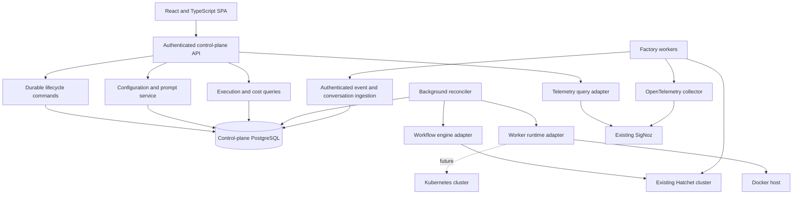

# Software factory control plane: architecture and implementation plan

Status: target architecture; an initial local implementation is available.
Date: 2026-10-20.

Implementation update: saved worker profiles now have a stable identity and
immutable revisions independent of shared factory settings. Workers follow the
latest revision on process start, including a trusted optional startup script.
Running workers retain their current configuration. See the
[operator guide](control-plane.md#saved-worker-profiles) for the implemented
lifecycle, migration and bootstrap behavior; it supersedes the initial explicit
per-worker configuration deployment flow described in this target plan.

Scope: a separate React web application for the existing software factory.

This document is a design and delivery plan. The [operator guide](control-plane.md)
records implemented functionality and remaining gaps. The existing factory continues to operate as it
does today until an explicit deployment adopts the new components.

## 1. Agreed requirements and decisions

The control plane must let an operator:

1. Create, start, drain, and stop worker instances on the current Docker host.
2. Monitor their tasks, workflows, stages, and execution attempts.
3. Inspect logs correlated to a stage and attempt.
4. Inspect redacted LLM communication history for each task.
5. Inspect model identity, token consumption, and dollar estimates.
6. Edit worker configuration and deploy selected configuration revisions.
7. Edit additional task prompts and preview the effective instructions.

The frontend will be React with TypeScript. Docker is the first worker runtime;
Kubernetes targets must fit the architecture later without redesigning the
application's domain model. Hatchet remains the first workflow engine. Redacted
conversation capture is the selected default for newly instrumented workers.

The first release is single-factory and single-operator organization, with
multiple workers and a target abstraction. It will manage the current Docker
host and preserve a path to multiple remote targets. It will not implement the
Kubernetes adapter in the first release.

## 2. Current codebase and implications

The factory already provides useful integration seams:

- `worker/factory/application/service.py`: application operations for planning,
  triage, implementation, review, feedback, and merge verification.
- `worker/factory/application/operations.py`: the boundary for operation
  observation and per-task configuration context.
- `worker/factory/application/telemetry.py`: model-call and usage recording.
- `worker/factory/adapters/orchestration/hatchet.py`: Hatchet task registration,
  task routing, schedules, retries, and dispatch.
- `worker/factory/adapters/otel.py`: model and stage traces, logs, and usage.
- `worker-config.yaml` and `config/`: shared settings, worker profiles, task
  templates, prompts, and runtime/model limits.
- `compose.yaml`: Docker worker definitions; optional SigNoz overlay and stack.

Important limits of the current implementation:

- OpenTelemetry intentionally stores metadata, not prompts or responses. Old
  conversations cannot be recovered from it.
- Factory correlation IDs are not equivalent to Hatchet run IDs. Explicit
  engine-to-factory correlation must be added.
- Settings are loaded at process startup. Saving configuration cannot change
  already-running workers without a deployment/restart.
- SQLite state and local file locks coordinate work on one Docker host. They
  are not a multi-host or Kubernetes-safe persistence/claim implementation.
- API clients expose their direct requests and responses; coding CLIs expose
  only the information their structured output interfaces make available.
- Native worker logs currently go to stdout and optional OpenTelemetry. Their
  presence in Hatchet's logs API must be verified; it must not be assumed.

The installed Hatchet SDK exposes worker list/get, pause/unpause, workflow/task
run lookup/listing, and log listing APIs. These are integration starting points,
not proof of every server-side behavior. Phase 0 below verifies them against the
actual cluster and pins the tested SDK/server compatibility.

## 3. System shape

Use a modular backend, not a separate microservice for every feature. Run the
HTTP API and background reconciliation loop as separate processes from the same
backend package, with PostgreSQL coordinating durable work.



Initial technology choices:

| Component | Choice | Reason |
| --- | --- | --- |
| Frontend | React, TypeScript, Vite | Independent browser app with a typed build |
| Server-state UI | TanStack Query | Cached queries, refresh, mutations, invalidation |
| Navigation | React Router | Direct links to workers, runs, attempts, and revisions |
| Backend | FastAPI, Pydantic | Fits the existing Python factory and validation model |
| Persistence | PostgreSQL, SQLAlchemy, Alembic | Durable relational records and explicit migrations |
| Runtime integration | Docker Engine adapter | Controls workers on the current host |
| Workflow integration | Hatchet SDK adapter | Cluster state and engine identifiers |
| Telemetry | SigNoz query adapter and deep links | Reuses current OpenTelemetry investment |
| Live updates | Server-Sent Events, with polling fallback | One-way state/log updates and reconnect support |

Dependencies will be version-pinned and locked during implementation. The React
bundle and API should share an origin in production to simplify authentication
and eliminate unnecessary cross-origin access. A development Vite proxy can
forward `/api` to the backend.

## 4. Ownership and sources of truth

| Data | Authority | Control-plane responsibility |
| --- | --- | --- |
| Desired worker state and configuration | Control-plane database | Store intent, revisions, and command history |
| Actual container/pod state | Runtime adapter | Observe and reconcile, never infer from UI state |
| Scheduling and task/run execution state | Workflow engine | Normalize and cache with observation timestamps |
| Worker heartbeat and application events | Instrumented workers | Correlate and annotate execution records |
| Historical redacted conversations | Conversation store | Protect, retain, query, and delete |
| High-volume logs, metrics, and traces | Telemetry backend | Query through an adapter and link from attempts |
| Original configuration files | Repository | Import/export reviewed non-secret configuration |
| LLM invoice charges | Provider billing | Show explicitly labeled estimates, not invoice claims |

The control plane must not silently overwrite authoritative engine status with a
worker log event. Conflicting or stale observations remain visible. Runtime
health, engine connectivity, and telemetry freshness are separate conditions.

There is no automatic reconstruction of historical prompts or retroactive
pricing of calls that have no recorded usage.

## 5. Domain model and adapter boundaries

Use stable control-plane IDs rather than Docker container IDs as application
identities. All durable records carry `factory_id`; runtime-owned resources also
carry `target_id`.

### DeploymentTarget

A named execution environment, initially `local-docker`, containing:

- ID, display name, runtime kind, and enabled/disabled status.
- Connection and credential references; secret values are never returned by APIs.
- Approved worker image mappings and network/storage policies.
- Workflow connection reference and capability flags.
- Runtime health, last successful observation, and last safe error summary.

Kubernetes targets will add namespace, service-account, secret, storage, and
resource policy in their adapter configuration. These fields do not become
mandatory Docker concepts in the application domain.

### WorkerSpec and WorkerInstance

`WorkerSpec` describes a worker profile, approved image/digest, target,
configuration revision, CPU/memory limits, and desired state.

`WorkerInstance` describes one realized process: stable instance ID, runtime
resource ID, unique worker name, engine registration ID, image, loaded config
revision, heartbeat, active attempts, and observed state. Separate specs from
instances so replacement and rollout history are preserved.

A profile is a reusable configuration template; an instance is an individually
manageable worker. Multiple instances of one profile must not share an engine
identity. The immutable snapshot supplies a unique effective worker name.

### WorkerRuntime port

```text
capabilities(target) -> runtime capabilities
list_instances(target) -> normalized observations
create_instance(spec, snapshot_reference, credential_reference, operation_id)
start_instance(instance, operation_id)
stop_instance(instance, grace_period, operation_id)
remove_instance(instance, operation_id)
get_instance_logs(instance, cursor, limit)
```

Adapter responsibilities include labels/selectors, approved image resolution,
credential delivery, resource limits, storage mapping, and normalization of
runtime failures. Arbitrary shell execution, host mounts, images, and environment
variables are not browser-supplied parameters.

### WorkflowEngine port

```text
capabilities(connection)
list_workers(connection, cursor, filters)
get_worker(connection, external_worker_id)
pause_worker(connection, external_worker_id)
resume_worker(connection, external_worker_id)
list_runs(connection, cursor, filters)
get_run(connection, external_run_id)
list_attempts(connection, external_run_id, cursor)
get_attempt_logs(connection, external_attempt_id, cursor, limit)
```

Keep external IDs in explicit mapping records. Vendor payloads stay inside the
adapter. Unsupported capabilities must produce an unavailable UI action with an
explanation, rather than a fake generic implementation.

### Other ports

- `TelemetryReader`: bounded log queries and trace links by correlation IDs.
- `ConfigurationRepository`: revisions, validation, comparisons, snapshots.
- `ConversationRepository`: bounded encrypted content and metadata operations.
- `CredentialResolver`: resolves server-side references at adapter boundaries.
- `EventPublisher`: worker event ingestion transport; independent of SigNoz.

## 6. Worker lifecycle, reconciliation, and adoption

Creating a worker creates a stopped specification and a durable command. Starting
is a separate explicit action. A start operation completes only when runtime
startup and engine registration are observed; otherwise it reports the condition
that is still pending. Registration has a configurable deadline.

Commands return `202 Accepted` with an operation ID. A database-backed reconciler
claims commands, executes idempotent adapter actions, and records progress.
Unique resource labels and operation IDs prevent duplicate containers after
retries or backend restarts. Persist a start/stop error without repeatedly
restarting a failing worker indefinitely; use bounded retries and backoff.

Worker states include:

```text
created -> starting -> running -> draining -> stopping -> stopped
                     |             |
                     +-> degraded  +-> drain_timeout
any transitional state -> error
```

Engine paused/unpaused, runtime running/stopped, and readiness are separate fields,
not collapsed into a single misleading health indicator. A missing heartbeat
means stale/unknown until reconciled, not idle or successful.

Drain protocol:

1. Persist desired state `draining` and issue an engine pause for this instance.
2. Confirm the pause and requery assignments, including work accepted during
   the pause race. Do not rely solely on a local active-task counter.
3. Wait for active work to complete; show durable waits separately from active
   execution. Verify their behavior with the installed engine.
4. Stop the runtime only when no assignments remain.
5. At the deadline, leave the worker in `drain_timeout`. Force stop requires a
   separate explicit action showing affected work and possible retry behavior.

If the server cannot reliably pause or enumerate assignments, disable graceful
drain and explain that only an interrupting stop is available. No drain promise
should be based on unverified SDK method names.

Docker scope is limited by factory ownership labels, configured Compose project,
and approved worker service/image identities. Existing Compose workers are
initially discovered as external/unmanaged. An explicit adoption operation maps
them to the factory and records their existing configuration provenance.
Unrelated databases, SigNoz containers, and other projects are never lifecycle
action targets. Compose scaling and the control plane must not simultaneously
own the desired state of an adopted worker.

A Docker adapter cannot use a path inside the API container as a host bind-mount
source. Its materializer must use an explicit host-visible snapshot root. Record
and validate the mapping instead of deriving host paths from client input.

## 7. Workflow, stage, and attempt visibility

The primary navigation is:

```text
repository / issue -> workflow run -> stage -> execution attempt
                                              | logs
                                              | model calls
                                              | usage and cost
                                              | exact configuration
```

Keep `factory_run_id`, engine run ID, engine task-run ID, attempt ID, worker
instance ID, and OpenTelemetry trace/span IDs distinct. A factory correlation
may span more than one engine workflow, such as feedback processing after the
initial issue workflow. Preserve parent/child relationships rather than assuming
one issue equals one run.

The Hatchet adapter adds engine execution context at task boundaries. The
existing operation observer supplies application stage context. Each retry gets
a separate attempt record, so retries and their costs remain visible. Stable
task keys map to the names in `config/workflow.yaml`.

All registered task categories need visibility: model-backed stages, scans,
webhook handlers, result recording, merge verification, and durable human waits.
Do not restrict instrumentation to the five model-backed stages.

Stage states normalize queued, assigned, running, waiting, succeeded, failed,
cancelled, and unknown. A terminated worker does not itself prove that Hatchet
cancelled or retried its task. Persist the engine's eventual decision.

The UI initially polls bounded queries. SSE adds invalidation notifications,
using a durable sequence cursor, heartbeat, reconnect backoff, and refetch after
cursor expiry. SSE is not a second source of truth or an unbounded log download.

## 8. Stage logs and telemetry

Normalize structured records with timestamp, severity, worker instance, stage,
attempt, factory correlation, engine IDs, trace ID, message, and source.

The stage-log view queries SigNoz using the known correlation fields. Runtime
stdout is a separate fallback for startup/configuration failures before stage
context exists. Engine logs can be shown when the verified Hatchet adapter can
retrieve them; do not assume Python stdout is automatically in Hatchet.

Log views support time range, severity, text search, pagination, and follow mode.
Return bounded pages with cursors, and label truncation and backend outages.
Deep-link to SigNoz for full trace/metric analysis. The control plane does not
reimplement SigNoz dashboards or copy its entire log store into PostgreSQL.

The existing OpenTelemetry collector/export path remains functional if the
control-plane ingestion API is unavailable. Prompt/response bodies must never
be attached to spans or normal log messages.

## 9. Redacted conversation capture

Capture is enabled in `redacted` mode for newly deployed, instrumented workers.
Provide `metadata_only` and `disabled` modes as deployment settings. A capture
change applies through a configuration revision, not an invisible global toggle
that changes the provenance of in-flight tasks.

Capture is separate from usage recording. Add a dedicated conversation recorder
around the provider boundary, preserving the provider-neutral application ports.

For direct API calls, capture the final assembled messages after task guidance
is applied and the returned response. Capture each coding iteration as a
separate interaction with its call ID and attempt/iteration references.

For CLI tools, capture the submitted task prompt and final structured response.
Optionally capture supported intermediate messages/tool events through a
versioned parser after verifying their format. Mark coverage as
`api_exchange`, `cli_prompt_and_result`, or `partial_cli_transcript`.
Do not claim a complete provider-internal conversation or capture hidden
reasoning. Token accounting can include reasoning-token counts without storing
private reasoning content.

Redaction and storage pipeline:

```text
provider boundary
  -> bounded capture
  -> redact known credential values and recognizable secret patterns
  -> mark truncation/redaction/coverage
  -> durable bounded local spool of already-redacted records
  -> authenticated ingestion
  -> validate and redact again
  -> encrypt content
  -> conversation store
```

Reuse and strengthen the existing safety patterns for keys, authorization
headers, private keys, and credential assignments. Also redact actual configured
credential values and tokens before the spool or network write. Treat
redaction as best-effort protection, not proof that repository content is public.
Avoid indiscriminate removal of all source code, since that would defeat the
requested conversation view.

The default planned bounds are 64 KiB per captured message and 512 KiB per
interaction. These are configurable safety caps, with UTF-8-aware truncation
markers. Use plain text rendering; never execute or render model-supplied HTML.
Do not log ingestion request bodies or include them in error-monitoring events.

Store encrypted content separately from queryable call metadata. Use a versioned
application encryption key from server-side secrets, maintained outside the
database; backups need protected key recovery. Future deployment targets can
use an external key manager without changing the conversation API. Transport
must use TLS for remote workers.

Access to transcripts is a separate permission from viewing metadata. Audit
conversation reads, exports, and deletions without copying content into audit
records. No unredacted transcript export is provided.

Conversation content retention defaults to seven days; metadata and accounting
retention default to 90 days. A scheduled job deletes expired content and spool
entries. Operator audit retention is independently configured. Backups have
separate expiry; UI deletion cannot promise immediate removal from old backups.

Conversation delivery failure must not fail a coding task. Display delivery
gaps, dropped-record counts, capture-disabled status, and retention expiry in the
UI. Use bounded retry/spooling; never allow an outage to fill the worker disk.

## 10. Worker event and ingestion protocol

Workers send authenticated versioned events to an ingestion API; they do not
connect directly to the control-plane PostgreSQL instance. This works for both
Docker workers and future remote Kubernetes workers.

An envelope contains:

```json
{
  "schema_version": 1,
  "event_id": "uuid",
  "occurred_at": "UTC timestamp",
  "worker_instance_id": "uuid",
  "config_revision_id": "uuid",
  "factory_run_id": "factory correlation",
  "engine_run_id": "external identifier or null",
  "engine_task_run_id": "external identifier or null",
  "attempt_id": "attempt identity",
  "sequence": 12,
  "type": "model_call.completed",
  "payload": {}
}
```

The server derives factory and target scope from the authenticated worker
identity; it does not trust client-supplied scope. A worker credential can ingest
only for its own identity and cannot read conversations, edit configuration, or
manage workers. Define a separate capability for fetching its assigned snapshot.

Delivery is at least once. Deduplicate by event ID and interaction/attempt keys;
store observed time alongside occurred time. Handle late completion events and
out-of-order delivery without regressing a completed call to running. Heartbeats
are observations, not evidence of task success. Event schema and size validation
happen before persistence, with bounded batches and rate limits.

Provide worker heartbeat, attempt started/completed, model call
started/completed, conversation captured, and delivery-gap event types.
Reconcile missing lifecycle events with the workflow engine.

## 11. Usage and cost accounting

A call record stores provider, requested model, response model, coding tool,
usage scope, input/output/cache/reasoning counts, timestamps, status, pricing
revision, and applicable estimated/reported amounts. Unknown counts remain null.

Distinguish provider requests from CLI turn/session aggregates. In particular,
Claude per-model usage nested inside a CLI invocation must not be added again to
an outer aggregate. Use explicit parent call IDs and an `accounting_leaf` flag
or equivalent rollup rule to prevent double counting.

Aggregate by attempt, stage, workflow, issue, worker, target, model, and selected
time range. Include failed attempts and retries. Return known subtotal,
unpriced-call count, missing-usage count, and completeness status. Use decimal
arithmetic for currency and integer counts for tokens.

Estimated API list-price cost, CLI-reported cost, and provider invoices are
different quantities. Display them separately; never add estimated and reported
cost for the same call. Cached input and reasoning are subsets of inclusive
input/output counts and must not be double counted. Cache-creation semantics
must follow the provider-specific normalization contract.

Snapshot the pricing table used for each estimate. Historical values must not
silently change when `observability/model-pricing.json` changes. An explicit
recalculation can create a new calculation version while preserving the original.

The current flat-rate estimator does not implement Luna's long-context
multipliers and Codex does not expose all cache-write counts. The control-plane
cost view must expose these limits. Where available usage cannot establish the
applicable tier, mark the calculation incomplete or unknown rather than present
an exact bill. Do not add unsupported Anthropic rates based on an unspecified
CLI default model.

## 12. Configuration, prompts, revisions, and rollout

Import the existing manifest and split YAML tree as revision 1. Preserve source
fragments so editing remains familiar. Store the submitted sources, canonical
resolved settings, content hash, author, change summary, validation result, and
parent revision in the database.

Repository files are the initial import and explicit export format. The control
plane's published revision is the deployment source of truth for workers it
owns. Saving through the UI does not silently modify the Git working tree or
commit/push changes. An export operation produces reviewable files for a later
Git commit; Git-backed configuration can become another repository adapter.

Configuration lifecycle:

```text
draft -> validate -> review diff -> publish immutable revision
                                   -> deploy selected workers
                                   -> observe loaded revision
```

Use optimistic concurrency with revision/ETag checks. A stale editor receives a
conflict with a diff instead of overwriting another edit. Validate every worker
profile, template reference, include path, model identifier, limit, and factory
selection. Reject credential fields and detect recognizable secrets before
saving. Server-side validation uses the existing configuration schema.

Prompt editing is a dedicated UI over the same revision model. Show built-in
instructions version, task defaults, selected template, task override, and the
effective additional prompt. The current semantics replace inherited
`additional_system_prompt` when a task overrides it; they do not concatenate
all template strings. Explain this in the editor and preview.

Show which tasks have no model calls, so editing their prompt is not represented
as changing deterministic behavior. Previewing a prompt does not call a provider
or incur model cost. Changes must preserve built-in response schemas and safety
checks. Custom factory/module paths are trusted code configuration: restrict UI
selection to an administrator-maintained adapter registry. Do not expose a
browser feature for importing arbitrary Python modules.

Materialize an immutable, read-only snapshot per instance/deployment containing
resolved settings, unique worker identity, revision ID, and pricing references.
Docker uses a controlled host-visible directory. A future Kubernetes adapter
uses a revision-named ConfigMap or bounded snapshot-fetch mechanism, with Secrets
kept separate. Snapshots are checksummed; a worker reports the revision it
actually loaded, not just what the server intended.

Saving does not restart workers. Apply replaces selected instances through a
tracked rollout. The UI shows desired versus loaded revision, failures, and
rollback actions. Rollback deploys a previous revision; it does not erase history
or change configuration underneath in-flight tasks.

Hatchet task definitions are registered by workers. Changes to schedules,
routing, retries, concurrency, or workflow structure may affect shared engine
registration, not just one instance. Phase 0 must determine registration/version
semantics. Use a coordinated rollout for engine-definition changes; do not
promise arbitrary simultaneous revisions on one shared workflow name. Prompt
and model changes are still tracked per actual attempt/config revision.

## 13. Persistent data model

Use explicit Alembic migrations. Do not auto-create production tables on every
request or rely on a shared SQLite file for the control plane.

| Entity | Key fields and relationships |
| --- | --- |
| factories | Factory identity and repository scope |
| deployment_targets | Runtime type, connection references, policy, health |
| worker_specs | Profile, target, desired revision/state, resource limits |
| worker_instances | Runtime ID, engine ID, identity, actual revision/status |
| lifecycle_operations | Idempotency key, command, progress, deadline, outcome |
| config_revisions | Parent, source fragments, resolved document, hash, author |
| deployments | Selected revision/instances, rollout/rollback progress |
| workflow_runs | Factory/engine correlation, issue, parent run, engine status |
| task_attempts | Stage, engine task/attempt IDs, worker, revision, timestamps |
| model_calls | Attempt, parent call, provider/model, coverage, outcome |
| usage_records | Call, normalized counts, usage scope, completeness |
| cost_estimates | Usage, pricing snapshot, calculation version, amount/status |
| conversation_content | Call, encrypted messages, redaction/truncation, expiry |
| ingested_events | Unique event ID, schema, sequence, processing cursor |
| operator_audit | Actor, action, resource, outcome; no secrets or transcripts |
| users / sessions | Local identity, role, hashed sessions, expiry |

Index target/worker status, factory correlation, external engine IDs, attempt
references, event IDs, timestamps, and expiry columns. Use unique constraints
for idempotency rather than application-only duplicate checks. Event and
conversation APIs use bounded cursor pagination. Retention purges run in chunks.

Control-plane state is distinct from factory execution state. Keeping the
control plane in PostgreSQL does not fix the factory's existing SQLite claim
adapter. Before enabling multi-host/Kubernetes execution, implement and validate
a shared factory state/claim adapter with fencing/lease semantics and recovery
behavior. This is a prerequisite, not an optional production polish item.

## 14. Backend API outline

Version routes under `/api/v1`. Use typed request/response models and consistent
safe errors with a request ID. Never return raw Docker inspect payloads, SDK
exceptions, environment variables, session tokens, or provider credentials.

| Endpoint family | Purpose |
| --- | --- |
| `POST /auth/login`, `POST /auth/logout`, `GET /auth/session` | Operator sessions |
| `GET /targets`, `GET /targets/{id}/health` | Target identity and capabilities |
| `GET /worker-profiles` | Approved profiles and effective settings metadata |
| `GET/POST /workers` | List and create stopped worker specifications |
| `GET /workers/{id}` | Runtime, engine, config, and assignment observations |
| `POST /workers/{id}/actions` | Start, drain, stop, resume, adopt, remove |
| `GET /operations/{id}` | Durable lifecycle progress and errors |
| `GET /runs`, `GET /runs/{id}` | Workflow discovery and correlated detail |
| `GET /runs/{id}/attempts` | Stage/attempt history |
| `GET /attempts/{id}/logs` | Bounded log queries |
| `GET /attempts/{id}/model-calls` | Model-call metadata and accounting |
| `GET /model-calls/{id}/conversation` | Authorized redacted transcript access |
| `GET /usage` | Filtered token/cost summaries with completeness |
| `GET/POST /config/revisions` | Versioned configuration reads and drafts |
| `POST /config/validate`, `POST /config/preview` | Validation and effective settings |
| `POST /config/revisions/{id}/publish` | Immutable published revision |
| `GET /config/revisions/{id}/diff` | Parent/selected revision comparison |
| `GET /config/revisions/{id}/export` | Reviewable YAML source bundle |
| `GET /prompts`, `POST /prompts/preview` | Effective prompts and provenance |
| `POST /deployments`, `GET /deployments/{id}` | Explicit revision deployment |
| `POST /deployments/{id}/rollback` | Tracked deployment of previous revision |
| `POST /ingest/events` | Worker-authenticated bounded event batches |
| `GET /stream` | Authenticated update notifications with cursors |

Mutations use idempotency keys where retries could create resources. Config edits
use revision preconditions. Lifecycle endpoints return operation records rather
than holding an HTTP connection open throughout a drain or rollout.

## 15. React application design

Use a restrained operational UI with a persistent target selector, navigation,
connection/freshness indicator, and explicit mutation feedback. Fetch all data
through the typed API client; no browser calls to Docker, Hatchet, providers,
PostgreSQL, or privileged SigNoz APIs.

Views:

- Overview: ready/paused/stale workers, active/failed/waiting runs, token totals,
  estimated/reported costs, and accounting completeness for a selected range.
- Workers: target/profile/status filters, create form, instance details,
  assignments, loaded/desired configuration, and lifecycle operation progress.
- Runs: issue/workflow filters, stage graph and chronological attempt list,
  logs, trace links, conversations, usage, and exact configuration references.
- Model calls: request/response panes with role labels, redaction/truncation and
  CLI coverage markers; requested/actual models and token categories.
- Configuration: profile forms plus source YAML editor, schema feedback,
  effective settings, revision diff/history, export, publish, and deploy.
- Prompts: task selector, template/override provenance, editable additional
  prompt, effective preview, and revision comparison.
- Settings: approved targets, retention/capture policy, integration status, and
  credential-reference status without secret retrieval.

Use URLs for run/worker/attempt identity and query filters so views can be linked
and refreshed. Separate loading, empty, disconnected, unauthorized, stale, and
partial-data states. Empty charts must not claim zero spending or successful
execution. Initial historical data may be absent until instrumentation is deployed.

Use semantic HTML, keyboard-accessible forms/dialogs, visible focus, labeled
controls, non-color-only status indicators, and responsive layouts. Transcripts
and logs render as escaped text with bounded incremental loading. Downloads and
copy actions require the same permissions as viewing their contents.

## 16. Authentication, authorization, and isolation

Initial deployment is loopback-bound and requires operator authentication. Use a
bootstrap admin secret supplied privately, a modern password hash, server-side
sessions with hashed stored tokens, HttpOnly/SameSite cookies, explicit expiry,
login throttling, and CSRF validation on mutations. Require HTTPS and Secure
cookies when exposed beyond localhost. Do not ship a built-in password or put an
admin token in frontend assets, URLs, browser local storage, or logs.

Define permissions for viewer, operator, and administrator roles. Conversation
read/export is an explicit permission. Operators manage allowed worker lifecycle
and deployments; administrators manage targets, credential references, trusted
adapter registry, and configuration policies. Worker ingestion credentials are
separate, individually revocable, and narrowly scoped.

Docker daemon access is privileged host access. Restrict it to the runtime
adapter service/agent, with allowlisted operations and resource scope. A raw
socket mount is an explicit local trusted deployment choice, not a security
boundary. For remote Docker/Kubernetes targets, use a separately deployed runtime
agent or authenticated adapter transport; never expose an unauthenticated Docker
TCP endpoint or accept a browser-specified daemon URL.

Provider/GitHub/Hatchet credentials are resolved from environment/secret references
and injected only into the worker runtime. They are excluded from configuration
revisions, exports, audit events, and API responses. Keep a separate reference
for observation credentials if the engine supports narrower read permissions.

## 17. Deployment, upgrades, and failure behavior

Add a separate control-plane Compose project with web/API, reconciler, and
PostgreSQL services. It must not replace the current Hatchet or SigNoz stack.
Expose only the loopback web port by default. Database and ingestion networking
are internal for Docker; remote-target ingestion uses an explicitly configured
TLS endpoint and scoped credentials.

Worker images remain separately built/approved artifacts. Creating a worker does
not build arbitrary source or pull an arbitrary user-selected image. Verify image
capabilities before start so old workers without conversation/revision support
are clearly labeled rather than shown as fully instrumented.

Use health/readiness endpoints for API database/schema readiness, reconciler
liveness, target observations, and integration status. SigNoz downtime should not
block worker lifecycle or config editing. Hatchet downtime makes engine actions
pending/failed, not apparently successful. Database downtime rejects mutations;
workers continue existing factory tasks and spool bounded redacted events.

Use migrations as an explicit deployment step, with backups and a documented
upgrade path. Reconciliation resumes from durable operations after restart.
Avoid introducing Redis or a message broker initially; PostgreSQL work claiming
is sufficient for the bounded first release.

## 18. Repository layout and implementation boundaries

Proposed layout:

```text
control-plane/
  backend/
    app/
      api/                   # Authenticated operator and ingestion routes
      domain/                # Targets, specs, instances, attempts, revisions
      application/           # Use cases, reconciliation, policies, queries
      ports/                 # Runtime, workflow, telemetry, persistence contracts
      adapters/
        docker/
        hatchet/
        signoz/
        postgres/
        credentials/
      security/              # Sessions, permissions, redaction, encryption
      main.py
      reconciler.py
    migrations/
    tests/
    requirements.lock
  frontend/
    src/
      api/
      components/
      features/
        overview/
        workers/
        runs/
        configuration/
        prompts/
      app/
    package.json
    package-lock.json
  Dockerfile
compose.control-plane.yaml
scripts/start-control-plane.sh
docs/control-plane-architecture.md
```

Worker changes belong in the existing observation/model-call boundaries plus a
small engine context adapter and ingestion publisher. Do not import the webapp
or database ORM into the factory domain/application. Shared wire schemas should
be small, versioned contracts, not a new dependency on all control-plane code.

## 19. Delivery phases and acceptance gates

### Phase 0: verify integrations and finalize contracts

- Pin tested Hatchet, SigNoz, Docker, backend, and frontend dependencies.
- Verify worker pause/drain assignment races, durable waits, engine IDs, run
  pagination, stage retry identities, and actual log sources against this cluster.
- Verify workflow registration/version semantics before revision rollout design
  is treated as complete.
- Verify Codex/Claude transcript and usage coverage using sanitized fixtures.
- Define schemas, target scope, runtime ownership/adoption, and permission matrix.

Exit: documented contract fixtures and working read-only adapter probes, without
starting/stopping existing workers or making paid model calls implicitly.

### Phase 1: application foundation and read-only visibility

- React shell, authenticated API, PostgreSQL migrations, sessions/permissions.
- Target registry, Docker discovery, Hatchet workers/runs, correlated read views.
- Versioned config import and effective settings/prompt previews.

Exit: authenticated users can inspect current workers/runs and validate imported
configuration; unrelated containers and secret values are absent from responses.

### Phase 2: worker lifecycle and versioned deployment

- Durable command processing, unique worker identity, stopped-worker creation,
  explicit start/stop, verified drain, and scope-checked adoption.
- Immutable snapshots, configuration revision diffs, prompt editing, publish,
  selected-worker rollout, and rollback.

Exit: test workers join the existing cluster; drain/timeout/retry behavior and
config loaded-versus-desired revisions are demonstrated safely.

### Phase 3: execution correlation, logs, conversations, and costs

- Worker instrumentation for all stage categories and model boundaries.
- Scoped ingestion, redaction-before-spool, encryption, retention, and gap tracking.
- Stage logs, attempts, model exchanges, token/cost rollups, completeness markers.
- UI transcript access controls and audit events.

Exit: a fixture workflow can be traced from issue/run to attempts and redacted
model calls; retries are separate and costs are not double counted. Missing
capture and unsupported pricing tiers remain visibly unknown/incomplete.

### Phase 4: operational hardening and Kubernetes readiness

- SSE/reconnect behavior, retention/deletion, backups, outage/restart recovery,
  bounded query/load testing, and documented operator procedures.
- Runtime adapter conformance tests and a Kubernetes target design validation.
- Shared factory state/claims adapter and remote credential/ingestion design
  before multi-host execution is enabled.

Exit: local Docker release meets all seven requirements; Kubernetes integration
has clear prerequisite gates and can be added behind the same ports. A working
Kubernetes implementation is a separate milestone, not claimed by this release.

## 20. Verification strategy

Unit tests cover effective configuration/prompt provenance, permission policy,
secret redaction, bounded capture, cost normalization, rollups, and reconciliation
state transitions. Use synthetic credentials, never real tokens in fixtures.

PostgreSQL integration tests cover migrations, unique ingestion/idempotency keys,
out-of-order events, optimistic edit conflicts, retention, and concurrent command
claiming. SQLite-only tests are insufficient evidence for those behaviors.

Runtime contract tests use isolated, labeled test containers and fake adapters;
never start/stop the existing production-like workers as a test side effect.
Hatchet integration tests verify actual cluster behaviors with dedicated test
worker identities and explicit non-billable fixtures.

Browser tests cover login/authorization, worker creation and lifecycle feedback,
run/attempt navigation, logs, escaped transcript rendering, config validation,
conflicting edits, prompt preview, deployment progress, and rollback. Validate
loading, empty, stale, and disconnected states as well as the happy path.

Security regression tests cover CSRF, scope checks, unrelated container access,
secret-bearing errors, YAML include traversal, arbitrary image/module selection,
transcript authorization, ingestion identity spoofing, and malicious model text.

End-to-end acceptance includes one controlled synthetic workflow with scripted
model responses, a retry, a redacted secret fixture, known token usage, and an
unpriced call. It must produce the expected stage history and accounting without
GitHub writes or provider charges. A real-provider acceptance run requires an
explicit operator action.

## 21. Open validation items and deferred scope

The product choices are settled: React frontend, Docker first with Kubernetes
adaptability, and default redacted capture. Remaining items are implementation
verification tasks rather than reasons to begin with an incompatible design:

- Exact Hatchet server capabilities/permissions for drain and versioned workflows.
- Reliable engine attempt IDs and log correlation for all registered task types.
- SigNoz query API authentication/schema for this pinned deployment.
- CLI transcript coverage and pricing-tier/caching limitations.
- Host-visible snapshot paths and credential injection on Docker Desktop.

Deferred: Kubernetes adapter implementation, arbitrary remote host onboarding,
OIDC/SSO, multi-organization tenancy, Git auto-commit/push, provider invoice
reconciliation, automatic budget enforcement, and provider-internal reasoning
capture. None should be implied by the first release's UI.

## 22. Reference material

- [Existing factory architecture](architecture.md)
- [Worker configuration and prompt semantics](worker-configuration.md)
- [Telemetry and cost limitations](observability.md)
- [React application tooling](https://react.dev/learn/build-a-react-app-from-scratch)
- [FastAPI documentation](https://fastapi.tiangolo.com/)
- [Docker daemon security considerations](https://docs.docker.com/engine/security/)

Hatchet integration observations above come from the installed SDK's
`features/workers.py`, `features/runs.py`, `features/logs.py`, and the repository's
Hatchet adapter. They must be verified against the running server in Phase 0.
