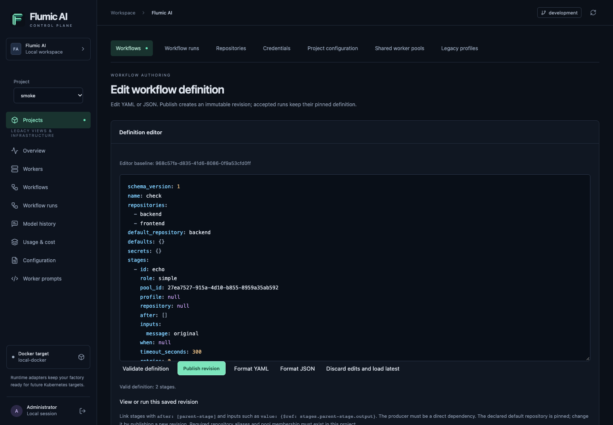
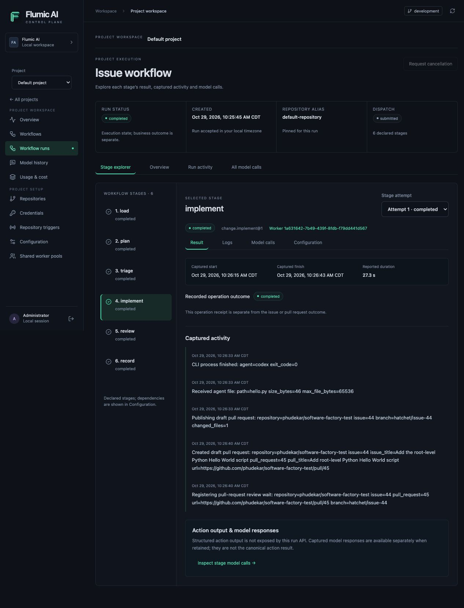

# Workflow controls

> **Current status:** The global `/workflows` screen described below has been retired. Current usage is the selected project's **Workflows** and **Workflow runs** pages. This document records retained backend compatibility contracts; use the [project workflow guide](project-runtime-api.md) for supported project execution.


The legacy Workflows page at `/workflows` lists only factory-owned workflow definitions through the
workflow-engine adapter. Trigger creates a run; Pause and Resume affect a
workflow definition across its workers, not individual active tasks or Docker
containers. The local Hatchet server reports native pause state for all eleven
registered factory definitions. No live mutations are performed during testing.

Pause leaves in-flight runs executing. Cron and scheduled triggers default to
DROP while paused, avoiding periodic scanner backlogs; operators can select
QUEUE instead and set a bounded queue TTL. Manual/event runs queue while paused.
Resume releases non-expired queued runs. Pausing a child workflow may leave
existing parents waiting for that child. This is not a factory-wide emergency stop.

API actions require an authenticated admin session, CSRF token and idempotency
key. Each action is recorded before the engine call, with a request digest,
workflow identity and status. Input bodies are validated but never persisted in
control-action/audit records. A repeated key returns its recorded outcome and
never replays a trigger. Reusing a key with different content is rejected. An
interrupted or timed-out engine call is marked uncertain (or remains running if
the process dies); operators must inspect workflow runs before explicitly issuing
another trigger. There is no automatic retry of uncertain actions and no false
claim of exactly-once delivery across the DB/engine boundary.

The adapter re-fetches the definition and verifies its factory allowlist for each
mutation. It validates inputs using the factory's existing Pydantic input models
and checks the configured repository. Native pause controls are disabled when
the server does not report pause state. Engine responses are reduced to
allowlisted metadata; vendor exceptions, workflow input and output are not
returned. Audit entries identify actions, not model conversations or credentials.

Implementation: extend the engine adapter with definition list/detail and control
methods; add a workflow control operation table and Alembic migration; install
scoped API routes; add navigation, definition cards/table, YAML run input, pause
options and recent action outcomes. Preserve worker configuration and runtime
behavior. Test adapter scoping, pause semantics, input validation, idempotency,
uncertain responses, audit and UI controls with mocks; read-only production
checks confirm the list and capability status. Back up the DB before deploying
the additive migration. No paid workflows are launched as deployment validation.


## Project workflow authoring and execution

Choose a project in the sidebar, then open its **Workflows** tab. These
`/projects/<project UUID>/...` routes manage data-defined graphs; the unscoped
legacy engine controls described above remain separate. Configure repository
connections and authorize shared worker pools first. No workflow starts merely
because a definition is validated or published.

### Create, validate and publish a graph

1. Select **New workflow**. **Insert starter using project repository and pool**
   inserts an echo example using an available repository and authorized compatible
   pool. If none exist, the placeholders must be replaced after configuration.
2. Edit YAML or JSON. Declare `schema_version: 1`, a unique `name`, repository
   aliases, `default_repository`, and stages. Each stage declares its pool, role,
   executor and inputs. Builtins require an exact version such as `core.echo@1`.
   Docker stages require a digest-pinned image, argv command and a pool advertising
   `docker@1` and `docker.run@1`.
3. Use `after: [load]` to establish a direct dependency. Reference its output with
   `value: {$ref: stages.load.output}`. Run inputs use `{$ref: input.message}`.
   Missing parents, cycles, invalid bindings, foreign repository aliases and
   unsupported capabilities are rejected by validation.
4. Select **Validate definition**. Diagnostics retain field paths, such as
   `stages.0.inputs`, without replacing your source. The expandable action catalog
   shows input/output schemas, required roles and the full workflow schema.
5. Select **Publish revision**. Publication creates an immutable version. Updates
   submit the editor's captured parent revision; a stale parent returns a conflict
   and preserves your draft. A newer head does not silently replace dirty text.
   **Discard edits and load latest** deliberately resets the editor.

Schema v1 supports `builtin` and `docker` executor names. Kubernetes worker
Deployments and native Jobs are available through a registered runtime target;
container stages retain `executor: docker` and use the worker's pinned target.
There is no separate `kubernetes` or function executor name to enable in YAML.
See [Kubernetes targets](kubernetes.md). See the [stage and binding
reference](workflow-development.md#data-defined-workflow-revisions).



The editor screenshot shows a saved issue-workflow definition in the existing Default project. It is an example to inspect, not a new publication.

### Run an immutable revision

Open **View or run this saved revision**, or choose a revision in **Immutable
revision history**. The saved document is read-only. The run form remains attached
to that exact revision even if someone publishes another head.

For the standard single-repository **Issue to pull request** recipe, confirm the
repository and use **Guided issue launch**: enter a positive issue number, select
saved feedback/verification revisions for that repository, and inspect their
links before submitting. The form constructs connection/revision UUID bindings
and pins the issue follow-up to the root revision you are viewing. It does not
create the source-host issue. **Advanced JSON** remains available for custom
workflows, multiple repositories or historical follow-up revisions. Guided fields
and advanced JSON are separate drafts after the first switch.

To install the standard recipes, use **Workflows → Install templates**. Select
a repository, compatible authorized role pools and saved provider credentials.
Existing recipes are retained, including their previous grants/pools; installation
does not hand over the repository or launch work. Repository handover is an
explicit, conflict-checked action on **Repositories → Repository execution**.

For advanced/custom launches, confirm the definition's default repository, provide **Run input JSON**, and supply
**Follow-up bindings JSON** when needed. The selection confirms the repository
already declared in the saved definition; changing it requires a new publication.
Follow-up bindings map repository connection UUIDs to workflow-kind revision UUIDs:

```json
{
  "<repository-connection-id>": {
    "issue": "<issue-revision-id>",
    "feedback": "<feedback-revision-id>",
    "verify": "<verification-revision-id>"
  }
}
```

Non-echo builtins require the appropriate project-owned bindings. The API validates
all references and pins the launch context. Missing bindings, another project's
repository UUID, revoked grants or an undrained legacy repository owner prevent
launch. Echo-only/custom Docker graphs can omit the map. The form reuses its
idempotency key when retrying an unchanged request after an ambiguous transport
failure; editing the payload creates a new request identity.

A `202` receipt means **accepted**, not completed. Start the
[`dynamic-runtime` service](project-runtime-api.md#deployment-and-activation) and
compatible shared workers before expecting progress. Publication or UI refresh
does not load new code into a worker image.

### Inspect dependencies, attempts and jobs

The project's **Workflow runs** tab lists the latest 50 canonical run records.
**Inspect Run** opens the **Stage explorer**. Select a stage on the left (or in
the horizontal stage strip on a narrow screen), then choose **Result**, **Logs**,
**Model calls** or **Configuration**. One stage and attempt stay in context;
there is no need to navigate nested stage, attempt and history expanders.

**Result** shows recorded operation evidence and captured timestamps with your
timezone. The run API does not expose structured action output; model responses
are available separately when retained and are not the canonical action result.
**Configuration** shows direct dependencies, input references, conditions,
role/pool, executor, timeout, retries and pinned effective settings. Inspect this
snapshot rather than today's editable defaults.

Attempt generations display their actual states, including skipped stages and
retries. **Stage attempt** selects a generation, defaulting to the latest one.
**Logs** and **Model calls** stay scoped to that stage and execution. Log search
filters retained messages; model-call filters and separate estimated/reported
accounting remain alongside their evidence.
Worker links open a project-qualified view of the shared infrastructure while
keeping history scoped to the selected project. Follow-up child links retain that
project too. **Overview** contains follow-up receipts, run/snapshot/revision IDs
and the engine identity. **Run activity** and **All model calls** show run-wide
evidence without inheriting the selected-stage filters. Capture and retention
limits remain visible; empty history does not prove that no activity occurred.

Docker job links show broker state, deadline, exit code, OOM result, cancellation
intent and captured stdout/stderr. Streams are bounded by the broker and the view
shows at most 65,536 characters per stream, with truncation indicated. No result
or exit code is displayed as success while capture remains unavailable.

**Request cancellation** records intent. A `cancelling` receipt does not prove that
an action or container stopped; inspect the canonical run/job terminal state.
Automatic retries follow the pinned stage policy. There is no manual stage-retry
button that bypasses assignment or external-effect reconciliation.



The run screenshot shows the recorded Hello World implementation under Default. Completed stage invocations do not imply human approval or merge; inspect the business outcome, follow-up wait and source-host PR.

### Model history and accounting

Run/attempt views support stage/execution, worker, provider and model filters.
The model-call tab queries up to 200 matching model events separately so that
later logs cannot crowd out retained exchanges. Accounting can cover more
records. Activity views show the latest 200 matching events and bounded logs. Job views scope history
to the job execution. Exchange reads use project-owned endpoints and retain the
existing seven-day expiration and audit policy; metadata-only or disabled capture
can leave no content to open.

Estimated and reported costs remain separate known subtotals, and parent summaries
are excluded from aggregate totals. Unknown tokens or prices stay unknown rather
than becoming zero. CPU/memory and logs never imply AI usage; a custom Docker action
must report supported usage records explicitly. See [capture, retention and
accounting](project-observability.md).
