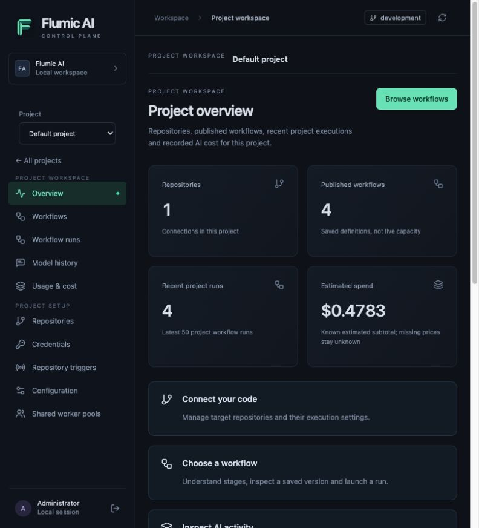
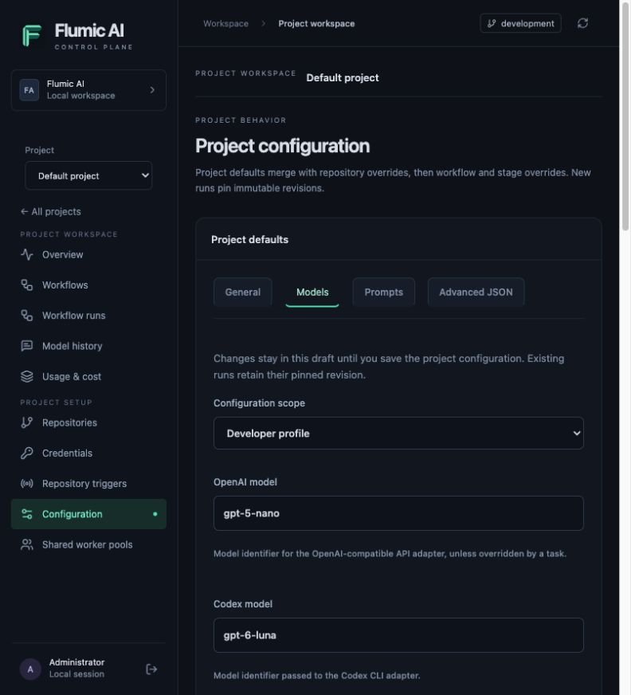

# Flumic AI Control Pane

The Control Pane manages project workflows and shared execution infrastructure.
Project settings and execution history live in PostgreSQL. The static worker
startup, legacy sidebar and saved worker-profile UI have been retired.

## Start

```sh
just control-up
```

Open **http://localhost:3400** and sign in using `CONTROL_ADMIN_PASSWORD` from the
private `.env.control-plane` file. The launcher generates credentials once. Back
up this file, database and runtime artifacts together; losing the encryption key
makes encrypted credentials and captured content unreadable.

The landing page is **Projects**. Choose a project to see its overview, workflows,
runs, model history, usage, repositories, credentials, triggers and configuration.
Outside a project, **Infrastructure** provides shared workers and runtime targets.
Old unscoped project URLs show guidance to choose a project; they do not launch or
translate legacy work.


## Project workspace screens

Select a project in the workspace selector before inspecting its repositories,
workflows, runs, model history, configuration and usage. Each of these views
stays scoped to the selected project; shared workers are authorized through pools.



- **Overview:** connection/workflow counts, recent executions and known estimated
  spend. Open a run to inspect its stages; a completed run does not prove that a
  pull request was published or approved.
- **Runs:** search recent runs and filter their controller state. Open **Inspect
  run**, then select a stage or attempt to narrow captured logs, usage and model
  calls. **Advanced run identifiers** and stage configuration retain the complete
  pinned IDs and settings for diagnostics.
- **Model history:** scan provider/model, stage, tokens, reported and estimated
  costs, then choose **View exchange**. The detail panel separates request
  messages from the response. Structured JSON is readable, system/context and
  original raw payloads remain available on demand, and missing or expired
  captures remain explicit. Close the panel or press Escape to return to the list.
- **Repositories, credentials and pools:** inspect current setup first, then use
  the explicit Add/Edit forms. Saving a credential does not verify its provider
  access. Authorizing a pool does not start a worker or prove free runtime slots.
- **Configuration:** use the grouped editor for supported settings or keep the
  complete configuration document in the advanced editor. A draft only takes
  effect after saving; new runs pin revisions and existing runs keep their
  original configuration. Unknown fields are preserved. Resolve a newer-revision
  conflict explicitly rather than overwriting it silently.

Choose **Models** and a configuration scope to inspect the saved model settings.
The example below selects the developer profile; selecting a scope does not save changes.



**View exchange** opens a readable detail panel. Use **View response** to jump
past request context. The screenshot shows the actual Hello World planning call;
unknown reported costs remain unknown.


Times display in the viewer's local timezone. Run **Created** means acceptance,
not worker execution start. Model/event times describe the captured operation;
worker **Registered** and **Last heartbeat** describe separate observations.
Missing timestamps are shown as unknown rather than inferred from another event.

## Worker lifecycle and configuration

Open **Shared workers → Add shared worker**, select a pool and deployment target,
and enter a unique worker name. Start the provisioned worker explicitly. A pool
provides role, action capabilities and slots; each project must authorize the pool.
A running container and Hatchet registration are separate observations.


Start, stop, restart, runtime logs and operation status remain available. Stop or
restart can interrupt work. An accepted lifecycle operation is not completion;
check its resulting status and worker registration. Graceful drain is not claimed.
The old **Create worker** and per-worker saved-profile forms have been removed.

### Saved worker profiles

Role-specific model settings and prompts are edited in the selected project's
**Configuration**, with repository/workflow/stage overrides. A saved revision
applies to new run admissions. Running and historical executions retain their
immutable pins. Repository profile YAML supplies bootstrap defaults rather than
live per-worker configuration. Backend compatibility profile records may still
exist during staged retirement; they are not the supported provisioning path.

### Factory settings and migration

Use project configuration and the [settings reference](configuration-workers.md).
Preserve factory revision ancestry and run pins when upgrading. See the
[retirement notes](maintenance/legacy-retirement.md) for backup, retention and
remaining backend/API/schema work. Removing a UI screen does not imply all its
compatibility backend endpoints have been removed.

### Startup scripts

Startup scripts and build-related fields in older saved documents are compatibility
settings. They are not a way to configure shared worker images from a removed
profile screen. Keep installed dependencies and tools in explicitly built worker
images; model/prompt behavior comes from the execution's pinned configuration.

## Conversation capture and accounting

Use the project's **Model history**, **Usage & cost** and run inspector. Capture
policy and retention can make request/response content unavailable; never infer
zero token usage or cost from a missing capture. Reported cost and estimates are
separate. See [project observability](project-observability.md).

## Worker images from a base OS

Build the supported simple/developer images with `just images-build`, or configure
an operator-approved target image. Recreate affected worker runtimes through the
lifecycle controls to adopt new images. Image/profile build APIs remain compatibility
interfaces during retirement; the current UI provisions shared workers from pools.

## YAML editors and validation

The project's guided configuration editor includes advanced document editing.
Validate and save deliberately; conflicts require loading or reconciling the
latest revision. Credentials belong in credential versions, not configuration.

## Removing workers

Stop the runtime before removing it, and check the lifecycle operation completes.
Worker removal does not reset the project or delete its workflow runs. Preserve
history spools needed for recovery. Do not delete Docker volumes or `data/` as a
shortcut for cleaning retired workers.

## Markdown worker prompts

Edit prompts in project configuration or workflow/stage overrides. Saving creates
a revision for new runs; inspect a run's pinned settings to understand its behavior.
See the [workflow cookbook](workflow-development.md) and [prompt guide](prompt-quality.md).

## Workflow controls

Choose a project's **Workflows** page to create, inspect or launch a definition.
Use project runs to inspect stages and logs. The old global Hatchet workflow
control screen is removed. See [project runtime APIs](project-runtime-api.md) for
versioned definitions, stage actions and repository activation.

## Host database storage

By default PostgreSQL uses the Docker named volume `control-db`. To keep the
control database on the host, set `CONTROL_DB_DATA_PATH` to an absolute directory
in the private `.env.control-plane` file, for example:

```dotenv
CONTROL_DB_DATA_PATH=/absolute/path/to/factory-data/control-postgres
```

For a fresh installation, create that directory before starting the stack.
On Docker Desktop, ensure the directory is shared with Docker. Database files
contain sensitive data; restrict access and exclude them from Git and file sync.
Keep the storage on a local filesystem suitable for PostgreSQL.

For an existing installation, do not point PostgreSQL at an empty directory:
that initializes a separate database. Stop API, reconciler and PostgreSQL first,
then copy the entire PostgreSQL data directory from the stopped container using
`docker cp -a factory-control-postgres-1:/var/lib/postgresql/data/. <destination>`.
Verify the copy, including `PG_VERSION`, before changing the environment setting.
Use the same PostgreSQL major version. Recreate the services without rebuilding,
check database recovery and API health, and verify saved profiles and workers.
Retain the original named volume until the migration and a fresh backup have
been verified. Never use `docker compose down -v` during migration.

Worker build logs and snapshots already use the host directory
`data/control-plane`. This setting moves only the control PostgreSQL data;
SigNoz storage and Docker image layers have separate storage settings. Host
mapping does not remove the need to monitor and reclaim Docker image space.

## Project-scoped configuration APIs

The backend can store independent configurations and multiple repository connections
for each project. Use `/api/v1/projects` to list or create projects, then retain the
returned project UUID in every project URL. These endpoints use the same operator
session, CSRF protection and `Cache-Control: no-store` policy as the existing API.
Projects separate configuration and history; they do not introduce per-user roles.

| Project URL suffix | Purpose |
| --- | --- |
| `/repositories` | List/create project-local aliases such as `backend` and `frontend`. |
| `/repositories/{id}` | Read or update one connection. Updates require its current `parent_id` revision; stale edits return 409. |
| `/factory-config` | Read/publish the project's shared settings with an optimistic parent revision. |
| `/worker-profiles` | List/publish project-local profile revisions; parents and clone sources must belong to this project. |
| `/config/revisions/{id}` | Read a full configuration revision; append `/export` for YAML. |
| `/config/effective` | Preview resolved settings for a repository alias and optional workflow/stage overrides. |
| `/events`, `/usage`, `/model-calls/{id}/conversation` | Read only the project's captured execution history and usage. |
| `/workflow-controls` | Inspect the project's persisted control receipts; receipt lookup is ownership-checked. |

All suffixes above start with `/api/v1/projects/{project_id}`. Missing or foreign
resource UUIDs return the same 404 response. Repository aliases are unique within
a project, so two projects may each connect a `backend` repository. Connection
updates append immutable revision records; an older revision remains available to
execution snapshots. Workflow-control idempotency keys are unique within a project.

For example, after authenticating as shown in the
[API recipes](../website/src/content/docs/api/recipes.md), create a project:

```sh
curl --fail-with-body -b /tmp/factory-cookies.txt \
  -H 'Content-Type: application/json' \
  -H 'X-CSRF-Token: YOUR_CSRF_TOKEN' \
  --data '{"slug":"payments","name":"Payments"}' \
  http://localhost:3400/api/v1/projects
```

Create a repository connection by posting
`{"alias":"backend","owner":"example","name":"payments-api","overrides":{"openai_model":"gpt-4.1-mini"}}`
to `/api/v1/projects/PROJECT_UUID/repositories`. The API validates the fully resolved
configuration before committing; invalid limits or identity overrides are rejected.
Credential references remain unavailable until the project credential service is
installed; do not put credential values in configuration documents.

A POST to `/api/v1/projects/PROJECT_UUID/config/effective` accepts:

```json
{
  "repository": "backend",
  "stage_repository": "frontend",
  "profile": "simple",
  "workflow": {"openai_model": "gpt-4.1-mini"},
  "stage": {
    "tasks": {
      "triage_issue": {"additional_system_prompt": "Include migration considerations."}
    }
  }
}
```

`stage_repository` is optional and must resolve within the same project as the run's
`repository`. Effective behavior applies project configuration/profile defaults,
then repository overrides, workflow defaults and stage overrides. Existing Settings
and task-schema limits still apply; the resolver also accepts stricter deployment
or pool limits from trusted server code. Clients cannot supply those limits. Identity,
credential, adapter factory, worker registration and task role fields cannot be
changed by repository/workflow/stage behavior overrides.

Existing unscoped configuration, profile and history URLs always refer to the stable
**default project**, regardless of a client's selected project. Workers, targets and
future worker pools remain deployment infrastructure. This API increment does not
start shared workers or install the later dynamic workflow coordinator; legacy static
workflow controls and managed-worker lifecycle remain on their compatibility path.

### Project credential versions and action contexts

Project credentials are managed through authenticated operator routes:

| Route | Purpose |
| --- | --- |
| `GET /api/v1/projects/{project_id}/secrets` | List version references, scope, purpose and revocation metadata. Values and ciphertext are never returned. |
| `POST /api/v1/projects/{project_id}/secrets` | Create an encrypted version. Use `parent_id` to rotate an existing version without changing its scope or purpose. |
| `POST /api/v1/projects/{project_id}/secrets/{identifier}/revoke` | Revoke that exact version. Repeated requests retain the original revocation time. |

Example request body for creating a project credential:

```json
{
  "name": "github-development",
  "purpose": "github",
  "value": "<provide your token securely>"
}
```

`purpose` accepts `github`, `openai` or `anthropic`. Add `repository_id` to restrict a
credential version to one repository connection in the same project. Omit it for a
project-level credential that can be explicitly granted to that project's repositories.
For repository-specific credentials, first create the repository connection, then create
the scoped secret and update the connection with its returned `id` as `credential_id`.
A repository connection accepts only an active, correctly scoped `github` credential.
A foreign reference returns 404; an owned revoked or wrong-purpose version returns 409.

To rotate a credential, submit a new value with the previous version's `id` as
`parent_id`, retaining its `name`, `purpose` and `repository_id`. Update the repository
connection to use the new version for future actions. Rotation leaves old pins valid;
revocation makes future resolution of the old pin fail. Neither operation silently
switches an existing action to the newest credential. Revocation cannot retract a
credential already delivered to an executing process; revoke it at the provider too
when immediate invalidation is required.

The action-context service stores an encrypted snapshot of effective settings plus
exact factory, repository, workflow and credential-version references. Generic context
serialization and logs omit effective settings as well as credential values. Trusted runtime
code pins this once per execution, with the required credential purposes. Replaying
context resolution uses that snapshot rather than current configuration. GitHub grants
come from the pinned repository revision; provider grants are explicit version IDs.
Missing, excessive, foreign and wrong-purpose grants are rejected.

Each action gets fresh GitHub/model clients and an isolated temporary CLI home and
workspace. Credentials are explicit constructor arguments or child environment values;
the worker process environment is never changed. Action-scoped filters remove resolved
credentials from result content, history, structured logs and escaping error messages.
Only `ActionInvocation` identifiers belong in engine payloads; full contexts and
credential-bearing objects must stay inside the authorized action process.

The context service provides internal pinning/resolution and isolated service composition.
Shared workers use the assignment-authorized context delivery described below. Existing
legacy workers continue using their existing bootstrap path.

### Shared worker pools and assignment authorization

A pool describes infrastructure capacity and permitted capabilities. It contains no
repository selection, model keys, prompts or project task configuration. A project
must be explicitly authorized to use a pool. Existing workers retain `legacy`
protocol and default-project behavior, even when their images are rebuilt.

In a project workspace, open **Shared worker pools → Add pool**. Choose a unique
workspace-wide name and role, review the role-filtered action versions, slots and
Hatchet transport (prefilled from the saved profile), then **Create pool**.
Creation does not authorize the project or start workers: **Authorize project**
and workspace **Workers → Add shared worker** are separate steps. Pool ID and
transport are shown under **Advanced pool details**.

For automation, the equivalent endpoint is `POST /api/v1/worker-pools`:

```json
{
  "name": "shared-simple",
  "role": "simple",
  "normal_slots": 2,
  "durable_slots": 16,
  "executors": ["builtin@1"],
  "actions": ["core.echo@1"],
  "hatchet_tls_strategy": "tls"
}
```

| Value | Effect and example |
| --- | --- |
| `name` | Unique infrastructure name, such as `shared-simple` or `shared-developer`. |
| `role` | `simple` or `developer`; selects the standard worker image and required engine routing label. |
| `normal_slots` | Concurrent action slots **per worker**, from 1 to 8; default 2. This does not replace project/deployment admission limits. |
| `durable_slots` | Durable engine slots per worker, from 1 to 16; default 16. The coordinator adapter uses these slots; public launch/API integration remains a separate milestone. |
| `executors` | Explicit versions allowed by policy, such as `builtin@1`. A worker advertises only locally installed capabilities. |
| `actions` | Explicit action versions allowed by policy. Shared startup currently installs only `core.echo@1`; the nine-action catalog/composition is implemented in source, while authenticated business-action transport activation and the Docker executor remain tracked milestones. |
| `hatchet_tls_strategy` | `tls` (default), `mtls`, or `none` for a deliberately unsecured development engine. |

Pool profiles are immutable in this increment. Create a replacement pool and new
workers to change infrastructure settings. Project behavior remains independently
revisioned through project/repository configuration.

Authorize a project with
`PUT /api/v1/projects/{project_id}/worker-pools/{pool_id}` and body
`{"enabled": true}`. Set `enabled` to `false` to deny subsequent claims, renewals,
context delivery and completion requests through that membership. Removing membership
cannot retract credentials already delivered or undo external effects.

Create a shared worker with `POST /api/v1/worker-pools/{pool_id}/workers`, for example
`{"name":"shared-simple-1"}`. Reconciliation creates its runtime; use the existing
worker start/stop/restart/remove actions for lifecycle management. Shared workers
cannot be configured with legacy project behavior profiles. To transition a legacy
worker, stop it and explicitly create a shared worker; no existing worker is silently
promoted. Rebuild the standard images first: shared creation requires image label
`software-factory.shared-protocol=1`.

The shared Docker environment carries only Hatchet and Control Plane infrastructure
identity. It receives no GitHub/model keys, project snapshots, shared `/data` mount or
Docker socket. Its separate startup path fetches the pool profile, negotiates
`shared-v1`, registers required pool/role/protocol labels, and advertises installed
executor/action versions. It never registers legacy repository scans or event handlers.
The pool/role-qualified engine task accepts only invocation identifiers and returns a
bounded execution receipt; action content stays outside engine payloads.

The trusted scheduler creates an execution authorization record with its project,
repository, run/stage/execution IDs, pool, role and exact action/executor versions.
Workers cannot create this authority by submitting their own project/run labels.
Claim checks authenticate the worker bearer token, explicit protocol registration,
project membership, persisted requirements and available normal slots. PostgreSQL row
locks ensure a concurrent claim has one owner.

Worker endpoints use `X-Worker-Id` and the worker bearer token, independently of browser
operator sessions:

| Route | Behavior |
| --- | --- |
| `POST /api/v1/shared-worker/register` | Negotiate pool, protocol, role, installed versions and slot bounds. |
| `POST /api/v1/shared-worker/claim` | Claim an authorized invocation with a caller-generated `claim_key`; returns the encrypted-at-rest input and a private lease proof. |
| `POST /api/v1/shared-worker/assignments/{identifier}/renew` | Extend the current lease using its `lease_token`. |
| `POST /api/v1/shared-worker/assignments/{identifier}/context` | Deliver the pinned settings and minimum credentials only to the owning worker with an active eligible lease. |
| `POST /api/v1/shared-worker/assignments/{identifier}/complete` | Persist an encrypted result; identical completion retries are accepted, while a changed result conflicts. |

Leases last 120 seconds and the worker renews every 20 seconds. Wrong workers, proofs,
capabilities, run IDs and stale leases are rejected. An expired assignment retains its
slot until reconciled; it is never silently handed to another worker while external
effects may still be running. Durable recovery, fair project/deployment admission and
the coordinator integrate in the run-state milestone (#7/#8). Legacy history ingestion
is rejected for shared workers; assignment-derived history follows in #12.

## Workflow definition API

These authenticated project-scoped routes publish graphs without starting runs.
Write requests use the existing operator session and CSRF protections.

| Route | Behavior |
| --- | --- |
| `POST /api/v1/projects/{project_id}/workflow-definitions/validate` | Validate `{"document": {...}}`; returns normalized digest and stage count without writing. |
| `GET /api/v1/projects/{project_id}/workflow-definitions` | List definition metadata. |
| `POST /api/v1/projects/{project_id}/workflow-definitions` | Publish the first immutable revision; returns definition ID and revision ID. |
| `GET /api/v1/projects/{project_id}/workflow-definitions/{identifier}` | Read definition metadata and current revision ID. |
| `PUT /api/v1/projects/{project_id}/workflow-definitions/{identifier}` | Append with `document` and current `parent_id`; stale parent returns `409`. |
| `GET /api/v1/projects/{project_id}/workflow-definitions/{identifier}/revisions` | List revision metadata and parent chain. |
| `GET /api/v1/projects/{project_id}/workflow-definition-revisions/{identifier}` | Read the decrypted document for an owned revision. |

Foreign project IDs/revisions return `404`. Validation rejects unknown action versions,
invalid graphs and bindings, incompatible pools, unscoped secret grants and unsupported
container options. There is no public snapshot/credential-resolution endpoint here.
The trusted run service will use the internal launch pin API in the run-state milestone.
See [creating data-defined workflows](workflow-development.md#data-defined-workflow-revisions)
for field defaults, examples, limits and the execution integration status.

## Durable run state and admission

The internal `WorkflowState` service persists runs, logical stage attempts,
encrypted inputs/results, business state and canonical external-resource claims.
Project-scoped run APIs, assignment-authenticated builtin/job transport and the
`dynamic-runtime` control service connect this state to the durable coordinator.
Saving a definition in the current UI still does not launch a run. Existing worker
pools retain their action allowlists; activate catalog actions deliberately.
See the [runtime API guide](project-runtime-api.md) for seeding, launch, cancellation
and uncertain-effect reconciliation.
See [builtin action contracts](workflow-development.md#builtin-actions-and-pinned-project-follow-ups).

A launch validates the chosen definition revision once and stores its exact graph,
repository/configuration revisions, effective stage settings and secret-version
references. Repeating the same project request key with identical input/revision
returns the same run; different input or revision returns a conflict. JSON object
key order does not affect identity. Advancing or replaying a run reads its stored
snapshot, including when an operator has since changed a repository connection.

| Policy | Default | Effect |
| --- | --- | --- |
| Active runs per project | `2` | Additional runs remain queued in persisted launch order. |
| Admitted actions per project | `4` | Bounds a project's ready/running actions across its active runs. |
| Admitted actions per deployment | `8` | Bounds all ready/running assignments, including reserved capacity. |
| Shared worker slots | Pool's configured slots, default `2` | Admission also requires registered role/action/executor capacity in that pool. |
| Assignment/resource lease | `120` seconds | A valid owner can renew; shared workers renew every `20` seconds. |

Trusted deployment code may inject `AdmissionLimits`, bounded to 1–32 runs/project,
1–64 actions/project and 1–256 actions/deployment. These are service configuration,
not new browser form fields. Ready projects rotate after each admitted action;
one project's parallel branches cannot drain the deployment queue ahead of every
other ready project. Frontiers sort by stage ID, and replay returns existing
execution IDs rather than creating another attempt.

All state transitions use a short database write fence before worker/assignment
locks. Both SQLite and PostgreSQL enforce it; concurrency tests use separate
PostgreSQL sessions and a file-backed SQLite database. Provider calls and container
execution do not run inside this scheduler transaction. Legacy lifecycle Docker
observations also run outside the fence; worker revision, lifecycle-operation state
and repository mode are rechecked inside it before accepting the command. A stale
observation returns a conflict so the operator can retry. PostgreSQL is the shared
production store for this runtime; legacy workers continue using their existing
SQLite state and file locks.

A transport retry reattaches the same execution identity. Only a confirmed terminal
failure may allocate the next configured retry generation, after the stage's retry
delay. A worker timeout or expired lease alone does **not** prove external effects
stopped: its slot and resource claims remain held for reconciliation. Terminal
completion is idempotent by execution/result digest; a changed result conflicts.
Never retry arbitrary external effects solely because a response was lost.

A false condition skips its stage and dependent branches. Failed prerequisites
block their descendants. Invalid resolved inputs or revoked/missing required
grants fail admission before an executable assignment survives the transaction.
Revoking one project's pool membership prevents new admission there without
rolling back other projects' progress. Disabling membership after admission does
not release an uncertain in-flight assignment; it still requires reconciliation.

### Business state and external-resource ownership

Business state is encrypted and scoped by project and repository connection.
The new `ExecutionStateStore` takes an explicit delivered action context and an
assignment-authenticated transport; it never reads a legacy SQLite key as a
fallback. Worker state/claim transport endpoints enforce assignment proofs and pinned scope. Generic stage
bindings retain encrypted repository-origin metadata across relays, and affine
builtins reject foreign-origin data before client construction.
Origin identities are deduplicated while collecting ancestry, with a separate
256 KiB logical JSON budget per admitted action. Exceeding that budget rejects the
stage before dispatch; repeated fan-in cannot amplify tiny outputs into unbounded
lineage records.

External claims use canonical lowercase GitHub host/owner/repository identity,
independently of project or local alias. For example,
`github.com/acme/service/issue/42` serializes two projects acting on the same
external item. GitHub pull requests and issues share this numeric claim namespace.
A repository-wide claim conflicts with all its item claims. Another project cannot
claim an external repository absent from that execution's pinned repository context.
Claims remain through exceptions and lease expiry until a trusted terminal receipt
or reconciler confirms effects stopped. This does not provide exactly-once writes
to GitHub or arbitrary Docker programs.

### Transition from legacy workers

Dynamic mutating actions require an explicit canonical repository mode transition.
The trusted `enable_dynamic_repository` operation refuses it while managed legacy
workers for that repository are not stopped/removed or have lifecycle operations
in progress. Once enabled, legacy create/configure/start/restart requests for that
repository are rejected; the reconciler enforces the same fence. Other repositories
and deterministic echo validation are unaffected. The current public API does not
expose this internal transition yet.

Drain standalone workers outside this Control Plane separately before enabling the
new mode. Their old file locks cannot coordinate with database claims. Existing
SQLite files, keys, worker identities and snapshots are preserved; nothing silently
migrates their business state or restarts containers.

Migration `e201f1000006` adds the run/state/claim tables and ownership constraints.
Downgrade removes new run/state/claim/mode data while retaining older project,
workflow revision and snapshot data. Drain new executions and back up these tables
before a downgrade; removing a mode fence during live execution is unsafe.
