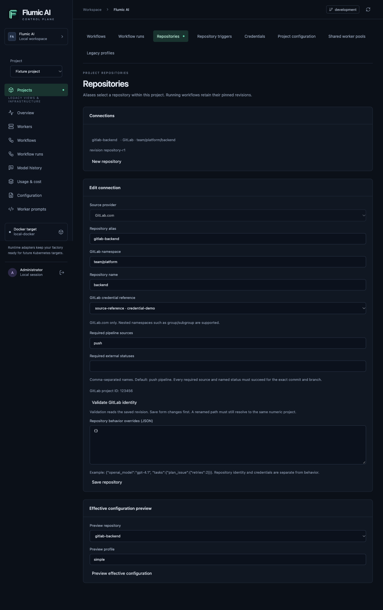
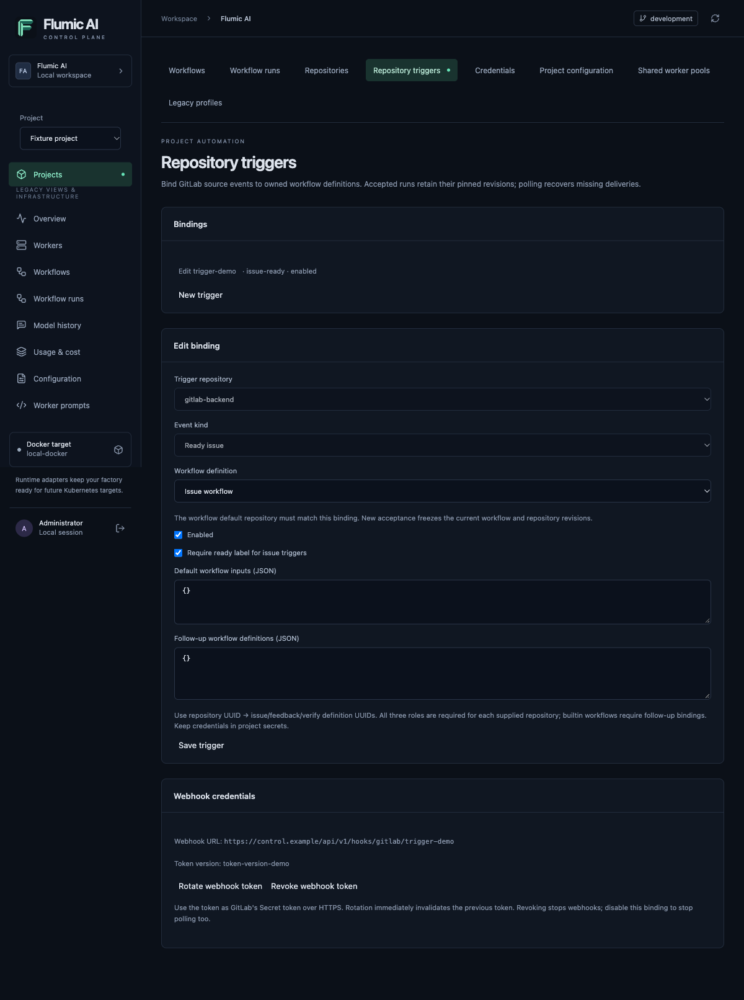

# GitLab.com setup and workflow behavior

GitLab.com support is being implemented in issue #16. Its adapters, Control Pane configuration and trigger paths require the disposable-project live release qualification before support is announced. Self-managed GitLab, fork merge-request publication and cross-project pipeline children are outside this version. GitHub remains the existing released source host.

## Connection and credentials

1. Build updated worker images: Git publication requires the `git` executable. The simple and developer images install Git. Shared workers must register the `gitlab` provider capability; an old worker with no provider declaration is eligible only for GitHub runs. Rebuilding an image does not replace running containers automatically.
2. Create a project in the Control Pane, open **Repositories**, select **GitLab.com**, and enter a stable alias, namespace such as `group/subgroup`, and project name. Save the connection before creating a repository-scoped credential.
3. Open **Credentials**, choose purpose **gitlab**, scope the secret to the saved repository, and enter an access token with the API and Git publication permissions below. Save it, then select its reference on the repository and save again. A GitHub-purpose credential cannot authenticate GitLab.
4. Select **Validate GitLab identity**. This reads the saved connection, resolves its actual numeric project ID, and saves an immutable validated revision. A stale form returns a conflict; reload rather than overwriting another edit. Unsaved fields are not validated. New runs require this verified ID.
5. Assign compatible shared worker pools, enable dynamic repository mode after draining legacy owners, and publish or seed workflow definitions with this connection as the default repository. GitLab and GitHub repositories can coexist in a project. The current workflow selects one authoritative source for each stage; unrelated connections do not gain each other's grants.

Use a classic GitLab access token with `api` access to create/read issues, labels, discussions and merge requests. Git-over-HTTPS publication also needs repository write access. For a personal access token, GitLab documents that `api` includes repository access over Git HTTP; `write_repository` alone does not grant API operations. A project access token, if available for your GitLab.com plan, should explicitly include the API and repository write scopes supported by that token type. Prefer a dedicated automation identity with access only to intended projects. See [GitLab access-token scopes](https://docs.gitlab.com/security/tokens/access_token_scopes/) and [personal access tokens](https://docs.gitlab.com/user/profile/personal_access_tokens/).

The automation identity must be allowed to read the source, create issues/MRs, and push its unprotected factory branches. Protected branch rules still apply. Configuring project webhooks requires GitLab's applicable project administration permission; grant it to the operator configuring the integration rather than broadening every worker's authority. Never place tokens in Git remote URLs, YAML behavior overrides, workflow inputs or documentation screenshots. Flumic encrypts saved versions and resolves only the selected repository's credential. Secret revocation prevents subsequent resolutions; rotation does not substitute a new credential into existing run pins.

*Browser smoke fixture: example namespace, credential reference and project ID; no live secret values.*

## Numeric identity, namespaces and configuration

GitLab issue and merge-request **IIDs** are independent local numbers. Issue `7` and MR `7` are different resources. A numeric project ID is neither of those IIDs nor the Flumic project/connection UUID. Flumic scopes canonical repository state and external claims as `gitlab.com/project/<numeric-id>` while retaining the current namespace path for URLs and publication.

After a namespace rename, edit the connection, save, and validate the new path. It must still resolve to the same numeric project. A path reused by a different project cannot retarget the connection; create another connection. Publication validates the numeric project and current path before and after Git operations. Namespace administration must be coordinated outside active publication; this is not an atomic remote namespace lock.

Repository behavior overrides continue to control labels, model choices, prompt/task settings and limits. They cannot override source identity or credential purpose. See the [worker settings reference](configuration-workers.md#repository-provider-metadata-gitlab-release-qualification-pending) for `repository_provider`, `repository_host`, `gitlab_project_id`, and `repository_check_policy_json`. The Control Pane owns these fields for shared runs; new acceptance pins the repository revision rather than reading ambient environment defaults.

## Trigger ready issues, feedback and verification

Open the project's **Repository triggers** tab. Select a validated GitLab repository, event kind and workflow definition. The definition's default repository must match the connection. Create separate bindings for:

- **Ready issue**: starts once per observed not-ready → ready transition. By default the issue must be open and carry the configured ready label. Existing plan-created or PR-open labels exclude it. Removing the readiness requirement admits other open issues; consider the resulting model workload before enabling that policy.
- **Merge request feedback**: observes open, same-project MRs linked with `Closes #<issue-iid>` (also accepted: `Fixes` or `Resolves`). The linked issue must remain open with the configured PR-open label. Human note IDs advance the feedback cursor; factory/system notes are excluded. Add a new comment or run manually after editing a previously processed note.
- **Merged change verification**: requires an actually merged MR and merge commit. Closing an MR without merging does not qualify. Queuing verification is not proof that its checks succeeded.

Default inputs are operator-authored JSON; fresh source identity fields take precedence. Builtin workflows require follow-up bindings: a repository UUID maps `issue`, `feedback`, and `verify` to **definition UUIDs**. All three roles must be supplied. They resolve to current immutable revisions once at acceptance. Manual run submission instead takes revision UUIDs. See [runtime API examples](project-runtime-api.md#gitlab-repository-triggers-release-qualification-pending) and [workflow authoring](workflow-development.md).

Creation or token rotation displays a webhook token once. Save it in the GitLab webhook's **Secret token** field, use the displayed HTTPS URL, and select issue, merge-request and comment/note events as appropriate for that binding. The receiver implements `X-Gitlab-Token`; GitLab signing-token verification is not implemented, so a signing token alone cannot authenticate this receiver. Current GitLab docs distinguish secret and signing tokens, and stable message IDs from recursive event correlation IDs: [webhook setup and headers](https://docs.gitlab.com/user/project/integrations/webhooks/).

Rotation invalidates the previous token immediately. Update GitLab's webhook configuration with the new value. Revoking stops authenticated webhook delivery; polling continues until you disable the binding. Disabling does not cancel accepted runs. Keep the source API credential separate from this ingress token.

The `dynamic-runtime` service polls enabled bindings independently of its dispatch pump. Polling recovers missed deliveries using scoped credentials and fresh source facts. An active run coalesces additional feedback; pending newer notes can launch after it terminates. The database commits observations, the receipt and the run pin together; the dispatch pump repairs a controller crash before submission. A `202` response means accepted, not completed. Read receipts, pinned run details and stage history in the project APIs; see [trace and accounting](project-observability.md).

Polling has bounded pages and batches, rotates tracked resources, and retries sanitized failures. It cannot reconstruct a ready-label toggle that happens entirely between observations. Large histories exceeding its read budget fail closed; inspect the binding error, reduce source noise or launch an explicit run after reviewing the source. Receipts currently accumulate without automatic retention. Refer to the runtime API for exact limits and retry/conflict semantics.

*Browser smoke fixture: saved binding, workflow selection and token-version references. Token plaintext is not shown.*

## CI policy and Git publication

The default required pipeline source is `push`. Use **Required pipeline sources** to require, for example, `push, merge_request_event`; use **Required external statuses** for names such as `security`. These fields map to `check_policy.required_pipeline_sources` and `check_policy.required_status_names`. An empty external-status list imposes no named-status requirement; an empty pipeline-source list is invalid.

Checks must belong to the exact commit SHA and target ref. Each required source must supply a successful pipeline with actual successful nonoptional job proof, including required accessible same-project children. Retried jobs use their current attempt. Optional failures can be ignored; skipped-only jobs do not prove success, blocking manual jobs remain pending, and unknown/inaccessible/truncated required checks do not become success. Configuring a pipeline source that your `.gitlab-ci.yml` never creates will keep verification pending. Pipeline runners and actual CI jobs must exist in the test or production repository.

The adapter publishes a validated patch through a private bare Git workspace, with a private temporary askpass credential file. It never checks out repository hooks or forwards credentials in command arguments. It verifies the expected parent and uses a ref lease to prevent overwriting an advanced human head. Recovery compares the full tree, parent and factory marker; a lost successful API response must not cause a second patch or model call. If publication is uncertain, inspect the existing branch/MR and run receipts before retrying. Never resolve uncertainty by resetting another contributor's branch.

Planned-task relationships use normal GitLab issue links plus explicit factory parent markers; do not assume GitHub sub-issue endpoints or a paid hierarchy feature. The MR and issue adapters use their separate IID namespaces for notes and labels.

## Live release qualification

Local protocol fixtures and isolated SQL tests qualify deterministic contracts. They do not establish live GitLab compatibility. The final harness must use the designated disposable GitLab.com project, a fake model, real HTTP/Git operations, a real runner/pipeline, duplicate delivery/recovery cases, and explicit source mutation/cleanup approval. It must not restart existing workers or make paid model calls. The configured test project is `pradiphudekar/software-factory-test`; neither this designation nor an `.env` token authorizes writes by itself.
