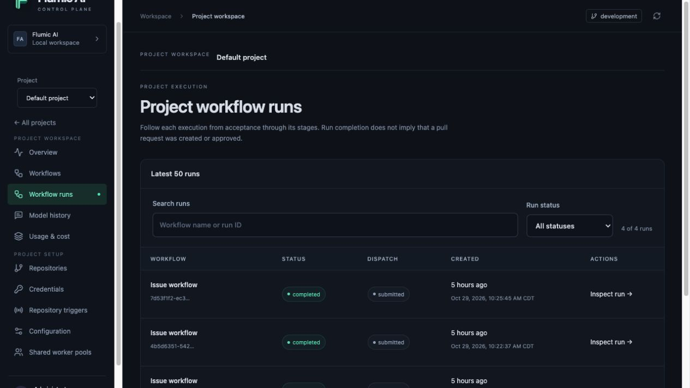

# Hello World: a recorded live example

This is the actual run of [parent issue #43](https://github.com/phudekar/software-factory-test/issues/43),
[implementation issue #44](https://github.com/phudekar/software-factory-test/issues/44)
and [draft PR #45](https://github.com/phudekar/software-factory-test/pull/45) in
`phudekar/software-factory-test`. Those links require access to the private
repository. Screenshots below record observed states, not recreated labels.

The initial planning call ran on the existing profile-based worker. The local
installation was then backed up and explicitly migrated to project execution;
implementation resumed under Default using the existing child issue. That
migration was specific to this installation, not a step for every new issue.

## Workflow effects at a glance

The Hello World example moves from **parent issue #43 → child issue #44 → draft PR #45**.
The parent tracks the plan, the child tracks implementation, and the PR carries
review state. Check the object named in each step; all labels do not accumulate
on the parent issue.

| Step | Where to look | What changed and who did it |
| --- | --- | --- |
| 1. Ready | Parent issue #43 | You apply `ready-for-agent`; this signals readiness, not execution. |
| 2. Planned | Parent issue #43 | Planning adds `agent-plan-created` and consumes the readiness label. |
| 3. Task created | Child issue #44 | Planning creates a linked implementation issue with `agent-subtask`. |
| 4. Waiting for clarification | Child issue #44 | Triage adds `needs-discussion` instead of proceeding with an ambiguous change. |
| 5. Resumed | Child issue #44 timeline | You clarify the requirements and apply `ready-for-agent`; the stored follow-up resumes and the worker removes the discussion/readiness labels. |
| 6. Draft PR published | Child issue #44 and PR #45 | Implementation opens a draft PR and adds `agent-pr-open` to the child; `agent-subtask` remains. |
| 7. Review posted | PR #45 | Review posts findings and adds `agent-pr-reviewed` to the PR. Human approval and merge have not occurred. |

These are recorded screenshots from October 29, 2026; transient labels were not
reapplied to recreate earlier states. In this example, worker actions appear
under `phudekar`, the identity used by the repository credential. That username
alone does not distinguish a human action from an automated one.

`load` reads the issue and `record` persists the result; not every workflow stage
adds a GitHub label. A completed run can be waiting for clarification or review.
`agent-pr-reviewed` means findings were posted, not approval, merge or completion
of the overall issue. The screenshots stop at a reviewed draft PR.

Each step pairs its GitHub state with the available Control Pane evidence.
**Control Pane evidence** beneath each step is expanded by default to show
its run, activity logs and model exchange. The Control Pane captures inspect retained runs after they
finished; they are not recreated in-progress states. Log images are viewport
excerpts, and model capture/retention may leave gaps. Use your own run IDs when
following these steps in another installation.

## 1. Ready to process — parent issue

The parent initially had `ready-for-agent`. This is a readiness signal, not proof
of execution. The example was explicitly triggered; automatic launch depends on
configured repository triggers.

No run or model request has started at this point. The readiness label alone
is not execution evidence; there is no matching run/log screenshot to fabricate.

## 2. Plan created — parent issue

The planner produced one implementation task. The parent acquired
`agent-plan-created`; its original readiness label was consumed. This does not
mean the implementation is finished.

Control Pane evidence: planning model logs

The original planning call was recorded before this installation moved to
project execution. Its retained exchange is available in **Default → Model history**,
but it is not a canonical Default project run. Do not substitute the later
parent run that reused the existing plan for the original plan-creation run.

## 3. Implementation work identified — child issue

The worker created #44 with `agent-subtask` and linked it to #43. Follow this
child for implementation progress; PR labels do not all accumulate on the parent.

Child creation belongs to the same planning result shown in step 2. It is
not a second model call or a separate charge inferred from a new GitHub issue.

## 4. Clarification requested — child issue

The repository already contained `hello_world/`. Triage asked whether to preserve
that directory and added `needs-discussion`. The control run completed its stage
calls, but its business outcome was waiting for discussion, not a generated PR.

Control Pane evidence: run, activity logs and model logs

**Run and stage:** `4b5d6351-5428-4d97-9dc1-537ec2d287ed`, filtered to `triage`.
The control run completed its invocations, while the business outcome was waiting
for clarification. No draft PR was produced by this run.

**Activity logs:** the messages identify issue #44, report `needs_discussion=True`
and say **Waiting for issue clarification**.

**Model logs:** the retained call is `729ca069-79ae-428f-bfb5-42777c4108fa`.
The accounting row is separate from its captured request/response. The response
sets `needs_discussion` to `true` and lists the questions later posted to the issue.

## 5. Clarification resolved — child issue timeline

The reply confirmed a new root-level `hello.py`, preserving existing files with
no requested CI/documentation changes. Adding `ready-for-agent` resumed the
stored discussion follow-up. The agent then removed the discussion/readiness
labels as it continued. This screenshot shows GitHub's actual timeline event
because readiness was transient, rather than recreating the old state.

Control Pane evidence: run, activity logs and model logs

**Resumed run and stage:** `7d53f1f2-ec3c-448a-80fd-f8e576a9fba7`, filtered to
`triage`. This is a new run created by the stored follow-up; the earlier run was
not rewritten. Screenshots inspect its retained state after completion.

**Activity logs:** issue #44 now has two comments; the log reports
`discussion_resolved=True`, `needs_discussion=False` and **Issue ready for patch generation**.

**Model logs:** call `64f60a0a-b3ee-49e7-a221-ad2a2382c72d` returned
`needs_discussion: false` and an empty questions list. Compare this with step 4.

## 6. Draft PR created — child issue

Implementation created draft PR #45 and added `agent-pr-open` to #44. The PR
contains only `hello.py`. Its CI build checks passed. Independently checking
commit `7a49fda15eff5ba5abc8f13757a00be837e15bee` confirmed stdout exactly
`Hello, world!` plus a newline, exit code 0 and empty stderr.

Control Pane evidence: run, activity logs and model logs

**Run and stage:** the same resumed run, `7d53f1f2-ec3c-448a-80fd-f8e576a9fba7`,
now filtered to `implement`. Selecting a stage narrows the evidence; it does not
launch another workflow.

**Activity logs:** the excerpt shows a single changed file, publishing draft PR #45,
its creation and registration of a review wait.

**Model logs:** call `e9f8d362-cbc0-4835-947a-7c2b4381eac1` records the coding
invocation's tokens and estimated cost. Coverage is `cli_prompt_and_result`,
not a transcript of every internal CLI/model interaction.

The returned artifact contains progress, a PR title and a detailed PR body with
acceptance criteria, validation and limitations. Those validation statements are
the model's report; the independent commit-specific check is described above.

## 7. Automated review posted — pull request

The automated review added `agent-pr-reviewed` to **PR #45**, not the parent issue.
It posted concerns about import-time execution. This label means a review was
posted; it does not mean the findings were accepted, the PR was approved or the
change merged. At the end of this recorded example, the PR was a draft awaiting human review.

Control Pane evidence: run, activity logs and model logs

**Run and stage:** the same resumed run, `7d53f1f2-ec3c-448a-80fd-f8e576a9fba7`,
filtered to `review`.

**Activity logs:** the post-creation review message identifies issue #44 and PR #45,
reports two findings including one suggestion, and records `agent-pr-reviewed`.
It does not record human approval or a merge.

**Model logs:** two retained calls are listed for this stage. The response opened
below is the later call, `d60fe46c-0fd5-4f64-8b57-cc1eb72c3372`.

The model raised import-time execution concerns and proposed a main guard.
Its severity labels are model judgments, not independently confirmed defects
or an approval decision. Review the findings against the actual issue requirements.

## Inspect the successful model exchange

In **Default project → Model history**, open the planning exchange. The captured
call used `openai / gpt-6-luna`, recorded **802 input / 234 output tokens**, and
an **estimated $0.0001972** for that call. Reported provider cost is unknown.
These numbers are not the cost of the complete workflow.

The user request contained the Hello World issue requirements and repository
context. The actual structured response contained one task titled **Add the
root-level Python Hello World script**, with criteria for the exact greeting,
newline and exit code. The [captured request excerpt and response](examples/walkthrough/hello-world-model-exchange.json)
retain those fields; the excerpt omits system instructions and the source-path
inventory. It is an actual planning response, not an invented example or evidence
that the model itself ran tests.

## Find the project runs

After the approved runtime migration, Default recorded the deterministic runtime
check, the parent run, the child discussion run and the resumed implementation.
The resumed implementation run is `7d53f1f2-ec3c-448a-80fd-f8e576a9fba7`.

A completed run means its stage invocations finished. Read operation results,
issue labels and follow-up receipts to distinguish clarification, no-op planning,
draft publication and actual merge verification. This example stops at a reviewed
draft PR; human approval and merging have not been performed.
