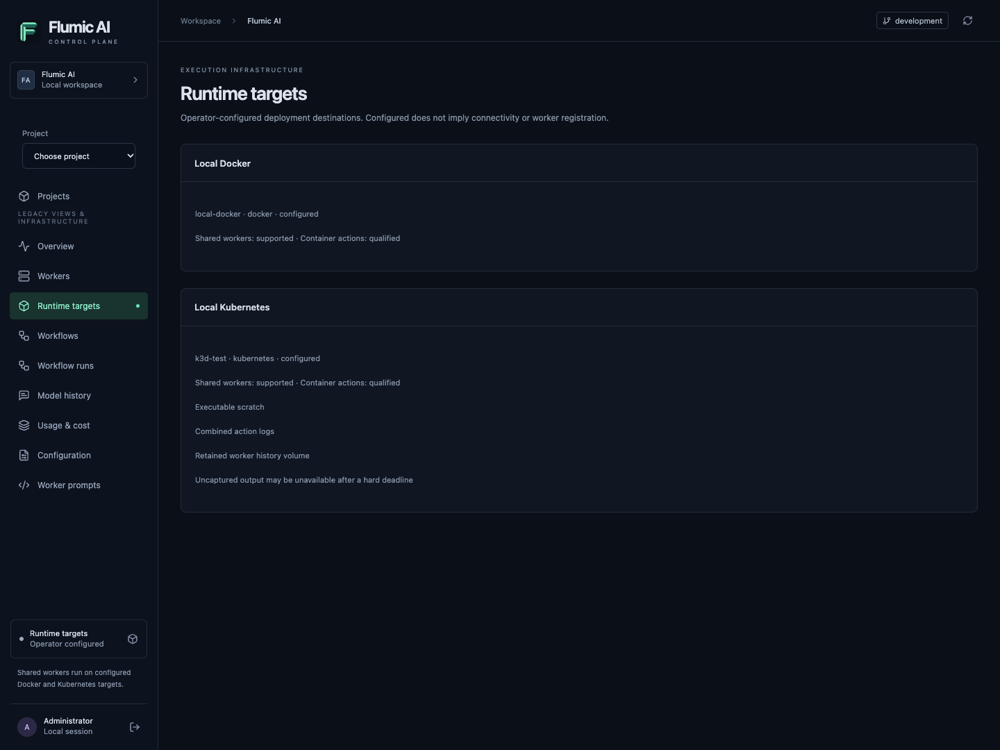
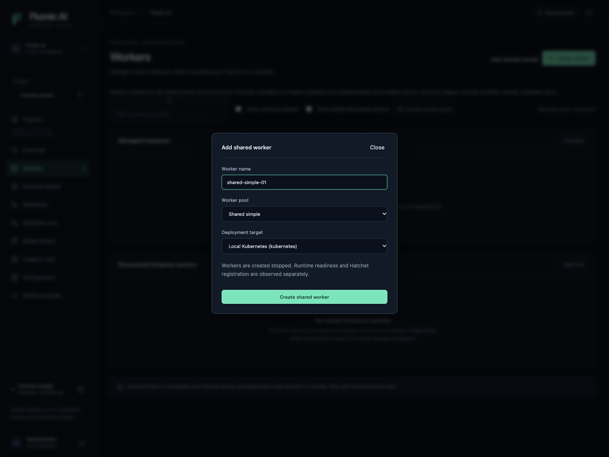
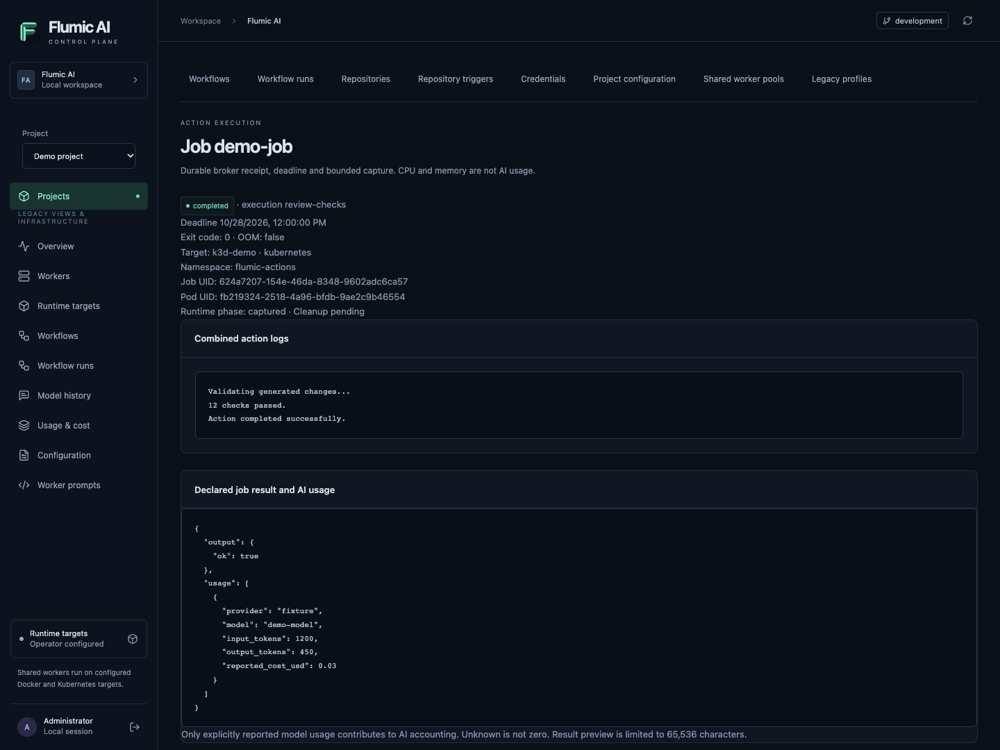

# Kubernetes runtime: operator configuration and behavior

**Status: native adapters implemented; qualified on a dedicated two-node k3d 5.9.0 / K3s 1.35.9 cluster with PostgreSQL.** The native adapters retain the existing workflow contracts and Docker runtime while adding operator-owned worker Deployments and one-time Jobs. They require a supported Kubernetes API with stable ValidatingAdmissionPolicy, an enforcing CNI, qualified node PID limits and PostgreSQL. Start with the [deployment walkthrough](../deploy/kubernetes/README.md).

## Four different scopes

A **Flumic project** owns repositories, workflows, immutable configuration/grants and scoped history. A **worker pool** shares role-compatible workers across authorized projects. A **runtime target ID** (for example `k3d-test`) names an operator-approved deployment destination; it is neither a project nor a user-supplied cluster URL. The target's **Kubernetes context** authenticates the controller to a cluster, while the two **namespaces** isolate persistent workers from arbitrary action Jobs. Multiple projects can share the same target and workers without combining history or credentials.

Workflow schema v1 retains its historical `docker` stage/executor identifiers for compatibility. That name describes the portable container-action contract; the pinned worker target selects Docker or native Kubernetes execution. No Kubernetes cluster authority, image overrides or privileged Pod specs can be attached by a workflow author.

## Target registry and reload rules

Set `CONTROL_RUNTIME_TARGETS_FILE=/run/flumic/runtime-targets.json` for **both** API and reconciler. Default unset means only `local-docker`. The path is read at startup, is limited to 1 MiB, and must contain strict JSON with unique keys and no unknown fields. The environment variable alone does not mount/forward the file through Compose: add explicit read-only mounts and environment overrides, then recreate both processes. Browser forms never upload kubeconfigs.

The current format supports `schema_version: 1` and **at most one Kubernetes target**, in addition to built-in Docker. Copy [target.example.json](../deploy/kubernetes/target.example.json), replacing every placeholder. Do not include credentials in that file. Operators may store a kubeconfig path there; the actual private kubeconfig must be mounted separately and restricted to controller RBAC.

All target settings below apply to newly pinned workers/Jobs after **both processes restart**. Existing workers and accepted Jobs preserve their target revision. A changed or missing current registry revision causes a pinned runtime to fail closed; do not silently repoint an existing ID to another namespace/cluster. Preserve old pinned configuration while settling work, or deliberately stop/remove and recreate workers after investigating retained resources. Reconfiguring a workflow or project does not repin an already accepted Job.

| Key | Type / default / example | Execution effect |
| --- | --- | --- |
| `schema_version` | Integer, required, `1` | Selects strict registry contract; strings and other versions fail startup. |
| `targets` | Array, default `[]`, maximum one | Adds a Kubernetes destination; Docker remains available. |
| `id` | Lowercase slug, required, `k3d-test`, maximum 80 chars | Stable destination identity; `local-docker` is reserved. |
| `name` | String 1–120 chars, required, `Local Kubernetes` | Public display name, not a credential or health probe. |
| `kind` | Required literal `kubernetes` | Selects the native adapter. |
| `deployment_id` | Slug, required, `factory-east` | Ownership/naming scope for this Control Pane deployment; preserve across restarts. |
| `auth.mode` | Required `kubeconfig` or `incluster` | Explicit controller authority; ambient current context is never used. |
| `auth.kubeconfig` | Absolute path, required in kubeconfig mode, `/run/flumic/kubeconfig` | Private process-visible config file; API TLS verification must be enabled. Forbidden with incluster. |
| `auth.context` | String, required in kubeconfig mode, `k3d-flumic-issue17` | Explicit context in that file; forbidden with incluster. |
| `worker_namespace` | DNS namespace, required, `flumic-workers` | Contains Deployments, pricing ConfigMaps, transport Secrets and private PVCs. |
| `worker_namespace_uid` | UUID, required, actual Namespace UID | Pins namespace incarnation; never reuse a deleted namespace's UID. |
| `job_namespace` | DNS namespace, required, `flumic-actions` | Contains suspended Jobs, action payloads and policies. Must differ from worker namespace. |
| `job_namespace_uid` | UUID, required, actual Namespace UID | Separately fences action resources; must differ from worker UID. |
| `images.simple` | Required digest reference, `registry.example.com/flumic/simple@sha256:…` | Approved shared-v1 image for simple pool workers. |
| `images.developer` | Required digest reference | Approved shared-v1 developer worker image. |
| `images.helper` | Required digest reference | Trusted init/collector implementation; actions cannot replace it. |
| `storage_class` | Required resource name, `local-path` | Dynamically provisions each worker's private retained history PVC. |
| `worker_endpoint` | Required HTTP(S) URL, `http://control-api.flumic-control.svc:8000` | Worker-to-Control-Pane endpoint reachable from Pods; no embedded credentials/query/fragment. |
| `image_pull_secrets` | Array of names, default `[]`, maximum 16 | Referenced pull Secrets must exist in both namespaces where used. |
| `node_selector` | String map, default `{}`, maximum 32 | Constrains worker/Job placement, e.g. `{"kubernetes.io/arch":"amd64"}`; qualification must cover eligible nodes. |
| `tolerations` | Array, default `[]`, maximum 32 | Permits matching taints; does not force placement. Example `[{"key":"factory","operator":"Equal","value":"true","effect":"NoSchedule"}]`. |
| `tolerations[].key` | String, default empty, max253 | Taint key; empty with Exists permits broad matching, so review carefully. |
| `tolerations[].operator` | `Equal` default or `Exists` | Equal matches value; Exists requires empty value. |
| `tolerations[].value` | String, default empty, max63 | Equal's matched value. |
| `tolerations[].effect` | Optional NoSchedule/PreferNoSchedule/NoExecute | Restricts matched effect; omitted matches all effects. |
| `tolerations[].tolerationSeconds` | Optional integer0–86400 | Only valid with NoExecute; controls tolerated eviction delay. |
| `network_policy_names` | Map, default `{}`, keys `none` / `bridge` | Names preinstalled reviewed policies. `none` must deny action network; bridge allows only approved egress. Missing requested mode blocks execution. |
| `network_qualified` | Boolean, default false | Container actions blocked until operator proves CNI enforcement. Built-in stages can still use shared workers. |
| `network_evidence` | String, default empty, max120 | Nonsecret record ID for tested denial/allowed egress on all eligible nodes. Required when qualified. |
| `pid_limit` | Integer16–512, default128 | Qualified effective kubelet Pod PID ceiling; must equal each action stage's `limits.pids`. It is not a per-container Kubernetes resource. |
| `pid_qualified` | Boolean, default false | Blocks container actions until node-level PID enforcement is proven. |
| `pid_evidence` | String, default empty, max120 | Nonsecret record ID of effective cgroup limit measurements. |
| `storage_mib` | Integer64–1048576, default256 | Private worker PVC requested size in MiB; not shared across workers. |
| `init_memory_mib` | Integer32–512, default64 | Init helper memory request/limit overhead. |
| `collector_memory_mib` | Integer32–512, default96 | Collector helper memory overhead; reducing it can cause capture OOM/loss. |
| `helper_cpu_millicores` | Integer10–1000, default100 | CPU request/limit for helpers; smaller values can delay materialization/capture. |
| `hatchet_secret_name` | Namespace resource name, default `flumic-hatchet-transport` | Worker transport Secret reference; source/model grants remain execution-scoped and are not broad worker environment credentials. |

*Illustrative fixture data; this screenshot is not live cluster qualification evidence.*

## Worker lifecycle, configuration and storage

**Workers → Add shared worker** selects a pool, name and registered target. Legacy worker creation remains Docker-only. Native workers use one-replica Deployments with Recreate strategy; creation begins stopped. Start changes desired state and waits for Pod readiness; runtime `running` means a ready process, while Hatchet registration and heartbeat are separate observations. Pending, image pull failures, crash loops and unschedulable Pods must never be interpreted as healthy registration.

*Fixture-only shared-worker form; no cluster credentials are entered in the browser.*

Worker identity and credential payloads are versioned immutable Secrets; pricing is projected through an immutable ConfigMap. Configure stops old Pods before installing the new manifest, then follows the desired state. No source-host or model-provider credentials are injected into the shared worker's broad environment. Execution assignments pin project-specific configuration and grants. Only the controller has Kubernetes API credentials; worker and action Pods disable token automount.

Each worker's private PVC preserves its control-event spool across restart/removal. A retained PVC has no Deployment owner reference and is deliberately not garbage-collected with the worker. Local-path storage ties data to a node and is **not high availability**; do not move a worker to a different node expecting its local history volume to follow. Choose portable storage deliberately and verify access mode/scheduling/replay. Pricing projection changes and credential rotation require orderly reconfiguration, not mutable in-place edits.

## Action execution, capture and cleanup

The broker atomically claims authority in PostgreSQL, persists a nonsecret creation intent, creates a suspended Job and binds its actual UID before materializing input. Payloads are immutable bounded ConfigMaps with proofs; action credentials use a separate Secret visible only to the action. The Job is unsuspended only after prerequisites are ready, with remaining budget frozen from the original absolute deadline. Retries cannot reset that deadline. Init/capture are fixed trusted helper operations; user code can be any approved container image/language. See [the action contract](docker-action-jobs.md) and [helper image protocol](../deploy/kubernetes/helper-image.md).

Kubernetes scratch is **executable**. Action resource limits do not include all helper/storage overhead. There is no shell-based host execution, Docker socket, hostPath, shared PID namespace or cluster authority in an action. Network `none`/`bridge` preserves workflow intent through qualified policies, rather than Docker network names. Policies must be installed before execution and reviewed with the CNI/node settings by a trusted operator.

Action exit, collector capture and cleanup are separate phases. Successful capture is persisted before collector release. Logs are **combined**, unlike split Docker stdout/stderr. Hard deadlines, eviction and collector loss can make uncaptured output unavailable. A missing result remains unknown rather than fabricated success. Kubernetes controller scheduling/termination is distributed: native activeDeadlineSeconds complements the backend's absolute result-acceptance cutoff but does not guarantee instantaneous process death at the wall-clock deadline.

Cancellation suspends the Job before cascading deletion. UID/resourceVersion preconditions, ownership proofs and manifest fingerprints prevent deletion/adoption of replacements. Late creates remain tombstones for guarded reconciliation. Cleanup-pending warnings are retried independently of the terminal result. A changed or foreign payload requires operator investigation rather than blind deletion. No exactly-once external-side-effect guarantee applies: inspect source/provider effects before retrying a failed action.

Project Job pages show target, namespace, Job/Pod UIDs, runtime phase, cleanup pending state and combined logs. These are scoped through project APIs; switching projects cancels old requests and must not reveal another project's runtime metadata. The public target catalog exposes safe capabilities and limitations, not kubeconfig paths or credentials. `configured` means loaded registry configuration, not live connectivity.

## Troubleshooting

- **Target missing:** check the mounted file and environment in both server processes, strict JSON validation and matching restarts. An empty registry intentionally shows only Docker.
- **Container actions unavailable:** qualify CNI/PID enforcement, supply nonempty evidence and policy names; stage PID count must match the qualified ceiling. Do not toggle booleans to suppress a failed measurement.
- **Namespace fence failure:** verify actual UID, fresh operator annotation, admission policy compilation/binding and controller dry-run permission. Never repair by reusing an old UID.
- **Pending/Unschedulable:** inspect approved node selector, taints, storage binding and helper/resource overhead. Keep runtime readiness separate from Hatchet registration.
- **ImagePullBackOff:** verify digest, architecture, registry connectivity and pull Secret presence in the affected namespace. Worker and helper images have different protocol responsibilities.
- **Running but unregistered:** verify Pod-reachable Control Pane and Hatchet endpoints, transport Secret and protocol compatibility. A process being ready does not prove scheduling eligibility.
- **Capture unavailable:** inspect deadline, action exit/OOM and collector state. Output recovery after hard termination is not guaranteed. Declared AI usage is independent from resource metrics.
- **Cleanup pending:** inspect exact recorded UIDs, ownership/spec drift and admission/network/API availability. Preserve durable evidence; do not delete resources by a broad selector.

## Qualification and reproducible CI

The real-cluster gate exercises both nodes: a measured 128-process parent Pod ceiling (including bounded fork rejection), default-deny and approved cross-node egress, rejected DNS/external traffic with positive controls, namespace-fence creates and annotation-stripping updates, restricted controller permissions, native worker registration/heartbeat, retained private PVCs and redacted history replay/deduplication. It also covers actual PostgreSQL/API/Job execution for two projects, frozen grants, combined capture, usage attribution, lost replies, controller restart, idempotent acceptance, nonzero/OOM/malformed output, cancellation without the submitter, hard deadlines during a controller outage and collector loss. Unschedulable and image-pull failures remain unhealthy infrastructure observations.

The test matrix uses fixed fake source/model actions: no source-host writes or paid model calls. Hatchet registration uses an explicitly selected disposable test tenant. A portable-storage failover or a new CNI/distribution is not qualified merely by copying the target file. Standard NetworkPolicy does not provide Docker-style network-interface isolation: traffic to the Pod's own node is subject to Kubernetes' node-traffic exception. Namespace/CNI/node administrators are trusted; restrict node services separately.

Run GitHub Actions **Tests** manually with both `run_kubernetes_contracts` and `allow_kubernetes_writes`. The job creates an isolated k3d cluster/registry/PostgreSQL container on a fresh runner, compiles the admission policy, installs restricted RBAC, builds digest-pinned fixture images and runs the real contracts. It requires the existing `FLUMIC_RELEASE_HATCHET_TOKEN`, `FLUMIC_RELEASE_HATCHET_HOST_PORT`, `FLUMIC_RELEASE_HATCHET_SERVER_URL` test-tenant secrets and optional TLS strategy variable. It never runs this live gate automatically on pull requests. Only `output/kubernetes-evidence/qualification-*.json` summaries are uploaded; kubeconfigs, credentials, inputs, raw logs and spools stay private.

For an explicitly owned fresh local cluster, `tests/integration/kubernetes_cluster_setup.py` verifies the independent kube-system UID, two Docker node ownership labels and an empty application-namespace inventory before bootstrap. It writes private environment/controller/checkpoint files. It refuses an existing application cluster and never deletes a cluster. Qualification processes sharing a checkpoint are serialized by a local fixture lock; product replicas use PostgreSQL leases. See [deployment assets](../deploy/kubernetes/README.md) and the [manual workflow](../.github/workflows/tests.yml) for exact setup commands.

### Inspecting a native Job

The Job detail page shows the selected target, namespace, Job and Pod UIDs, capture and cleanup state, combined action logs, and explicitly reported model usage. These identifiers connect the broker receipt to Kubernetes resources when diagnosing an execution.

*Illustrative fixture data; this screenshot is not live cluster qualification evidence.*
