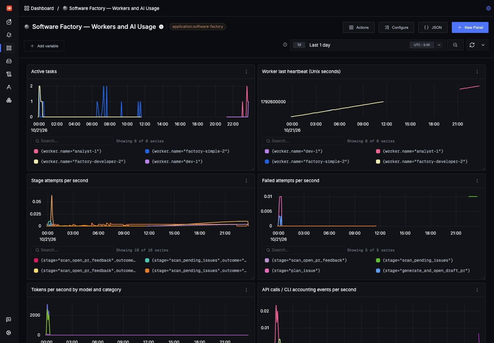
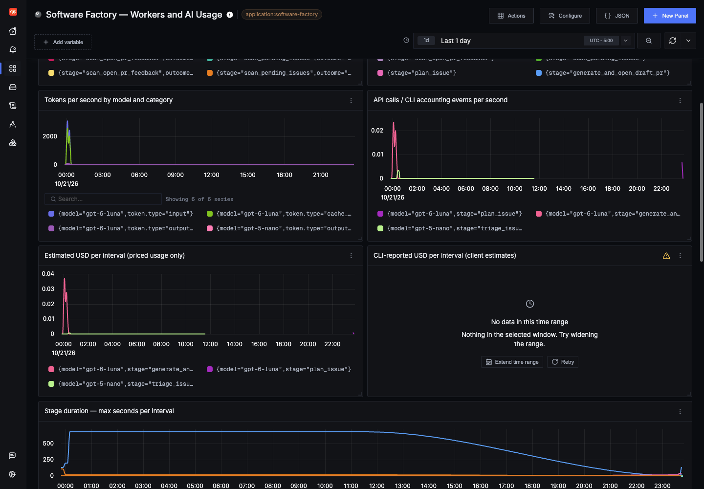
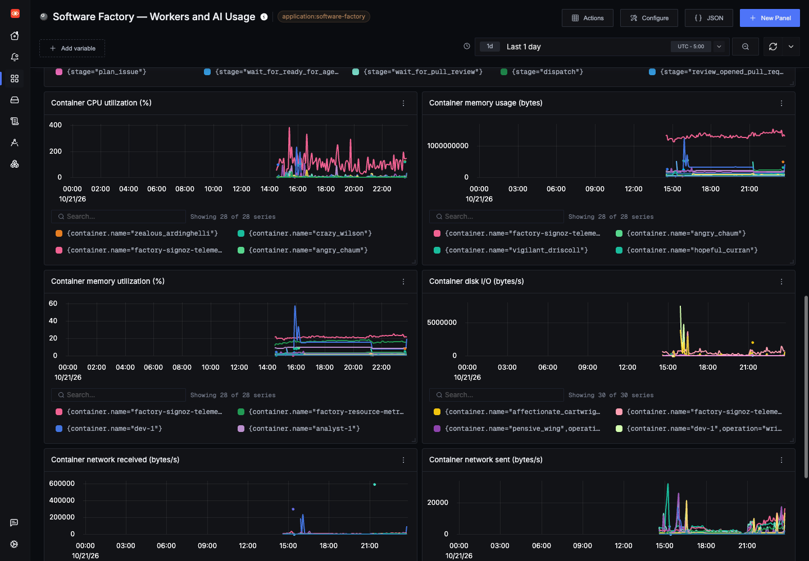

# Flumic AI observability

The optional monitoring stack is self-hosted SigNoz. Workers export standard
OpenTelemetry traces, metrics, and logs over OTLP/HTTP. The factory application
still depends only on its observation and usage interfaces.

## Start and open the dashboard

```sh
./scripts/start-observability.sh
```

The startup script provisions `observability/dashboards/software-factory.json`
through an authenticated, one-shot container. Open **http://localhost:3301** and
choose **Dashboards → Software Factory**. The provisioned dashboard retains its
existing name, **Software Factory — Workers and AI Usage**, after the Flumic AI
product rename; telemetry service names and labels also remain unchanged. Repeated starts update the same dashboard
by its stable name; they do not create duplicates. Local dashboard edits may be
replaced by the checked-in JSON on subsequent starts.

For an existing account, set `SIGNOZ_API_KEY` (with dashboard read/create/update
access), or `SIGNOZ_ADMIN_EMAIL` and `SIGNOZ_ADMIN_PASSWORD`, in the root
`.env.observability` file. An optional `SIGNOZ_ORG_ID` selects an organization.
The script loads `.env` first and `.env.observability` overrides it; only the
SigNoz credential variables are passed to the provisioning container. Keep this
ignored file private. Missing credentials fail provisioning without changing
an existing account.

For a fresh installation, supplied admin credentials initialize the account.
Without supplied credentials, bootstrap generates a local account once and saves
its login in `data/observability-bootstrap/login.json` with private permissions.
The bootstrap never prints passwords or session tokens.

The stack runs separately from factory workers; starting it does not process
GitHub issues or call a model. OTLP ingestion is bound to localhost ports 4317
(gRPC) and 4318 (HTTP). The UI uses 3301. Named Docker volumes persist SigNoz data.
Manual JSON import remains available as an alternative.

This uses SigNoz's V2 dashboard format. It contains nine panels:

- Active tasks per worker and worker heartbeat timestamps.
- Stage attempt and failure rates.
- Token rates by model and token category.
- API-call / CLI-accounting event rates by model and stage.
- Estimated USD and separately CLI-reported USD per interval.
- Maximum stage duration per export interval.

The panels filter `service.name = 'software-factory'` and
`deployment.environment = 'development'`. Change the environment filter when
using another deployment environment. A heartbeat chart uses Unix seconds;
advancing values mean that a worker process is still exporting telemetry.
An absent/stale heartbeat must not be interpreted as an idle, healthy worker.

Use **Traces** to inspect individual issue timelines and expand stage/model
spans. Filter on `factory.issue_number`, `factory.factory_run_id`,
`factory.stage`, `gen_ai.request.model`, or `gen_ai.response.model`. Start logs
identify the issue/stage while a long-running stage span is still active.
Completed spans contain durations and outcomes. Trace/log correlation is handled
by OpenTelemetry. Human wait sleeps do not count as actively executing coding
work.

SigNoz also has **AI Observability** for GenAI traces. Configure prices for your
models there to populate its native cost panels. Our custom dashboard's
estimated-cost panels use the separate, versioned application price file below;
keep both pricing configurations consistent if using both views.

### Worker and stage dashboard



Captured from an existing local installation using **Last 1 day**. The panels
show recorded worker and stage activity; gaps can indicate missing telemetry or
stopped workers. A flat or absent series alone does not establish worker health.

## Enable telemetry on factory workers

After the monitoring stack is running:

```sh
./scripts/start-observed-workers.sh -d
```

This loads the existing Hatchet `development` profile, rebuilds the worker
images, and uses `compose.yaml` plus `compose.observability.yaml`. **Starting
these workers enables normal issue scans and real GitHub/agent operations.**
Both roles join the monitoring network and send to
`http://factory-signoz-ingester:4318`. The overlay selects
`factory.adapters.otel:otel_observer` and mounts the price file read-only.
The overlay selects the observed profiles from `worker-config.yaml`; they inherit
the base worker profiles. Model settings and task prompts come from that file.

The default `start-workers.sh` remains the logging-only path. Outside Compose,
select an observed profile with `WORKER_PROFILE` and set its YAML endpoint,
environment, and pricing path for your host. The adapter uses Python OTLP/HTTP
exporters with explicit endpoints from YAML. Standard exporter authentication
headers remain available through credential environment variables. Export
failures are diagnostic failures; batch export does not synchronously call
SigNoz as part of each business operation. The SDK retries/drops telemetry on
outages; this is not a durable billing ledger.

## Model and token reporting

- **OpenAI API:** every completed API response records configured model,
  provider-reported model, input/output tokens, cached input, and reasoning
  tokens where available. Empty-response errors retain reported usage.
- **Codex CLI:** `codex exec --json` supplies completed-turn usage. Each factory
  iteration records the sum of its completed turns, excluding intermediate
  cumulative snapshots. The configured model is recorded; CLI events do not
  guarantee a provider-resolved model name. The final completion still comes
  from the existing output-last-message file.
- **Claude Code:** `--output-format json` supplies the result text and per-model
  usage/cost. Each reported model gets a nested usage span, including cache read
  and cache creation tokens. Built-in invocations start new conversations and
  do not pass resume/continue flags, avoiding conversation-total double counting.
- **Codex healthchecks:** their own stage/model spans report usage and cost when
  the CLI supplies it. Probe processes do not appear as additional live workers.

Missing/malformed usage is **unknown**, never a zero-token claim. CLI totals
summarize an invocation and do not reconstruct every internal model/tool call.
Claude per-model spans are accounting records created after the CLI result; use
the outer CLI span for execution duration, rather than treating those records
as measurements of individual model-call latency.
SDK-internal retries without a usable response can incur unreported usage.
Standalone connectivity checks and uninstrumented external/custom tools are not
included automatically. A custom coding integration can use the
`factory.application.telemetry.model_call` context manager and `ModelUsage`
contract to report its own usage.

Input tokens are normalized to include cache reads. Cache-creation tokens are
separate where the provider reports them. Reasoning is a subset of output;
it is not added to the output total a second time. Do not sum the token metric's
input and cache-read categories as though they were independent totals.

## Cost estimates

`observability/model-pricing.json` contains USD-per-million-token rates and a
verification date and official source links. It includes configured `gpt-5-nano`
and `gpt-6-luna`, plus the `gpt-4.1-mini` compatibility fallback and documented
snapshot aliases. Claude has no explicit configured model, so its rate is not
assumed. Restart worker processes after changing the file.

Rates are Standard API text-token list prices. GPT-6 Luna's stored rates apply
through 272,000 prompt tokens; longer prompts cost twice the input/cache rates
and 1.5 times the output rate for the whole request. The current flat-rate
estimator does not apply these multipliers, Fast/Batch/Flex pricing, or regional
premiums. Codex turn summaries may aggregate several provider calls and do not
currently expose cache-write counts; unreported cache writes are excluded.
These estimates therefore may understate large-context or cache-write charges.

The estimate is:

```text
((input - cached_input) × input_rate
 + cached_input × cached_rate
 + output × output_rate
 + cache_creation × cache_creation_rate) / 1,000,000
```

The application emits `factory.cost.estimated_usd` only with known usage and
applicable rates; `factory.cost.status` otherwise remains `unknown`. The custom
estimated-cost chart is a subtotal of priced, reported usage, not the whole
provider bill. An empty panel means no known estimate, not zero spending.
CLI-supplied costs are labeled reported client estimates and shown separately;
do not add them to calculated estimates for the same calls. Tool fees, pricing
tiers, discounts, provider-internal retries, and invoice adjustments can differ.
Reconcile with provider billing for accounting.

### Token and cost dashboard



The same one-day window shows token/accounting rates and the known priced-usage
subtotal. The CLI-reported cost panel has no data in this capture; that means no
reported client estimate for this window, not zero cost. Dashboard rates and
interval totals complement the control plane's run/stage/attempt accounting; they
are not a provider invoice.

## Metadata and privacy

The telemetry interface accepts identifiers and accounting metadata, not prompts,
source files, completions, or tool transcripts. CLI JSON events are parsed for
usage but raw stdout/stderr are not exported as normal progress logs. Exception
spans contain error class/status without exception text or stack traces.
Recognizable secrets are redacted from exported factory logs and attributes.
Custom adapters must preserve these boundaries.

Worker gauges use bounded stage/worker labels, and model counters use
model/provider/stage labels. Issue/run/attempt identifiers remain on traces/logs
rather than creating a metric series for every issue. Worker metrics export
every 15 seconds; traces/logs export in batches. Queue depth and scheduling delay
require additional orchestrator instrumentation and are not inferred here.

## Validate without model charges

```sh
.venv/bin/pip install -r worker/requirements.txt
.venv/bin/python scripts/telemetry-smoke.py
```

The smoke command performs no GitHub or model calls. It emits synthetic data in
`deployment.environment = 'telemetry-smoke'`, with `factory.synthetic = true`,
so it does not contaminate the default development dashboard. Use that
filter in Traces/AI Observability to inspect it, or temporarily change a copied
dashboard's environment filter. This validates exporter/collector/storage flow.

```sh
.venv/bin/python -m unittest discover -s tests -q
ruff check worker tests scripts/telemetry-smoke.py
```

Unit tests use in-memory exporters/readers and verify propagation, privacy,
accounting, unknown usage, and worker gauges without contacting SigNoz.

## Lifecycle and reproducibility

```sh
# Monitoring only; factory workers have a separate lifecycle.
docker-compose -f observability/pours/deployment/compose.yaml ps
docker-compose -f observability/pours/deployment/compose.yaml logs --tail=50 ingester
# Stop the monitoring stack, retaining its data volumes:
docker-compose -f observability/pours/deployment/compose.yaml down
```

The checked-in deployment was rendered with Foundry v0.3.0 from
`observability/casting.yaml`. `observability/versions.json` records the pinned
SigNoz/collector versions. Local adjustments bind ports to loopback, use UI port
3301, and correct the generated OpAMP endpoint to the SigNoz service (rather
than the generated PostgreSQL hostname). The generated local database password
is only a container-network development default; this deployment is for local
use, not a production security/HA template.

Regenerating through Foundry overwrites generated settings. Reapply these
adjustments and validate compatible versions before upgrading. The generated
collector includes `signozspanmapper` and `signozllmpricing` for native AI views.

References:

- [SigNoz Docker installation](https://signoz.io/docs/install/docker/)
- [AI telemetry requirements](https://signoz.io/docs/ai-observability-telemetry-requirements/)
- [V2 dashboard schema](https://signoz.io/docs/dashboards/dashboards-v2-api/)
- [Codex structured events](https://developers.openai.com/codex/noninteractive/)
- [Claude Code programmatic output](https://code.claude.com/docs/en/headless)
- [GPT-5 nano pricing](https://developers.openai.com/api/docs/models/gpt-5-nano)

## Infrastructure resources

Start `scripts/start-resource-metrics.sh` after SigNoz. A separate pinned
OpenTelemetry Collector exports Docker container CPU, memory, network and block
I/O every 30 seconds over OTLP. New workers are discovered automatically; the
control API, reconciler and database are included. Container names and allowlisted
Compose/worker labels identify each series. No environment variables or worker
credentials are collected. The collector observes all running containers on this
Docker host, so infrastructure charts also include other local workloads.

The collector exposes no inbound ports. It runs as root to read the Docker
socket; a read-only socket mount still grants Docker API access. Keep this agent
on a trusted host. For Kubernetes, deploy a node collector with kubeletstats and
hostmetrics instead of mounting a Docker socket.

The existing factory dashboard includes container CPU utilization (%), memory
bytes/percentage, disk read/write bytes per second and network bytes per second.
Shared disk usage/utilization is grouped by `mountpoint` and `state`: `/` is the
collector overlay on the Docker image filesystem, `/host-data` is the filesystem
holding `data/control-plane` on the host. These are capacity metrics, not a claim
that each worker owns the whole disk. Used utilization is 0–1; alert on used
space above 0.85 and available space below 0.10. CPU here means CPU utilization,
not hardware cycles per instruction (CPI). Block I/O availability depends on the
Docker runtime/cgroup implementation; absent data is unknown, not zero. Stopped
workers have no live resource metrics; their earlier series remain queryable.

Re-run the dashboard bootstrap after changing its JSON to update the saved
SigNoz dashboard. New metrics appear after the next scrape and export batch.
Keep Docker disk capacity and host disk capacity monitored separately, even when
PostgreSQL is bind-mounted to host storage.

### Container resource dashboard



This real one-day view includes multiple running Docker services. Compare series
by container name; shared infrastructure and unrelated host workloads can also
appear. A missing resource series is unknown rather than zero. CPU can exceed
100% when a container uses multiple cores. Inspect disk-capacity panels separately
from per-container block I/O.
