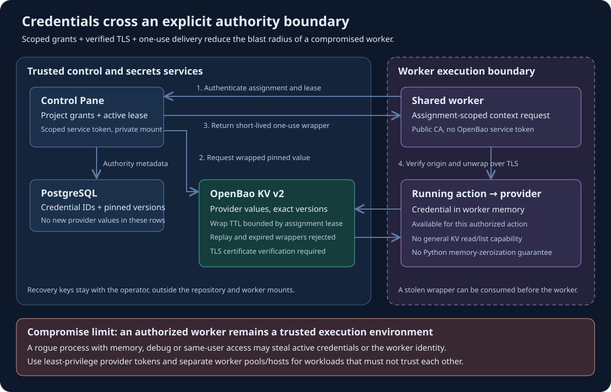

# OpenBao credential storage

Flumic can store project provider credentials in an operator-managed OpenBao KV v2
mount. PostgreSQL stores credential IDs, ownership, purpose, revision lineage,
revocation, and the pinned KV version. OpenBao paths are derived from the mount,
project UUID, and credential UUID. Keep the configured OpenBao instance and mount
stable for a database.

## Local quick start with Docker Compose and just

Prerequisites: Docker Compose v2, a running Docker engine (for example Colima),
Python 3, OpenSSL with `req -addext` support, and [just](https://just.systems/).
Run these commands from the repository checkout you use for your local stack.
Port 8200 must be available. Keep the existing Hatchet development profile configured
as described in the [quick start](../README.md).

```sh
# Start the separate, persistent TLS secrets service and configure Flumic.
just openbao-up

# Verify initialization and unsealing. Expect initialized=True sealed=False.
just openbao-status

# Build current worker images, then rebuild/recreate the Control Pane services.
just images-build
just control-up
```

`openbao-up` generates local TLS material, initializes and unseals OpenBao,
enables the `flumic` KV v2 mount, and creates the scoped Control Pane service
identity. A small renewal container renews its 24-hour periodic token hourly.
Existing Control Pane admin passwords, database passwords and encryption keys
are preserved; missing `.env.control-plane` credentials are generated privately.
The command starts only the secrets stack, without restarting existing workers.

The setup writes these values to the ignored `.env.control-plane` file:

```dotenv
CONTROL_OPENBAO_ADDR=https://factory-openbao:8200
CONTROL_OPENBAO_MOUNT=flumic
CONTROL_OPENBAO_TOKEN_FILE=/run/flumic-openbao/token
CONTROL_OPENBAO_CA_FILE=/factory/.local/openbao/ca.pem
```

The `.local/openbao/enabled` marker makes `just control-up` and the other control
commands automatically select `compose.control-openbao.yaml` and `.env.openbao`.
The overlay mounts the service-token directory read-only into the API, reconciler
and workflow runtime. Both stacks use the existing `worker-network`; Docker DNS
resolves `factory-openbao`. The host endpoint is `https://localhost:8200`.
No manual token copying or disabling TLS verification is needed.

Open **http://localhost:3400**, then select the project and open **Credentials**.
Add a new provider credential and use it in the repository or workflow configuration.
New credential values go to OpenBao; existing database credentials are unchanged.
For an existing installation, use the explicit migration procedure below when ready.
Build and **recreate existing shared workers through Worker Pools** before testing
OpenBao-backed actions. A plain container restart retains its previous environment
and mounts. Newly created Docker shared workers receive the endpoint and a read-only
public CA file; they do not receive the service token or recovery keys.

### Restart, inspect and stop

```sh
just openbao-logs       # Follow server and token-renewal logs.
just openbao-down       # Stop only the secrets stack; retain all data.
just openbao-up         # Start again, unseal, renew identity, reapply settings.
just openbao-setup      # Unseal an already running server after a Docker restart.
just openbao-status
```

OpenBao starts sealed after a server restart. Run `just openbao-up` or
`just openbao-setup` before resuming credential-dependent work. If downtime has
expired the service token, setup replaces its sink atomically; Control Pane reads
that file on each operation. The scripts refuse to replace a configured remote
OpenBao address. Setup requires the retained recovery file for an initialized server
and never resets its storage automatically.

### Local state and recovery

`.env.openbao` records the private state directory, normally
`~/.local/share/flumic-openbao/<checkout-id>/`. It contains Raft storage, TLS key,
`service/token` and `bootstrap.json` (initial root token and unseal key).
Only the public CA and overlay marker are under `.local/openbao/` in the checkout.
These paths are ignored by Git and excluded from Docker build contexts. Scripts
print status rather than token values. Back up the private directory and the
Control Pane database together; retain `.env.openbao` to locate the original state.
Moving to another checkout otherwise creates a different local instance.

This single-node setup uses one locally retained unseal key for development.
Production deployments need operator-managed initialization, unseal, authentication,
backup and recovery practices. Do not delete the private state directory while
PostgreSQL still contains references to its credentials. Switching back to a remote
service requires deliberate migration; removing the marker alone does not move secrets.

Docker worker CA files configured with `CONTROL_OPENBAO_CA_FILE` must reside inside
`FACTORY_ROOT`, so the adapter can map the public file through `FACTORY_HOST_ROOT`.
This quick start handles Docker workers. Kubernetes workers require independently
configured network access and CA trust; the local Docker hostname is not a Kubernetes
service address.

## Configure trusted services and workers

Enable a dedicated KV v2 mount before using Flumic. Set these values in the private
Control Pane deployment environment.

| Variable | Purpose |
| --- | --- |
| `CONTROL_OPENBAO_ADDR` | Trusted HTTPS origin reachable from the Control Pane and shared workers |
| `CONTROL_OPENBAO_MOUNT` | Dedicated mount, default `flumic` |
| `CONTROL_OPENBAO_TOKEN_FILE` | Path to a private token sink inside trusted Control Pane containers |
| `CONTROL_OPENBAO_CA_FILE` | Optional CA bundle path inside trusted Control Pane containers |

Mount the service token sink and optional CA bundle into the API, reconciler,
and dynamic runtime with a private Compose override. An operator-managed auth
agent can refresh the token file. Flumic reads it when making requests. Scope the
service policy to create and read on the dedicated credential data paths. The
service does not need list, update, destroy, or policy-management privileges.
Keep the OpenBao root token and recovery material in operator custody.

Build and replace shared worker images before migrating existing credentials.
Docker and Kubernetes workers receive the OpenBao origin from the Control Pane
configuration. Their images must trust the endpoint certificate. For privately
managed workers, `FACTORY_OPENBAO_CA_FILE` can name an already mounted CA bundle.
Qualify network egress and DNS resolution from each worker target.

At built-in action startup, a lease-authorized context request returns one
short-lived wrapping token per OpenBao-backed grant. The worker checks the
wrapping origin and calls the OpenBao unwrap API over TLS. It keeps the resulting
provider value in memory for that action. The worker acknowledges start after retrieving grants,
so credential delivery does not consume the stage execution timeout. Older workers are rejected for
OpenBao-backed grants. Trusted server consumers such as repository validation
and Job brokerage read the pinned KV version using the service identity.

## Security boundaries and compromised workers



### What the boundary protects

The Control Pane remains the authority for project membership, repository and
workflow configuration, credential grants, assignment ownership and active leases.
OpenBao is the authority for provider values. A worker cannot select an arbitrary
KV path and read it using the controller's identity: that identity is not delivered
to workers. PostgreSQL stores references to new OpenBao-backed credentials, so a
read-only database leak does not directly reveal those provider values. Existing
legacy ciphertext must be cleared through the verified migration before that
statement applies to all stored credentials.

| Mechanism | How it reduces exposure | Boundary or limit |
| --- | --- | --- |
| Scoped assignment delivery | The API checks the worker, project, run, grants and lease before delivery, then rechecks authority after remote wrapping | A stolen worker identity can act within whatever assignments the Control Pane authorizes for that worker |
| Dedicated controller policy | Only the trusted controller can create/read credential data under the configured project prefix | It is a service-wide identity, not one token per project; controller compromise can expose every credential in that prefix |
| Short-lived, single-use wrappers | The worker receives a wrapped exact-version response rather than a reusable OpenBao read token; expiry/replay is rejected | A thief who obtains a live wrapper first can unwrap it; wrapping limits replay, not first-use theft |
| Verified TLS and origin/version checks | The worker verifies the endpoint certificate, wrapping origin and expected credential version before accepting a value | Host administrators or attackers who replace the trusted CA or application code can defeat these checks |
| Public CA only in workers | Managed Docker workers receive the public CA file, without the controller token sink, Raft data or recovery material | The CA proves server identity; it is intentionally not a secret |
| Action-start credential resolution | Provider values are fetched for the authorized action and held in worker memory, rather than baked into the worker image or global provider environment | Plaintext must exist during provider use; Python does not guarantee immediate memory erasure |
| Fail-closed delivery | Missing/expired authorization, failed TLS, unavailable OpenBao and invalid wrappers prevent credential delivery; referenced credentials do not fall back to database ciphertext | Availability failures can stop work; configure monitoring, recovery and token renewal |
| Redacted history | Credential-aware logging and output filtering reduce accidental persistence in logs and model history | Redaction is best effort and cannot prevent a malicious action from transforming or exfiltrating a secret |

### What a rogue process can still do

**OpenBao does not isolate processes inside an already compromised worker.** A
process with sufficient access to the worker's memory, debugger interface or
execution context can read an unwrapped credential while it is in use. It may also
steal the worker's Control Pane token and request contexts that this worker is
permitted to receive. Multiple projects sharing one worker therefore share a
trusted execution environment; authorization checks are not an OS sandbox between
those projects.

Revoking a grant or cancelling an assignment prevents subsequent authorized
delivery. It cannot retract a provider value that was already unwrapped. The
provider credential's own permissions, expiration and revocation determine what
an attacker can do afterward. Use repository-scoped source tokens, narrowly scoped
model/gateway keys and provider-side spending/rate limits where supported. Rotate
provider credentials after a suspected worker compromise; revoking a wrapping token
alone is insufficient.

### Deploying for stronger isolation

Keep arbitrary untrusted code in isolated action containers or Jobs, and pass only
the credentials that action explicitly needs. Do not expose the Docker socket,
host private OpenBao directory or controller token sink to those workloads. Review
privileged containers, shared volumes, process namespaces and debug permissions;
container isolation depends on the runtime and host configuration.

Use separate pools and execution hosts for workloads or projects that must not
trust each other. Kubernetes deployments can add appropriately enforced network
policies and restricted pod security; Docker deployments need equivalent host and
network controls. Restrict egress to the required Control Pane, OpenBao and provider
endpoints when the workload permits it. These are deployment hardening measures,
not protections automatically established by the local quick-start network.

The local setup deliberately retains root/unseal material in a private host file
for repeatable development recovery. Host compromise can therefore compromise the
local secrets service. Production should use independently protected recovery
material, managed authentication/renewal and OpenBao audit logging configured to
avoid exposing raw values. See [ADR 0008](adr/0008-openbao-credential-authority.md)
for the architectural decision and the [architecture guide](architecture.md#openbao-credential-authority-and-delivery)
for the execution sequence.

## Migrate an existing installation

Use a trusted maintenance environment with the same database, encryption key,
OpenBao origin, mount, token sink and CA configuration. Run the current schema
migration first. Restore-test PostgreSQL and OpenBao backups together before
cutover. Pause admissions and credential writes and drain all assignments.
Stop control services before applying the copy or clear step.

```sh
python scripts/migrate-openbao-credentials.py inspect
python scripts/migrate-openbao-credentials.py copy \
  --expected-count <count> --fingerprint <inspection-fingerprint> \
  --verified-backup-and-offline
```

Copy reads each existing value into memory, creates its OpenBao path with CAS 0,
and verifies the pinned version by read-back. The PostgreSQL transaction switches
the verified rows to OpenBao references together. Existing ciphertext is retained
for the rollback window. An interrupted copy can leave a create-only path in
OpenBao. The next copy checks the value at that path before adopting it.

Resume qualified workers and verify repository access and normal project
execution. When the rollback window has closed, quiesce services again, take
fresh backups and repeat inspection. Run `clear` with the new inventory count
and fingerprint plus `--verified-backup-and-offline`. Clear verifies values again
before removing legacy ciphertext. Historical database backups and WAL follow
their retention policy. Keep the root encryption key for existing encrypted
contexts. Restore OpenBao data and PostgreSQL references to compatible points
in time.

## Failure and revocation

OpenBao-backed records fail closed when the store cannot serve the exact
version. Revocation blocks new wrapping requests. An issued wrap can remain
valid until its short expiry, and the provider must invalidate a key already
retrieved by a worker. An ambiguous unwrap requires a newly authorized context
request before provider execution. A credential write with an ambiguous response
can be retried with the same idempotency key and payload. The credential form
retains its key for an unchanged retry. Inspection lists pending credential UUIDs
and project IDs. If a pending submission cannot be retried, revoke that specific
version with the authenticated project secret revocation API before migration.
An abandoned OpenBao path requires separate operator reconciliation.

If OpenBao cannot supply redaction values when an action reports completion,
the controller records a cancelled terminal receipt with output withheld.
This blocks automatic replay of provider effects. History ingestion can retry
after the store recovers.

Qualify the OpenBao transport against a disposable TLS server with the optional
`OPENBAO_TEST_BIN` test described by `tests/test_openbao_live.py`.

## Architecture and decision record

The [credential sequence](architecture.md#openbao-credential-authority-and-delivery)
shows storage, authorization, worker unwrap and start acknowledgement.
[ADR 0008](adr/0008-openbao-credential-authority.md) records the alternatives,
operational costs and migration guarantees.

### Gateway credential versions

Gateway connections use two project-scoped credential purposes. Store the
restricted model API key as `gateway-inference` and the catalog discovery key
as `gateway-management`. Both require OpenBao. Keep the gateway's provider
credentials in the gateway's configured secret store. The Flumic deployment
reads only the referenced OpenBao version for the operation it performs.

An administrator can create a connection revision with
`POST /api/v1/projects/{project_id}/gateway-connections`. Supply an approved
HTTPS endpoint ending in `/v1`, an `inference_credential_id`, and an
`aliases` object mapping allowed gateway model names to their tokenizer models.
Set `management_credential_id` to use the revision's `/verify` endpoint.
Verification reports which configured aliases appear in the gateway catalog.
It does not run inference.

To rotate a key, create a new OpenBao-backed credential version and then create
a connection revision with the prior revision as `parent_id`. An administrator
can revoke the old credential version to block new dispatch claims that use it.
A dispatch already claimed may still finish. The gateway manages the upstream
keys and gateway-side rate and spending policies.
