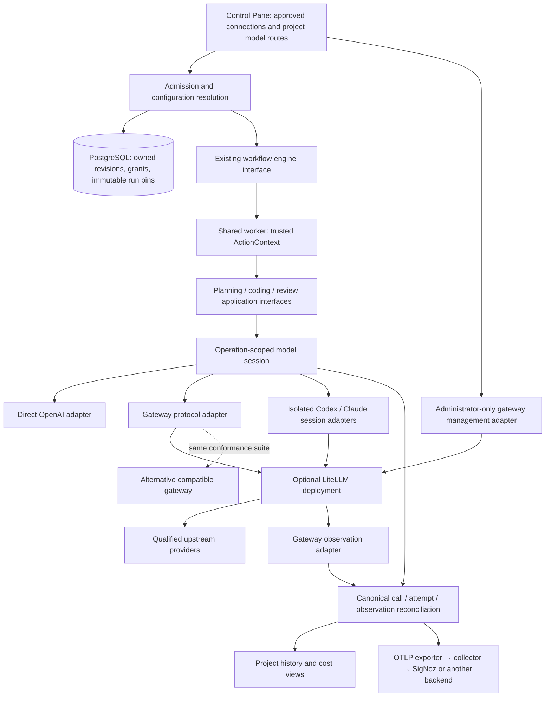

# LiteLLM integration and replaceable external dependencies

Date: 2026-10-30. Status: **proposed plan for review, not an implemented or accepted architecture**.

Source baseline: `ee9b861` on `codex/user-walkthrough` (PR #53). This plan is on a separate branch; merge/rebase onto the reviewed UI baseline before implementation. Existing gateway epic [#39](https://github.com/phudekar/flumic-software-factory/issues/39) and issues #41–#45 remain the delivery backlog. Do not create duplicate issues or close them before their implementation PRs merge.

## 1. Outcome and scope

Allow an administrator to approve a model connection once, a project to select it with its own restricted credentials, and any compatible shared worker to execute pinned stages through that connection. Start with LiteLLM as an optional external gateway. Workflow definitions continue to describe work, prompts, models and dependencies without encoding the chosen gateway product.

Make model transport, source hosts, orchestration, execution runtimes, telemetry and selected infrastructure replaceable through small application-owned interfaces. Replacement means passing the same semantic contract tests and qualifying declared capabilities; a matching URL or Python method name is insufficient.

Deliver readable modules, operational documentation and measured test coverage across owned code. Do not claim existing code is fully covered: current green default suites contain 396 worker tests (15 skipped), 427 backend tests (13 skipped), and 116 frontend tests, but CI does not yet require a browser-to-worker-to-gateway E2E suite or publish comprehensive branch coverage.

This task produces a plan only. It does not install LiteLLM, change the database, route live workers, provision keys, call paid models, change public docs to advertise gateway support, or migrate existing runs.

## 2. Approach comparison and recommendation

| Approach | Benefit | Cost / limitation | Recommendation |
| --- | --- | --- | --- |
| External OpenAI-compatible gateway, with separate management adapter | Independent deployment, central upstream keys, replaceable LiteLLM/Bifrost implementation | More operations; protocol compatibility and durable budget behavior must be qualified | **Proposed default** |
| Embed LiteLLM's Python SDK in every worker | One process; provider translation library | Worker dependency/version coupling; CLI transport still needs a gateway; governance repeated across processes | Do not use for the first release |
| Only add a configurable OpenAI base URL | Small patch | Misses token counting, credential purposes, pins, CLI homes, attribution and retry ownership | Useful internal transport capability, insufficient as the feature |

Direct OpenAI API execution remains explicit and compatible. Existing Claude/Codex direct CLI execution remains available. A rejected or unavailable gateway never triggers an automatic direct-provider bypass. A gateway outage is a visible execution failure or bounded wait according to policy.

Proposed rollout: API transport first; project governance and accounting next; qualified CLI transports next; full-stack qualification before general availability. Docker/Compose is the first disposable qualification environment; Kubernetes uses the existing native runtime rather than a new operator. Bifrost is a second conformance candidate, not a promised equivalent feature set.

## 3. What the source actually does today

| Source | Current behavior | Required change |
| --- | --- | --- |
| `worker/model_client.py:ModelClient` | Combines prompts, Pydantic validation, token checks, OpenAI construction, request/error handling, capture and usage extraction; JSON-object Chat Completions; token-count fallback uses Responses | Retain task/schema behavior; inject transport and token-budget interfaces |
| `worker/factory/adapters/token_budget.py` | Uses known tiktoken model names; refuses unknown names unless remote counting succeeds | Count against the qualified effective alias/protocol, with provenance; never guess alias tokenization |
| `worker/factory/bootstrap.py` | Legacy and shared-action composition both select installed factories; shared actions already receive explicit credentials and private homes | Centralize descriptors and session construction, retaining the separate credential/trust paths |
| `worker/factory/workflows/actions.py:minimum_purposes` | Recognizes specific factory strings and maps API/Codex to OpenAI, Claude to Anthropic | Installed descriptor registry owns capabilities and minimum credential requirements |
| `worker/cli_agent.py` | Restricted subprocess environment; rewrites Codex config; selects direct credentials; archive safety, change collection and completion parsing share a large module | Extract CLI session configuration from workspace/process safety; add explicit approved gateway configuration |
| `app/project_context.py`, `app/workflow_definitions.py`, `factory/workflows/contracts.py` | Owned secret versions, encrypted immutable context, live revocation checks at resolution; allowed purposes are closed | Add connection revisions, project bindings and a dedicated gateway inference purpose without weakening existing grants |
| `factory/application/telemetry.py`, `adapters/telemetry.py`, `adapters/pricing.py`, `app/history.py` | Usage source/capture separation, nullable usage/cost, project/run/stage correlation and parent/leaf handling | Add logical calls, billable attempts and gateway observations with explicit reconciliation |
| `app/ports.py`, `app/runtime_router.py` | Existing engine/worker/job interfaces; Docker/Kubernetes routing and fenced target snapshots | Preserve these seams; improve typed construction/lifetimes separately, not as a prerequisite rewrite |
| `.github/workflows/tests.yml`, `tests/integration/` | Unit jobs required; real Docker/Hatchet/GitLab/Kubernetes contracts mostly opt-in | Add mandatory deterministic gateway integration and real-stack E2E gates for relevant changes |

Also revisit the source-based [architecture review](../reviews/2026-10-28-architecture-review.md). Its findings are leads to re-verify, not proof that each remains unfixed. This plan does not silently bundle its unrelated fixes into the gateway work.

## 4. Proposed architecture



### Ownership

- Flumic owns workflow/stage identity, prompt rendering, result schemas, source safety, immutable intent, project authorization, canonical action state and reconciled history.
- The gateway owns its upstream routing, provider credentials and the gateway policies actually configured there. Flumic never assumes that sending a budget number or project tag enforces anything.
- Provider/gateway adapters translate wire formats, normalize bounded errors, expose capabilities and own HTTP client lifetime. They do not decide workflow progression or repository mutations.
- Source-host adapters own GitHub/GitLab translation; engine adapters own submission/waits; runtime adapters own Docker/Kubernetes effects under existing fences.
- PostgreSQL remains the runtime authority under [ADR 0003](../adr/0003-postgresql-runtime-authority.md). Swapping databases is not a drop-in promise: locking, leases and transactions require separate qualification.

### Small interfaces with substantial behavior behind them

Proposed names describe contracts to implement, not existing classes:

| Interface | Caller learns | Implementation hides |
| --- | --- | --- |
| `ModelTransport.generate(request) -> GenerationResult` | Messages, requested model/alias, JSON requirement, output limit, deadline and call identity | SDK/protocol details, normalized errors, request IDs and provider usage mapping |
| `TokenBudget.assess(request, route) -> TokenAssessment` | Count, provenance, completion reserve and safe/unsupported decision | Exact-model tokenizer mapping or qualified remote count route |
| `ModelSessionFactory.open(resolved_route, credentials, context)` | Context-managed operation lifetime | Client creation/close, capture scope, safe correlation and CLI private files |
| `AdapterDescriptor` | Installed ID/version, capabilities, credential requirements and trusted factory | Provider-specific construction; not arbitrary request-supplied Python imports |
| `GatewayAdministration` | Validate/import a binding and, when supported, provision/revoke a key | LiteLLM-specific management endpoints and edition differences |
| `UsageReconciler.observe(observation)` | Typed source observation and stable identities | Deduplication, partial/reordered delivery, reconciliation and projections |

Keep the existing `Planner`, `ChangeReviewer`, `CodingAgent`, `Repository`, `WorkflowDispatch` and `JobRuntime` interfaces. Add a seam only where behavior actually varies. Direct and gateway transports, GitHub/GitLab and Docker/Kubernetes provide real alternative adapters; do not add a universal plugin container around everything.

### Proposed code ownership

| New or extracted module | Responsibility / existing migration point |
| --- | --- |
| `worker/factory/application/model_contracts.py` | Typed generation/count requests, capability profiles, normalized results and retry/billing error classification; no SDK imports |
| `worker/factory/application/model_tasks.py` | Prompts, business schemas and safe result validation extracted from `worker/model_client.py`; keep its import path as a temporary compatibility shim |
| `worker/factory/application/model_routing.py` | Pure effective-route resolution; accepts trusted records and returns provenance, without importing backend HTTP/database modules |
| `worker/factory/adapters/models/` | Direct Chat transport, gateway protocol transport, qualified counters and response/usage normalization |
| `worker/factory/adapters/cli_sessions.py` | Codex/Claude private configuration and authentication; `cli_agent.py` retains workspace/process/change-safety orchestration initially |
| `worker/factory/bootstrap.py`, `application/service.py` | Trusted descriptor composition and one adapter instance per operation for both capability discovery and execution |
| `control-plane/backend/app/llm_connections.py`, `llm_policy.py` | Administrator connection routes, project bindings, grant resolution and live policy; thin routes over owned use cases |
| `control-plane/backend/app/adapters/gateway_admin/` | Gateway-specific key verification/provisioning/revocation, including edition capability checks |
| `control-plane/backend/app/llm_accounting.py` | Durable logical calls, upstream attempts, observations and read projections; extend history additively |
| `control-plane/frontend/src/features/llm-connections.tsx`, `project-model-routes.tsx` | Administrator connection forms and project route selection; reuse existing guided-form and conflict-preservation patterns |

Names are proposed and may be refined during implementation without moving vendor knowledge into business modules. Do not create every directory in slice 0; introduce each with a tested behavior.

## 5. Configuration, credentials and admission

### Proposed versioned records

| Record | Owner and contents | Mutability |
| --- | --- | --- |
| `LLMConnectionRevision` | Administrator: protocol family, approved origin/base path, TLS/CA policy, capability declaration, adapter/version, timeout/retry/fallback bounds, declared gateway routing revision | Immutable revisions; disabling a connection is live policy |
| `ProjectModelBindingRevision` | Project: approved connection, restricted credential-version reference, allowed aliases and operation/backend compatibility | Immutable; grants and revocation remain authoritative |
| `ResolvedModelRoute` | Admission: connection/binding revisions, effective model or alias, capability profile, output/context limits, policy/price references | Included in accepted run/action pins; no raw secret |
| Gateway management credential | Installation/operator ownership; accessible only to administrator management logic | Independently rotated; never a project action grant |

**Proposed illustrative configuration, not valid current YAML:**

```yaml
schema_version: 1
model_route:
  connection_id: gateway-primary       # approved database identity
  model_alias: engineering-small       # gateway alias, not a guessed tokenizer
  capability_profile: structured-chat-v1
# Secrets are supplied through an owned binding, never pasted here.
```

The administrator form creates/test-validates a connection; a project form chooses an approved connection and allowed alias. Repository/workflow/stage overrides may select only approved bindings allowed by project policy. Inputs from an issue, workflow payload or model output cannot select a hostname, CA path, admin key or factory import.

Use the existing effective order: project defaults → selected profile → repository → workflow defaults → stage overrides, then the operation's applicable task settings. Introduce a single resolver that returns the final route, prompt and provenance. Preserve direct-mode legacy `openai_model`, `codex_model`, `claude_model` and `task.model` behavior through an explicit compatibility compiler. When adopting gateway mode, map model selections to approved aliases explicitly; ambiguous mixtures of legacy model overrides and new route declarations are validation errors rather than silent precedence changes.

Enforce management access through a server-side administrator guard using the current authentication model. Do not bundle the named-user/OIDC/RBAC epic #40 into this integration. Its later administrator-capability policy (#47) should replace the guard through one explicit authorization seam; hiding controls in the frontend is never the enforcement mechanism.

Endpoint/TLS values are administrator-owned runtime configuration, not baked into images. Allow private Docker/Kubernetes service addresses only through explicit operator approval; reject project-selected destinations, unsafe redirects and unbounded responses. Enforce network egress restrictions as well as configuration validation. Do not globally reject private IP ranges: the local gateway legitimately lives there.

Add a closed `llm_gateway` inference credential purpose with project, connection and optional repository binding. Extend schemas, trusted minimum-purpose computation, encrypted pins, redaction, revocation, worker resolution and UI validation together. A gateway key is not an `openai` key merely because one wire protocol resembles OpenAI.

Initially support importing a pre-provisioned restricted virtual key. The management adapter must verify its scope against the approved connection before use; an administrator assertion alone does not prove upstream restrictions. If the selected gateway/edition cannot expose sufficient validation, mark that capability unavailable and require a documented operator qualification path before production enablement. Automated provisioning is a subsequent capability, not an excuse to give master keys to workers.

The qualification path must produce **authoritative gateway evidence** of key ownership/project mapping, permitted aliases/routes, budget/rate scope, expiry, and absence of management privileges. A UI screenshot, successful inference, operator checkbox or self-supplied metadata does not satisfy import verification. An adapter without sufficient verification cannot enable the governed production profile; manual setup is allowed only when the resulting key is verifiable through the same contract.

Pin inference credential versions rather than silently rotating accepted work onto new keys. Normal rotation adopts a new version for new work and drains the old version; emergency revocation blocks subsequent use. A running CLI can retain a resolved credential, so gateway-side request authorization/revocation and bounded credential-cache behavior are required. An already accepted upstream call may continue and incur cost after local cancellation.

Pin Flumic's routing intent and record the actual returned provider/model. An external mutable alias is not frozen by a Flumic snapshot. Strict reproducibility requires a qualified immutable routing deployment/revision; otherwise display that upstream routing can change. Live revocation, model restrictions and spending enforcement remain live even when intent is pinned.

### Live policy and capability profiles — proposed builder decisions

| Profile / rule | Exact initial contract |
| --- | --- |
| `api-structured-v1` | Chat JSON-object behavior, validated token assessment, scoped authenticated inference, bounded errors/deadlines, requested/resolved identity and honest usage coverage. Necessary for API qualification, insufficient alone for governed production |
| `governed-project-v1` | Add authoritative key verification, durable model/budget enforcement and bounded live authorization. Required for production gateway project bindings |
| `cli-codex-v1` / `cli-claude-v1` | Add the corresponding real binary/protocol/count/session contracts and request-time policy enforcement for internal requests. Unsupported until every mandatory capability is qualified |
| Connection disable | Block new admissions/assignments immediately. Existing admitted work drains under its pins unless an explicit emergency revocation is requested; disablement alone is not presented as cancelling in-flight work |
| Revocation/model restriction | Every API inference/count request revalidates its scoped grant or a bounded authorization lease. Proposed maximum positive authorization cache: 30 seconds; a failed refresh/partition denies further requests once that lease expires |
| CLI live authorization | A qualified gateway-side authorization hook or inference ingress must enforce an equivalent per-request lease for every internal CLI request, bound to trusted assignment/project identity. A cached static key or CLI startup check alone cannot qualify. Keep this implementation behind an adapter; do not advertise the CLI path while missing |
| Revocation confirmation | Administrator UI distinguishes requested/pending from confirmed. Proposed confirmation SLO: 60 seconds on a reachable healthy deployment; missed confirmation blocks new work and raises a visible incident. During a partition the authorization lease expires closed, rather than reporting successful revocation |
| Already sent inference | May complete or be billed after cancellation/revocation. Record uncertainty; do not promise upstream interruption or zero charge |
| Replacement support | A gateway may pass the execution profile but fail governance/CLI/attempt visibility. Report the exact subset. Only adapters passing all required profiles are drop-in replacements for a deployment requiring those profiles |

The authorization lease requires a real mechanism in slice 3: a validated request-time control check for API calls and, before CLI release, a qualified gateway authorization extension or trusted inference ingress that verifies assignment-bound context. Client tags cannot authorize or extend the lease. This is a release gate, not an assumption that LiteLLM's default static-key cache implements Flumic revocation. If the selected version cannot satisfy it, change the deployment architecture or keep that path unavailable; weakening the requirement requires a separate approved design decision.

Gateway capability profiles also become trusted worker-registration/assignment eligibility data. A pool declaration alone cannot certify an old worker's model transport or CLI session support. Roll out readers/schema support before enabling new pins; old workers continue accepting compatible direct work and must not receive unsupported gateway contexts.

## 6. Protocols, retries and token budgets

| Path | First contract | Qualification gate |
| --- | --- | --- |
| API planner/reviewer/coder | Chat Completions with JSON-object output plus current local Pydantic/path validation | Preserve current completion limits, refusals/empty/malformed response handling and prompt safety |
| API alias token count | Qualified count capability for the effective alias and exact request envelope | Include system guidance/schema overhead; refuse generation on unsupported/failed/invalid count |
| Codex CLI | Responses transport and private generated model-provider configuration | Pin CLI/gateway versions; real process fixture must prove routing/auth/capture/cleanup |
| Claude CLI | Messages and required count route, private environment/settings | Pin versions; qualify selected alias and authentication header semantics |
| Strict JSON schema, streaming, tools | Additional declared capabilities | Not implied by Chat Completions compatibility; reject when required and unsupported |

Separate prompt/schema handling from transport in `ModelClient` before adding gateway fields throughout its methods. Inject one operation-scoped adapter for capability checks and execution; do not construct one for discovery and a second for generation. Preserve existing task results and CLI metadata-only completion contracts.

Keep transport-attempt retries, gateway upstream retries/fallbacks and workflow-stage retries distinct. For the initial gateway pilot, disable SDK-level automatic retries and gateway fallbacks unless explicitly qualified. Later configurations must specify an end-to-end attempt ceiling and deadline; do not multiply SDK × gateway × stage retry counts silently.

Classify authentication, revocation, forbidden alias and budget rejection as non-retryable policy failures; distinguish rate limiting with a bounded `Retry-After`, connection errors before send, and uncertain timeout after send. Generic status alone is insufficient when a gateway reports a budget error as 429. Sanitize provider bodies before errors reach logs. A timed-out generation has uncertain billing; retry is not exactly-once inference.

Context limits are checked against every allowed route/fallback, not only the requested alias. Unknown tokenization, unavailable price data or unknown usage stays explicit. No silent tiktoken fallback for an arbitrary alias; no removal of requested JSON constraints to make a provider accept a request.

For the initial gateway profile, a token assessment is acceptable only when it is an authoritative count or a qualified conservative bound for that exact declared request envelope. Label the provenance. Do not treat an unbounded/calibrated average estimate as a hard context safeguard. Disable gateway prompt augmentation and hidden request transformations initially; any later transformation needs a versioned counting contract. Native CLI envelopes must be assessed/limited at the qualified gateway request interface; counting only the outer Flumic prompt does not qualify them. A route whose alias, transformations or count endpoint cannot meet this requirement remains unavailable.

### Durable retry and deadline ownership

- Persist a call record and request digest before dispatch. Replay of the same execution/operation/turn reuses the call identity and validates the digest; different content is not an idempotent replay.
- SDK/network retries remain within one logical call. A new workflow attempt has a new call identity linked to the original **retry group** for `(run, stage, operation)`; its generation must not reset the group's authorized spending/attempt ceiling.
- The control plane persists group budget/deadline and reserves each Flumic-controlled attempt atomically before network dispatch. It derives remaining time from the original accepted deadline; worker restart cannot extend it. Use monotonic deadlines inside a process and a trusted persisted wall-clock deadline across processes.
- An unknown-after-send call is marked potentially billable and requires reconciliation or explicit retry authorization before regeneration. Do not silently replay it as a known failed/no-cost request.
- Count gateway-internal retries against the same declared ceiling only when the pinned gateway can enforce and expose them. Otherwise keep internal retries/fallbacks disabled and mark hidden billing attempts unknown. CLI autonomous calls have a separately enforced request/rate/time policy at the gateway/ingress; outer stage retries are not their request ceiling.
- Full CLI support requires durable correlation/authorization supplied by the gateway authorization adapter for each internal request. Do not infer CLI turn IDs by parsing arbitrary prompt text or claim that process restarts provide exactly-once billing.

## 7. Budgets, attribution and observability

Start with project-scoped gateway budgets/rate limits and Flumic's existing bounded worker concurrency, output limits and deadlines. Do not invent an independent spend total that disagrees with gateway enforcement. Qualify concurrent admission/reservation behavior and in-flight overshoot for the pinned gateway build. Hard per-stage USD reservation is an open product decision; CLI internal requests cannot be bounded accurately by counting outer workflow attempts alone.

Reject production budget-required mode if the gateway's durable governance is absent/unavailable or fail-open. Test database/cache outages, stale authorization caches, replica concurrency and restart recovery. Validate restriction enforcement with real project keys, not client-controlled metadata. Manual create-new/revoke-old rotation is acceptable when the pinned OSS edition lacks an automatic rotation feature; record its limitations.

Three identities are distinct:

1. **Logical model call:** Flumic project/run/stage/execution identity plus a unique call ID, allocated before transport.
2. **Upstream attempt:** one potentially billable gateway/provider attempt, including retries and fallbacks when observable.
3. **Observation:** SDK, CLI, gateway or provider telemetry describing a call/attempt; duplicate observations are not additional charges.

Use trusted project/key binding for authorization. Trace headers and metadata are correlation hints, not an authorization boundary. A shared worker able to change tags must not gain another project's key or model access. Do not create one broad multi-project virtual key and rely on metadata to divide its privileges.

Extend history additively with requested alias, resolved provider/model, connection/routing revision, upstream IDs, cache/count provenance, accounting source and coverage. Reconciliation upserts observations with durable uniqueness keys and an auditable projection. Do not alter the existing immutable event identity/digest to overwrite prior telemetry. If a gateway lacks stable attempt identifiers, keep its observations diagnostic/unreconciled rather than matching solely on timestamp/model and manufacturing certainty.

Count distinct billable attempts once; exclude CLI parent summaries when qualified child observations exist. Preserve raw reported values and separate known estimates from provider/CLI/gateway reports. Missing counts/prices remain unknown. A fallback can cost money even if the final response fails. Gateway totals and worker estimates must not be summed.

### Accounting projection oracle

1. Persist logical call/retry-group IDs before send. Match SDK and gateway observations only through qualified upstream request/attempt IDs or a trusted explicit correlation map. CLI gateway authorization assigns per-internal-request identity under the signed assignment scope. Time/model similarity is never a deduplication key.
2. For the same attempt, prefer provider-returned token usage captured by the direct response; otherwise use qualified gateway-forwarded provider usage. Use a matched CLI leaf only when no more specific observation exists. Retain disagreements as conflicts rather than silently changing totals. Cached-input/reasoning subsets follow existing normalization rules.
3. Keep reported monetary sources separately labelled. For `canonical_reported_usd`, choose a matched provider-reported amount when present, otherwise a matched CLI leaf report, otherwise unknown. A gateway-computed amount is a labelled gateway estimate, not a reported/invoiced charge. Flumic's price-table estimate is a separate projection using resolved identity and price revision; retain alternative gateway estimates without adding them to it. A reported amount is not claimed invoice-equivalent.
4. A source correction appends an observation with source identity/revision and recomputes the projection; it does not mutate an immutable prior event. Duplicate source revisions are idempotent. Conflicting or unidentifiable reports remain visible and cannot increase a trusted complete subtotal by guesswork.
5. Sum distinct known attempts once. Unknown retry costs remain unknown even when the final attempt is priced; a partially observed call must be marked partial, not shown as its final attempt's complete bill.
6. If CLI children cannot be matched, show the parent aggregate separately as aggregate coverage; do not add it to possibly overlapping child amounts. Keep unmatched gateway records diagnostic until reconciliation is justified.

Stable upstream attempt IDs are optional for the minimum execution profile but mandatory for claims of complete attempt-level reconciliation. A replacement may support execution with explicitly partial accounting; it does not pass a deployment profile requiring complete attempt attribution.

Keep raw gateway observations outside the legacy `model.completed` summation path. New observations carry an accounting schema/call identity; read projections aggregate a new identified call exactly once, while historical events without that identity continue through the existing legacy projection. Never count a new call in both paths. Preserve immutable raw events and associate canonical calls with an authorized Flumic `capture_event_id` when one exists; a gateway request ID is not a conversation lookup credential. Test mixed historical/new data, replay and rollback across this boundary before changing `/usage` or model-history reads.

Export bounded attributes through the existing OTLP interface; SigNoz remains an observation backend, not application authority. Gateway prompt/source logging is disabled by default and must respect Flumic's capture/retention policy. Verify exporter/collector payloads for sensitive source and credential leakage. Capture does not include hidden reasoning.

## 8. Other redesign opportunities and priority

| Priority | Existing seam / problem | Proposed refactor | Replacement proof |
| --- | --- | --- | --- |
| P0, gateway prerequisite | Factory names repeated across bootstrap and credential policy | Installed typed descriptors; one session constructor; credential policy remains closed | Direct + gateway pass shared model and grant contracts |
| P0 | Monolithic `model_client.py` mixes task and vendor behavior | Task prompt/schema module plus injected model transport and token policy | Existing planning/patch/review tests run with both adapters |
| P0 | CLI workspace/process safety mixed with provider configuration | Private `CliSession` adapters plus reusable archive/process/change collection code | Two simultaneous projects, both CLIs, injected timeouts/errors, real binary fixture |
| P1 | Price identity assumes a direct provider/model | Reconciled call/attempt/observation projection with provenance | Aliases/fallbacks, missing usage and duplicate/delayed events |
| P1 | Configuration compilation/validation can depend on HTTP modules and temporary YAML | Pure document compiler; YAML and HTTP are adapters; shared precedence/provenance | Existing factory/project/profile/graph digests and conflict tests |
| P2, separate delivery | Runtime factory string keys and optional reflective close | Typed registry and explicit context-managed lifetimes | Existing Docker and Kubernetes contracts, including authority/UID fences |
| P2, separate delivery | Hatchet client construction duplicated in API/runtime startup | One operator transport resolver and engine-session factory; preserve durable wait semantics | Real Hatchet + local adapter contract where capabilities overlap |
| P2, separate delivery | Large repository protocol and transport dictionaries | Typed issue/pull/check values; split read/change/feedback capabilities where callers need them | Existing GitHub/GitLab suites + common source-host conformance |
| P2, separate delivery | Large routes/service files and duplicated settlement/error policy | Extract use-case modules, shared completion policy and bounded loop/shutdown policy | Stale lease, forged receipt, uncertain mutation, cancellation and restart tests |
| P2 | Telemetry export/configuration knowledge scattered | Inject sinks/clock into composition; OTLP export adapter owns backend specifics | Local collecting sink + real OTLP collector, then SigNoz smoke qualification |

The last six refactors are not a universal rewrite prerequisite for LiteLLM. Schedule independent PRs with their own acceptance criteria. Preserve PostgreSQL authority, existing action schemas and runtime isolation differences. A future engine/runtime/database replacement needs its own capability/consistency tests; changing one selector must never bypass safety policy.

## 9. Maintainability rules for the implementation

- Keep application logic free of SDK response objects, HTTP request objects, gateway headers and import strings. Translate once at an adapter.
- Construct dependencies in composition roots; supply clocks, sleeps, clients and ID generators through existing/new internal seams when they enable deterministic fault tests.
- Prefer typed request/result/error values over `dict[str, Any]` crossing unrelated modules. Preserve wire dictionaries inside adapters until a deliberate compatibility migration.
- Split modules by responsibility: task prompts/schema validation, transport, token assessment, session configuration, accounting reconciliation and routes. Do not scatter `if gateway == "litellm"` through business functions.
- Use capability data for selection and stable enums for behavior, never UI titles. Keep failure states explicit rather than catching everything and returning success/empty collections.
- Remove superseded code/tests after compatibility is demonstrated; avoid parallel old/new clients with inconsistent policy. Compatibility wrappers receive removal criteria and a migration guide.
- Update architecture diagrams, configuration reference and examples with every merged contract change. Mark preview/unsupported combinations clearly.

## 10. Delivery sequence and review gates

Each slice is a reviewed PR, with failing behavior tests first, focused implementation, full relevant suites and a checked acceptance list. Close linked issues only after merge. Dependencies #41 → #42 → #43 and #44 → #45 remain; accounting design must be agreed before the API pilot is used beyond disposable qualification.

After approval, record ADRs for optional gateway ownership, immutable intent versus live authorization, and canonical accounting/reconciliation. Allocate ADR numbers then; the existing index records accepted implemented decisions and should not present this proposal as released behavior.

| Slice | Issue | Concrete deliverable | Required evidence before merge |
| --- | --- | --- | --- |
| 0. Baseline and qualification spike | #41 / #45 | Coverage inventory, protocol matrix template, pinned test images/CLI versions, minimal real gateway + fake provider fixture; prove disposable engine bootstrap | Reproducible no-paid-call request/count/key/usage round trip; no unqualified version defaults |
| 1. Deep model seam and descriptors | #41 | `ModelTransport`, token assessment, session lifetime and installed descriptor registry; direct adapter first | Existing direct behavior unchanged; public-interface unit/contract tests; no extra adapter constructions |
| 2. Connections and API gateway adapter | #41 | Versioned records/resolver and gateway Chat adapter; controlled DB migration; old config compiles to direct routes | TLS/alias/JSON/count/error/retry cases and pin stability; pilot enablement remains restricted |
| 3. Scoped credentials and governance | #42 | Gateway inference purpose, project bindings, admin management/import/verification, explicit budget policy | Cross-project/connection/model attacks, rotation/revocation, concurrent quota/outage tests |
| 4. Attribution and reconciled accounting | #44 | Call/attempt/observation persistence/projections and Control Pane coverage display | Duplicates/reordering, retry/fallback cost, CLI summaries, capture/redaction and OTLP tests |
| 5. API-first vertical release | #45 | Guided connection/project config and real-stack API workflow E2E, Compose onboarding | Browser → admission → engine → worker → real LiteLLM → fake upstream → repository fixture → history |
| 6. Isolated CLI gateway sessions | #43 | Codex Responses and Claude Messages/count adapters; private settings/auth; qualified capability matrix | Unit subprocess tests plus pinned real-binary sessions, shared-worker project isolation and cleanup |
| 7. Qualification and documentation | #45 | Two-project load/recovery, Bifrost conformance report, Docker/Kubernetes examples, safe screenshots, rollback guide | Required E2E matrix, coverage gates, edition/license review, explicit opt-in bounded live tests |
| 8. Other external-dependency cleanup | Follow-up issues linked to #39 | Individually scoped runtime/engine/repository/config/telemetry refactors | Contract parity and targeted E2E per seam; do not combine all refactors into one PR |

Detailed verification, module inventory, fault scenarios and CI jobs are in [the test strategy](2026-10-30-llm-gateway-test-strategy.md). These are implementation steps to plan against, not checked-off work.

## 11. Migration, rollout and rollback

1. Merge PR #53 or rebase this work explicitly onto its final equivalent; establish a green measured baseline.
2. Introduce additive, reversible schema records and a compiler compatibility layer. New reader/writer behavior must remain compatible during rolling deployment; new gateway pins require upgraded capable workers.
3. Install the gateway in a disposable environment with its own persistence and network restrictions. Do not reuse the live local database, Hatchet tenant, source repository or secrets for tests.
4. Qualify the exact gateway image digest, protocol surface, CLI versions and required OSS/enterprise capabilities. No `latest` deployment images in release fixtures.
5. Configure one approved connection and restricted synthetic project binding. Run deterministic API-first E2E and compare direct-mode artifacts. Gateway capability failure blocks adoption, not existing direct projects.
6. Enable one explicitly selected real project after qualification/approval; begin with fallbacks and extra retries disabled. Observe errors, attribution gaps, latency and cost coverage before expanding.
7. Adopt CLI paths and a second project only after their isolation matrix passes. Keep saved direct configurations available for an explicitly approved future run.
8. Roll back by disabling new gateway admissions and reverting future routing configuration. Drain/cancel accepted gateway work according to its pins; do not rewrite it to direct mode. Retain history and additive records until their retention period ends. Schema downgrade requires proof no active pins depend on it.

## 12. Decisions to confirm before implementation

These are proposed defaults, not previously approved choices:

- Optional external LiteLLM with local Compose onboarding; direct access remains a deliberate supported mode.
- Standard OSS features first; qualify needed management/rotation features rather than require an enterprise purchase implicitly.
- Project gateway budgets/rate limits first; strict hard per-stage USD reservation is deferred unless explicitly required.
- All models used by a selected API/CLI path must satisfy that path's declared JSON/count/tool capabilities; unsupported routes fail validation.
- Broader engine/runtime/source-host replacements are separate deliveries; PostgreSQL replacement is outside this plan.

No product implementation begins from this proposal without approval. Record durable accepted decisions as ADRs after approval; do not label this proposal an accepted ADR.

The builder check additionally surfaced live authorization, key verification, token-assessment accuracy, durable retry ownership, accounting precedence and release boundaries. Sections 5–7 and the test strategy now specify proposed contracts for these. In particular, request-time CLI authorization may require an extra gateway extension/ingress; it must not be hidden as a trivial base-URL configuration change. The 30/60-second lease/SLO values are proposed defaults for review, not measured guarantees.

## 13. External references and compatibility limits

Reviewed official documentation on 2026-10-30. These are reported product capabilities, **not qualification evidence for Flumic's pinned versions**.

- [LiteLLM gateway overview](https://docs.litellm.ai/docs/proxy/quick_start): supports compatible HTTP client integration; this motivates an external adapter rather than embedding its SDK in every worker.
- [Virtual keys](https://docs.litellm.ai/docs/proxy/virtual_keys): key management uses a database; documented automatic key rotation is edition-dependent. Qualify the selected build and manual rotation alternative.
- [Budgets and rate limits](https://docs.litellm.ai/docs/proxy/users): durable configuration is required for enforcement; the documented DB-less budget behavior is insufficient for budget-required production mode.
- [Codex client setup](https://docs.litellm.ai/docs/proxy/client_setup/codex_cli): Responses transport and generated provider settings require explicit CLI integration.
- [Claude client setup](https://docs.litellm.ai/docs/proxy/client_setup/claude_code): Messages transport and approved model aliases require explicit session configuration.
- [Token counting](https://docs.litellm.ai/docs/tokenize): counts have different sources/accuracy; qualify alias/provider counting instead of treating estimates as authoritative.
- [Gateway retry/fallback configuration](https://docs.litellm.ai/docs/proxy/reliability): these are additional attempts to budget and reconcile, not invisible reliability improvements.
- [Spend tracking](https://docs.litellm.ai/docs/proxy/cost_tracking): gateway records provide another accounting observation, not a second charge to add to worker totals.
- [OpenTelemetry](https://docs.litellm.ai/docs/observability/opentelemetry_integration): verify capture defaults and exporter payloads; Flumic's retention policy must not be expanded implicitly.
