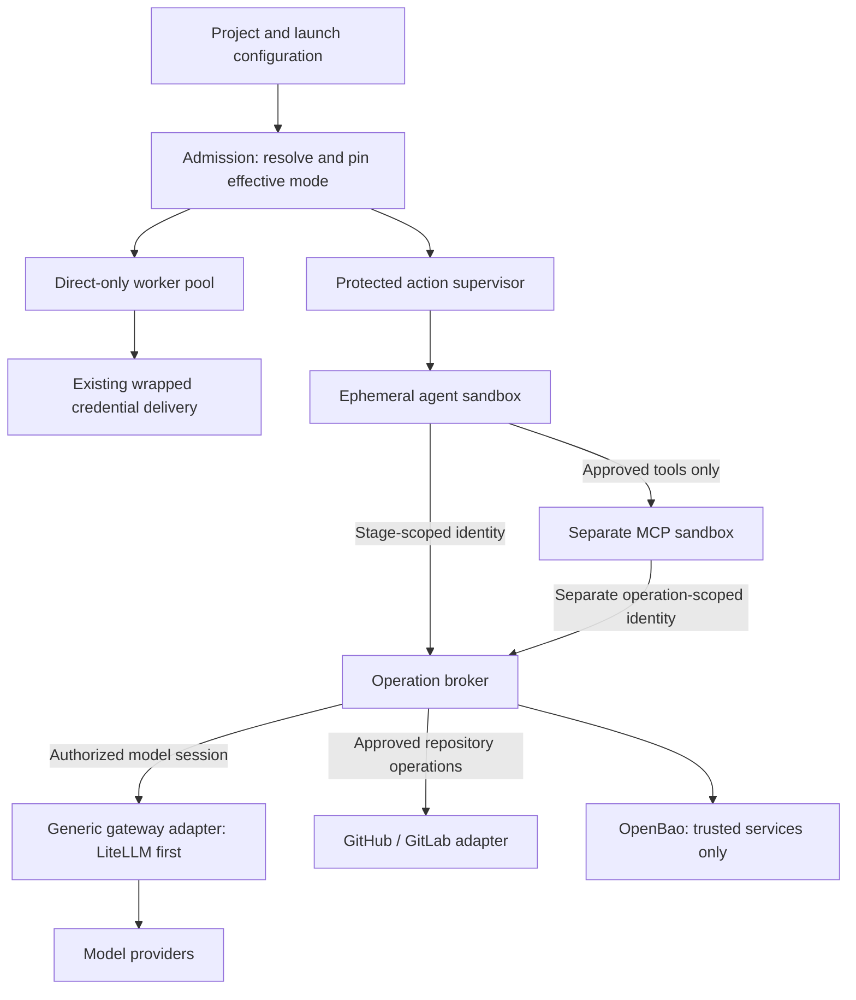

# Direct and protected execution modes

Date: 2026-11-07. Status: **design approved by the user on 2026-11-07; not implemented**.

User-selected direction: retain direct execution and introduce a separate protected
execution mode. This document extends the [generic LLM gateway plan](2026-10-30-litellm-integration-plan.md)
and its [test strategy](2026-10-30-llm-gateway-test-strategy.md), rather than creating
another competing gateway integration. Existing gateway epic #39 and its issues
remain the gateway backlog; reconcile their current status before creating issues.

## Outcome and current baseline

Allow a project to choose flexibility or stronger credential isolation explicitly.
Protected execution must keep upstream model and source-provider credentials out
of the worker, generated code, CLI agent and MCP execution environments. Authorization
is enforced by trusted services rather than prompt instructions.

Today Compose can start LiteLLM, but this checkout does not route worker inference
through it. `worker/model_client.py` constructs the provider client directly;
`worker/cli_agent.py` supplies model keys to CLI subprocesses and performs Codex
login. OpenBao currently delivers wrapped credentials that a shared worker unwraps
at action startup. That improves secret storage and transport but still exposes
plaintext within the worker. Neither optional LiteLLM startup nor OpenBao wrapping
alone establishes protected execution.

The local OpenBao bootstrap, documentation and CA forwarding changes are currently
uncommitted in this checkout. Land/rebase that prerequisite separately before
implementing this proposal. Do not modify live data, worker ownership, credentials,
provider routes or Docker services while preparing the plan.

## Approaches and choice

| Approach | Benefit | Trade-off |
| --- | --- | --- |
| Require protected execution globally | Uniform guarantees | Removes direct-provider and unqualified CLI flexibility |
| Separate direct/protected modes | Explicit guarantees while retaining existing integrations | Two execution contracts and qualification matrices |
| Best-effort proxy with automatic direct fallback | Fewer visible outages | Silently breaks credential isolation; rejected |

The user chose separate modes. Recommended implementation choices below remain
implementation choices within the approved design; adapter details are pinned in the implementation plans.

## Mode and policy semantics

| Property | `direct` | `protected` |
| --- | --- | --- |
| Provider credential delivery | Existing explicit OpenBao-backed delivery | Upstream values stay in trusted broker/gateway services |
| Model calls | Direct SDK/CLI; approved gateway routes may also be selected | Qualified gateway route only |
| Repository access | Existing provider adapters and scoped credentials | Brokered, authorized repository operations only |
| Worker fleet | Direct-only pool capacity | Protected-only capacity with qualified sandbox and network controls |
| MCP | Existing configured tools; do not imply isolation | Explicit server/tool approval and separate sandbox identity |
| Unsupported adapter/runtime | Existing behavior | Reject admission with an actionable explanation |
| Gateway/broker outage | Route-specific bounded failure | Fail closed; never switch to direct mode |

Proposed first-release configuration:

- Projects have `default_execution_mode: direct | protected`; migrate existing
  projects to `direct` without changing current runs.
- A project also has `minimum_execution_mode`, default `direct`. Setting it to
  `protected` disallows direct launches. Treat this as a security policy; changes
  require the configured administrator authorization boundary and an audit event.
- Workflow launch configuration can request a mode. Omission selects the project
  default. The server resolves it against the project minimum and deployment
  policy before accepting a run. Clients cannot weaken these policies.
- Pin the effective mode, policy revision, route/connection revision, repository
  binding, tool policy and qualified runtime target in the immutable launch snapshot.
  Child/follow-up runs inherit at least the parent's protected minimum. Replays
  retain their pinned mode; changed policy may reject them, never silently downgrade.
- Ordinary policy/default changes apply to new admissions, including newly admitted
  follow-up runs and replay attempts. Already admitted runs, including queued
  assignments and their later stages, retain their pinned mode and authority.
  Before tightening a minimum, the UI shows how many admitted direct runs remain
  authorized. Emergency revocation/cancellation is a distinct explicit operation:
  cancel affected queued/running assignments, invalidate their broker capabilities
  and prevent further dispatch. An already accepted provider request may finish.
  Record both policy changes and emergency actions; never imply that changing a
  default itself terminates existing execution.
- No per-stage downgrade in version one. A protected workflow uses protected
  execution for every credential-bearing stage. A later mixed-mode feature would
  require a separate design and explicit UI semantics.
- Show mode and qualification failures in project configuration, workflow launch,
  run inspection and worker-pool pages. Clearly label direct execution as allowing
  provider credentials in trusted worker processes. Mode selection is a guided
  form, with advanced policy details grouped separately.
- Do not use existing broad Control Pane access as proof of administrator identity.
  If multi-user/RBAC support is not yet available, use the existing authenticated
  deployment administrator boundary; do not expose policy weakening to future
  project-member roles. Verify current auth implementation before schema/API work.

## Architecture and authority boundaries

The protected supervisor is trusted infrastructure, not an agent tool. It owns
leases, sandbox lifecycle and credential-free completion receipts. The sandbox
never receives the supervisor's worker registration/lease credentials, controller
OpenBao token, wrapping tokens for upstream values, container-management access or
provider credential files. Keep control-channel and model/tool identities separate.

The operation broker owns run/project/assignment authorization and revocation.
External adapters own protocol behavior. Sandbox adapters own process, filesystem,
network and lifecycle isolation. Business stages must not import LiteLLM management
APIs, Docker clients or OpenBao clients.

### Scoped identities, not reusable provider keys

Issue short-lived identities bound to project, run, stage, attempt, approved service,
operation set and expiry. Authenticate an audience as well as identity; a model
identity cannot authorize repository or MCP operations. Check active authority on
each request, with bounded caching/invalidation documented before release. An opaque
capability stored hashed server-side is a viable initial mechanism; token format
is an implementation choice, not permission to omit revocation.

The sandbox can steal its own scoped identity if compromised. Protect against
misuse by validating server-side operation scope, repository/ref, allowed model,
request size, concurrency, request count and token allowances, not by assuming the bearer
will behave. Handle renewal through the trusted supervisor and current assignment
lease. Cancellation/revocation prevents new requests; document that an upstream
request already accepted may still finish or incur cost.

### LLM gateway integration

Reuse the existing gateway connection/route proposal. Separate inference transport
from gateway administration and capability discovery. LiteLLM is the first adapter;
a second implementation must pass the same semantic conformance suite.

Prefer a Flumic model-session facade in front of the gateway: the sandbox presents
its stage identity; the facade checks policy and forwards through an approved
connection. Provider keys and gateway administration keys stay outside the sandbox.
Do not assume LiteLLM virtual keys alone provide immediate stage cancellation or
hard concurrent budget enforcement. Qualify those semantics or enforce them in the
facade. First-release hard stage limits are request count, concurrency and qualified
input/output token allowances with atomic reservation before dispatch. Require a
bounded maximum output and a qualified input-counting method; reject a protected
route that cannot enforce these limits. Do not return reserved allowance after an
uncertain response until reconciliation establishes what was consumed. Monetary
usage remains measured/reconciled; gateway project-dollar budgets are explicitly
labeled according to their qualified semantics, without promising a hard stage-USD
ceiling. Hard monetary reservations are a separate follow-up, consistent with the
existing gateway plan's deferral. This is a proposed scope choice for review.
Never retry uncertain inference automatically without accounting for possible
upstream execution and double charging.

Support SDK transport first. Qualify Codex and Claude separately for endpoint,
protocol, authentication and model alias compatibility. A gateway token that a CLI
requires may be exposed to its sandbox environment, but it must be only the scoped
facade identity. Prevent login from persisting upstream provider credentials.
Incompatible CLI versions stay direct-only; do not advertise protected support
until their real subprocess paths pass qualification.

### Repository broker

Expose typed operations, not a general HTTP forwarder or arbitrary Git command:
read pinned source, retrieve issue/PR context, publish a prepared patch to an
execution-owned branch, and submit/update the authorized PR or MR. Inventory the
actual built-in operations before finalizing the port.

The trusted broker resolves the source credential from OpenBao. Enforce provider,
repository identity, canonical resource claim, allowed refs and non-forced update
rules. Validate patches and paths, preserve existing cursor/idempotency semantics,
and reject arbitrary destinations, credential helpers and caller-supplied auth
headers. Return source/artifacts and redacted structured results without provider
tokens or authenticated remote URLs. Keep GitHub and GitLab adapters replaceable.

### Sandbox and MCP isolation

Provision fresh action identities, process namespaces, workspaces and homes; remove
them after completion/cancellation. No host PID namespace, Docker socket, privileged
mode, controller state, other action homes or credential-bearing shared caches.
Run non-root with bounded resources, dropped capabilities, no privilege escalation,
core dumps disabled and an appropriate seccomp profile. Disable automatic service
account token mounts unless specifically required by the trusted supervisor.

MCP servers run outside the agent sandbox, with an explicit environment allowlist,
server/version approval, tool allowlist and independently scoped broker identity.
They receive no inherited agent/provider environment or agent home. Remote MCP
servers are external trust boundaries: configure explicit authenticated connections
and do not pass through unrelated tokens. Disallow unreviewed repository-provided
MCP configuration in protected mode.

Network policy must be enforceable, including DNS, IPv6, host gateways, metadata
endpoints, redirects, proxy CONNECT and alternate provider hosts. The sandbox may
reach only approved broker/tool endpoints; the broker validates destinations too.
Do not assume a Docker bridge enforces egress policy. Qualify a dedicated sandbox
network/egress implementation on a disposable Docker environment first; qualify
Kubernetes with enforcing network policy separately. If the target cannot prove
these controls, protected admission is unavailable on that target. Direct remains
available only when explicitly allowed and selected.

## Threat model and limits

Protect against generated malicious code, prompt-injected shell/tool actions,
malicious MCP implementations and accidental child-process credential inheritance.
Assume trusted broker/supervisor, OpenBao, gateway administration and runtime host.
Host-root, kernel, broker or OpenBao compromise is outside this isolation guarantee.
For mutually hostile tenants use stronger host/VM isolation, not only containers.

Protected mode prevents delivery of upstream provider credentials to execution;
it cannot prevent all misuse of permitted operations, exfiltration of source via
permitted model/tool channels or exploitation of a provider. Tight operation
policies and data classification remain necessary. Logs, model prompts, crash
artifacts and retention need independent redaction and access controls.

## Delivery sequence and acceptance gates

Deliver one reviewed PR at a time, with documentation and tests in each slice:

1. **Mode contracts and admission.** Project defaults/minimum, immutable run pins,
   pool capability declarations, UI labels, migration preserving direct behavior,
   admission-only policy changes and separately authorized emergency revocation.
   No protected runs admitted until required capabilities are genuinely available.
2. **Generic gateway sessions.** Implement the existing gateway plan's transport,
   project bindings, attribution and scoped model-session facade. SDK conformance
   and deterministic gateway E2E tests; no automatic direct fallback.
3. **Repository operation broker.** Port built-ins to typed broker calls; preserve
   resource claims, replay recovery, pinned source and repository authorization.
4. **Protected sandbox target.** Separate supervisor and disposable agent runtime,
   enforce credential-free mounts/environment plus qualified egress. Enable a
   narrowly supported protected SDK workflow only after end-to-end qualification.
5. **CLI and MCP qualification.** One adapter/server family at a time; isolated
   homes, endpoint configuration, environment inheritance and malicious tools tested.
6. **Kubernetes and operator rollout.** Qualify native runtime adapters and policy
   prerequisites, then add guided configuration, diagrams, screenshots and a
   walkthrough for selecting modes, failures, monitoring and recovery.

Do not delay all gateway functionality until every isolation target exists:
explicit direct-mode gateway routing can ship earlier, without protected claims.
Do not expand this effort into unrelated orchestration/storage rewrites.

## Test strategy

Use existing backend/worker/frontend suites and extend the gateway test strategy.
Each slice starts with a failing behavior test and ends with focused validation,
code review and a separately reviewable commit/PR. Publish coverage of changed
security modules and inspect missing branches; a percentage alone is not acceptance.

Required negative and lifecycle cases:

- Unknown mode, forbidden downgrade, tampered snapshot, cross-project or wrong
  audience identity, expired token, cancelled lease, unauthorized ref/model/tool.
- Admission/runtime capability mismatch, target changes, container/image restart,
  broker/gateway outage: no direct fallback or plaintext context delivery.
- Concurrent request/token reservations, request retries, lost response, reconciliation,
  cancellation races and provider-side request completion after cancellation.
- Policy tightening leaves admitted run pins unchanged; new incompatible launches
  and replays fail, follow-ups resolve current minimums, and explicit emergency
  cancellation revokes future dispatch and capability use for affected runs.
- Seed distinctive fixture credentials only in trusted services. Malicious code
  inspects environment, process metadata, mounts, homes, logs, artifacts and child
  processes/MCP environments; assert upstream fixture values never reach them.
- Attempt direct provider/OpenBao access, metadata-service access, DNS/IPv6/proxy
  bypass, cross-sandbox mounts and controller/worker identity theft.
- Try abusing a stolen sandbox capability: permitted scope is usable, but another
  repository, stage, audience, model, revoked assignment or exceeded budget fails.
- GitHub/GitLab patch publication replay and concurrent ref updates preserve
  current safety contracts; never force push unrelated changes.
- Real CLI subprocess tests with deterministic model fixtures, plus isolated MCP
  server tests. Mocks alone cannot demonstrate credential or network isolation.
- Full disposable Compose E2E: project to issue to protected workflow to brokered
  source mutation to usage history; counterpart direct flow remains compatible.
- Qualify Kubernetes independently. Missing runtime/egress prerequisites must be
  visible and deny protected admission, not silently skip a release gate.

CI should require deterministic tests for relevant changes; real-provider smoke
runs remain explicit and cost-bounded. Use fixture identities, no real credentials
or live repository mutations in default CI. Preserve project/run/stage/attempt
correlation, human-readable timestamps and logical-call versus billable-attempt
accounting without recording scoped identity values.

## Source seams for the implementation plan

| Existing area | Planned responsibility |
| --- | --- |
| `app/database.py`, migration versions | Project policy revisions and immutable effective-mode/route pins |
| `app/project_context.py`, `app/worker_pools.py` | Mode-dependent delivery; deny upstream secret delivery to protected execution |
| `app/workflow_definitions.py`, `app/workflow_runs.py`, `app/trigger_runtime.py` | Validate and pin modes consistently for manual, triggered and follow-up runs |
| `factory/workflows/contracts.py`, `actions.py`, `coordinator.py` | Typed policy/session handles; no vendor SDKs in workflow coordination |
| `worker/model_client.py`, `worker/cli_agent.py` | Separate task semantics, transport and sandboxed CLI session construction |
| `app/ports.py`, `runtime_router.py`, Docker/Kubernetes adapters | Explicit sandbox capabilities and target qualification |
| `app/job_broker.py`, existing repository application/adapters | Reuse lifecycle and claim semantics without exposing privileged job credentials |
| `factory/shared_worker.py` | Trusted supervisor path; no action execution with its own control identity in protected mode |
| Frontend project configuration, workflow launch, pools and run inspection | Guided mode selection, route readiness, status and limitations |

Introduce focused modules for policy resolution, capability issuance, model
sessions, repository operations and sandbox lifecycle as their slices require
them. Exact names and signatures belong in the implementation plan after design
review; do not add a generic plugin framework or broad refactor as a prerequisite.

## Approved scope and implementation handoff

The user approved the separation of modes and these choices: project defaults plus
minimum policy, no per-stage downgrade, dedicated protected capacity, brokered
upstream access and capability-gated runtime availability. The following detailed
implementation plans should be separate but linked: mode/admission, generic model
sessions, repository broker, sandbox/MCP qualification. Existing generic gateway
work stays under its original backlog with new security dependencies attached.

The task-by-task [delivery plan](../superpowers/plans/2026-11-07-protected-execution.md)
splits this design into mode/admission, model broker, repository broker and
sandbox/MCP plans. The task plans are ready for review; implementation has not started.
