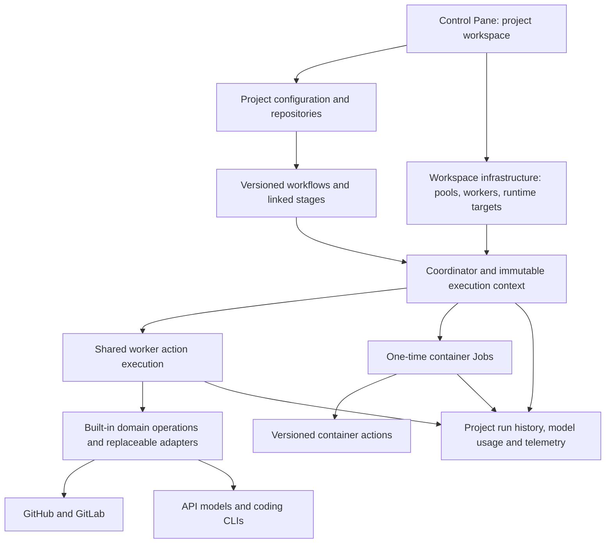

# Retire the legacy runtime and its data

Status: approved by the user; implementation in progress. Retired worker database
history and positively identified local filesystem data have been archived and
removed. Remaining code/schema retirement is still in progress.

Builder check: an independent reviewer read this design on October 30, 2026 and
reported no important unanswered questions before implementation planning.

## Intent and approved scope

Flumic has one execution model: project-owned workflow definitions dispatch
versioned actions to authorized shared worker pools or one-time container Jobs.
Remove the previous repository-bound, profile-based worker runtime and the
duplicate operator surfaces that supported it.

The user selected **remove legacy code and history; preserve current project**.
Take a backup before deleting the retired runtime's history. Preserve the Default
project, its current configuration, repositories, credentials, workflows and
completed project runs. This is not a workspace reset or a replacement of the
Docker, Kubernetes, Hatchet, GitHub, GitLab or direct model-provider adapters.

## Approaches

1. **Remove retired code and retired history, preserving current project data.**
   This is the selected approach. It removes the duplicate execution model and
   obsolete history while keeping the working installation and its project runs.
   It requires explicit dependency checks and a guarded local cleanup.
2. Remove retired code but keep legacy history in an archive viewer. This would
   preserve historical browsing but require maintaining compatibility readers and
   confusing duplicate history semantics. The user chose deletion instead.
3. Reset all storage and bootstrap a new installation. This is rejected because
   it destroys the current project, configuration and completed runs.

## Verified starting point

Inventory taken from local PostgreSQL and Docker on October 30, 2026. Counts are
observations, not predicates authorizing future deletions; re-inventory at apply.

| Resource | Observed | Treatment |
| --- | --- | --- |
| Default project | 1 | Preserve |
| Repository connection | 1 | Preserve, including revisions and credentials |
| Project workflow definitions | 4 | Preserve, including revisions and launch pins |
| Completed project runs | 4 | Preserve, including attempts and artifacts |
| Running shared workers | 2 | Preserve identities, pools, credentials and mounts |
| Shared worker execution events | 99 | Preserve |
| Retired worker records | 4 | Remove after checks and backup |
| Retired worker execution events | 56,007 | Remove by verified retired worker IDs |
| Conversations joined to retired events | 2 | Remove with those events |
| Retired lifecycle operations | 35 | Remove with retired workers |
| Saved worker profile revisions | 22 | Retired launch configuration; inspect references before removal |
| Factory configuration revisions | 7 | Preserve; current project execution depends on them |
| Compiled worker snapshots | 16 | Remove only when unreferenced by retained data |
| Assignments referencing retired workers | 0 | Must remain zero at cleanup |
| Active project runs | 0 | Require a quiescent execution window for apply |

All execution events already carry the Default project ID, including old ones.
**Never delete events by project ID, age, workflow name or missing attribution.**
The four retired worker IDs and their observed states are:

- `ea40d2ed-463b-4c0f-a8c0-010004d610bf`: `analyst-1`, stopped.
- `040f0dce-96d1-4fe4-9ef0-1b1b2d2695ba`: `dev-1`, stopped.
- `e3dce3c9-c381-4393-8355-1034a5c6ae2f`: `factory-simple-2`, removed.
- `1bb04861-fa35-40bf-b049-6b21bcbbf625`: `factory-developer-2`, removed.

The two Docker containers still present for this retired fleet are `analyst-1`
and `dev-1`; both are stopped. The current workers are `default-simple-1` and
`default-developer-1`, both using `shared-v1`.

## Architecture after removal

Keep the existing action invocation, immutable context, assignment lease,
idempotency, project isolation and runtime target contracts. Domain operations
remain reusable behind the existing action interface. Do not introduce a new
runtime abstraction simply to replace the deleted one.

### Worker composition

- Make the worker entry point shared-only. Explicit retired/unknown protocols
  must fail with a helpful error; a missing protocol must never launch static
  workflows. Choose the existing shared protocol as the sole supported mode.
- Remove static Hatchet workflow registration, legacy dispatch, the static local
  runner and environment-bound `build_service` composition. Keep `action_service`,
  `run_builtin`, action catalogs and the shared coordinator/action registrations.
- Extract Hatchet client construction into a small transport module before
  removing the static orchestration module: shared workers and connectivity
  checks currently import its `create_client` function.
- Remove repository-global SQLite state and provider-specific wrappers used only
  by that runtime. Preserve `ExecutionStateStore`, project state/claims and
  `OperationBusy`; relocate shared imports to their current owner where needed.
- Remove managed legacy bootstrap/config download and ingest publishers. Preserve
  shared history delivery, model recording, redaction, pricing and retry behavior.
  `ControlObserver` is currently reused by shared execution; extract its useful
  recording behavior rather than deleting the entire module on name alone.
- Keep application use cases, repository clients, direct API/CLI model adapters,
  safety checks and credential isolation. Rewrite valuable tests that currently
  reach these through a static worker; delete tests only for removed behavior.

### Configuration

Factory revisions, role-specific behavior defaults, models, labels, prompts,
limits and the settings compiler are **current project configuration**. Retain
their values and immutable revisions. The effective precedence remains project,
repository, workflow and stage, with immutable execution snapshots.

Remove legacy worker launch profile CRUD, `worker_configurations` storage and
compiled worker-specific launch snapshots when no retained references exist.
Separate project settings routes from `worker_configs.py` before deleting that
module's retired responsibilities. New project/bootstrap code must not repopulate
retired saved worker profiles on startup. Bootstrap defaults may still be loaded
from the repository for a fresh project.

Remove runtime selectors that exist only for static launch, such as global
SQLite persistence and static orchestration selection, from new editable config
and examples. Do not mutate the ciphertext, digest or document of an existing
immutable run pin or revision just to remove an old key. Historical pins may
contain inert old fields; the reader must continue to validate and execute
retained supported action contexts. A narrow normalization at the configuration
reader is acceptable for retained documents; it must not restore static runtime
behavior. Record the new configuration contract and rejection behavior in docs.

### Control Pane backend

- Remove legacy worker creation, per-worker configure/bootstrap and legacy ingest
  endpoints. Shared worker creation remains under worker pools.
- Keep operator authentication, audit, workspace worker observation and shared
  lifecycle start/restart/stop/remove. Simplify Docker/reconciler branches to
  shared workers without weakening ownership, target snapshots, operation fencing
  or Kubernetes resource claims.
- Remove static engine workflow controls and their operation records. Project
  workflow launch, stage controls, scheduling/follow-ups and run inspection remain.
- Remove legacy repository takeover/draining checks after the static writers have
  been shut down. Preserve external resource claims, repository validation and
  authorization used by project execution. Existing project activation remains
  intact; new repository onboarding must not ask about legacy workers. Inspect
  current trigger/launch consumers before removing an execution-mode table.
- Project-owned read/write interfaces require a project path; remove accidental
  fallback of unscoped project requests to Default. Keep genuinely workspace-wide
  interfaces such as health, auth, pools, runtime targets and shared lifecycle.
- Retired API paths return an explicit failure (404 or 410), never silently map a
  legacy write into a new project action. Refresh the generated API reference.

### Control Pane frontend

- Make Projects the workspace landing page. Outside a project, navigation shows
  Projects and infrastructure controls for shared workers, pools and runtime
  targets. Infrastructure is not labeled legacy.
- Remove duplicate unscoped overview, static workflows, run history, model history,
  cost, configuration and prompt pages. Preserve their current project versions.
- Do not delete shared presentation components merely because a legacy page used
  them. Keep run inspector, logs, model exchange viewer, usage summaries and human
  readable timestamps within projects.
- Remove legacy profile worker forms and takeover acknowledgment UI. Shared
  workers are provisioned from pools, with clear links from project membership.
- Old browser links show a helpful retirement message or navigate to Projects
  without interpreting an old engine run ID as a project run ID. Legacy writes
  are never redirected or replayed.

### Deployment and documentation

Remove the static fleet `compose.yaml`, static worker telemetry overlay, old
compatibility Compose alias, legacy start/observed-worker scripts, static issue
event scripts and their `just workers-up` / `just issue-send` recipes.

Keep explicit worker image builds and Control Pane, database, gateway, monitoring
and resource metrics deployment files. Both worker image variants still serve
shared pools. Keep `worker-network` and runtime targets. Check every retained
shell script, fixture, Dockerfile COPY and CI command for deleted path references.

Update README, quick start, walkthrough, deployment, architecture, configuration,
workflow cookbook and generated API docs to describe only current supported
usage. Update screenshots where the visible UI changed. Preserve old ADRs and
historical design documents as historical decisions, with a retirement notice
where needed; do not rewrite history to imply the static runtime never existed.
Record the retirement as an ADR during implementation.

## Guarded data cleanup and deployment

### Backup and preservation manifest

An online backup was taken before implementation at
`~/.codex/backups/flumic-legacy-retirement-20261030T203157Z`. It contains a custom
PostgreSQL dump, application filesystem archive and private configuration files.
Its archive catalog was checked. This is an initial recovery point, not a claim
that a live filesystem copy is transactionally consistent with PostgreSQL.

Before actual cleanup, pause new admissions and background writers, drain current
assignments and briefly stop affected Control Pane/shared worker processes without
removing identities, then take a final quiesced backup. Do not restart removed
legacy workers at any point. Verify a restore of the final database dump into an
isolated temporary database before deleting live rows. Remove that temporary
database after verification.

Build a private preservation manifest from the live state: exact project,
repository, credential, configuration, definition, run, attempt, assignment,
context and shared worker identities; immutable document/ciphertext hashes;
project event/conversation IDs; memberships and pool profiles. Do not print secrets
or captured conversations. Compare before/after retained logical rows, not entire
database bytes or routine session/heartbeat timestamps.

### Database cleanup interface

Provide one maintenance command with `inspect`/dry-run and explicit apply modes.
It emits a manifest with identities and counts, validates the backup and expected
manifest at apply time and runs deletion in one database transaction under the
same serialization discipline as worker lifecycle/workflow transitions.

Deletion predicates are based on stored `protocol == legacy`, explicit approved
worker IDs, stopped/removed state and absence of live/pending work. Abort if:

- the target set changed, any target restarted or has pending/running operations;
- any retained assignment, runtime binding or project execution references a
  target worker or a candidate configuration snapshot;
- any target event has assignment/execution attribution that might belong to a
  current project execution;
- run/admission quiescence cannot be established or the backup cannot be verified.

Within the transaction remove conversations joined by ID to approved retired
events, those events, retired lifecycle records and the retired worker rows.
Remove legacy static workflow-control operation rows after verifying they are not
project workflow actions. Remove retired worker profile records and compiled
snapshots only after checking all typed and serialized retained references. Keep
all factory revisions and their ancestry. Unknown or orphan conversation records
are not inferred to be legacy; use explicit provenance or leave them for existing
retention. Preserve operator audit history and add a redacted cleanup audit entry.

The command must be idempotent after successful apply. It is an operator task,
not a startup hook. Normal startup/migration must not wipe history on another
installation implicitly.

### Schema migration

Keep existing Alembic history for upgrade and fresh-install paths. Add a forward
migration removing exclusively retired tables/fields and constraining worker
protocol defaults to shared-only. It must fail with actionable instructions if
retired rows remain; it must not silently purge them. On a fresh database the
historical migrations create empty retired tables, so the forward migration can
remove them without a manual cleanup step. Preserve columns and wire fields still
needed by current records; schema tidiness does not justify breaking project pins.

Run guarded cleanup with the old schema present, then migrate/deploy the new code.
This offline rollout avoids old code writing retired data between cleanup and
upgrade. Document full-dump restore as rollback for data deletion; downgrade must
not claim to reconstruct deleted history.

### Local filesystem and Docker cleanup

Use a separate explicit resource manifest after the database transaction. Remove
only retired containers matched by their stored identities and runtime ownership;
verify their stopped state again. Archive then remove the retired worker snapshot
subtrees, legacy control-spool directories and old SQLite file plus sidecars if
unreferenced by every current mount/process. Resolve symlinks and enforce that
each path is inside an approved root. Never recursively delete `data` or `shared`.

The canonical checkout's `data` is actively used through symlinks by the live
planning worktree. Keep `data/control-plane/postgres-host`, current shared-history
spools, pricing files, all private encryption configuration and the live source
worktree. Do not prune Docker volumes/images/networks or unrelated worktrees.
Keep existing rollback images and private backups for recovery.

Hatchet and SigNoz are shared infrastructure. This cleanup removes Flumic's old
Control Pane history and retired registrations/containers it owns; it does not
delete tenant-wide engine history, ClickHouse data or shared telemetry stores.
External historical traces expire under those services' retention policies.
If API support permits disabling a provably retired scheduled registration, do
so by exact verified identity, never workflow-name prefix matching. Abort rollout
if a retired registration can still dispatch to a legacy writer. No issue labels,
branches, PRs or GitHub/GitLab artifacts are deleted.

## Verification and acceptance

1. Migration tests cover a fresh database, an upgraded database containing retired
   records, refusal before cleanup, successful cleanup/migration and rerun.
2. Cleanup tests use mixed current/retired records within the same Default project;
   current data hashes are unchanged, historical target rows disappear, and all
   refusal cases are tested. PostgreSQL integration exercises transaction and
   foreign-key behavior, not only SQLite substitutes.
3. Shared worker registration, assignment/lease fencing, credential scoping, built-in
   action execution, follow-ups, history ingest and worker lifecycle remain tested.
   Preserve GitHub/GitLab behavior and Docker/Kubernetes Job contracts.
4. Frontend tests cover Projects landing/navigation, infrastructure provisioning,
   project isolation, absent legacy creation controls and readable run/model logs.
5. A no-paid-model end-to-end workflow using `core.echo@1` proves project launch,
   pool dispatch, completion, run inspection and history after the upgrade.
   Complete the local qualification without altering the four retained runs.
6. Worker/backend unit suites, PostgreSQL contracts, frontend tests/build, Compose
   deployment contracts and docs build/link/reference checks pass. Static searches
   find no executable legacy entry points or stale supported-usage examples.
7. Post-rollout local inspection proves preserved project identities, revisions,
   four completed runs, retained shared history and healthy shared workers. New
   startup does not recreate retired profiles, workers or history.

Implementation details such as exact module names, test fixtures and batching
are left to the builder. Breaking changes must be clearly listed in release and
upgrade documentation; no general-purpose plugin framework or gateway integration
is added as part of this retirement.
