# Flumic AI walkthrough: from a new project to monitoring

This walkthrough is for a technical developer using the **project workspace** in
the Control Pane. Follow the numbered steps in order. Sign in with your installation's administrator account to follow the setup steps.

## Understand the connections first

A **repository connection** identifies where code and issues live. A **workflow**
defines the work as stages. A **pool** declares which capabilities may execute
those stages; running **workers** supply the capacity.

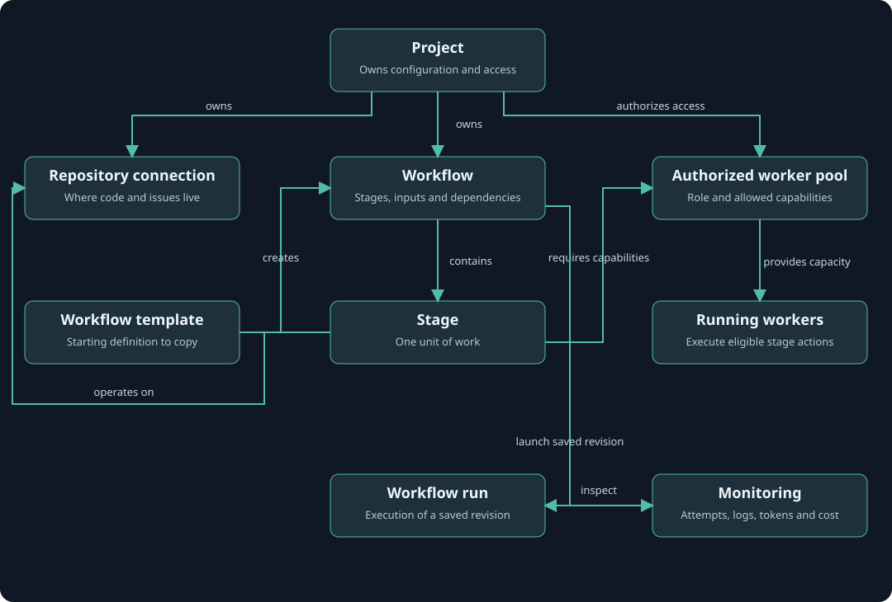

A **workflow template** is a starting definition for an editable workflow.
**Target repository** means the repository the created workflow operates on,
not a template repository to clone.

Read [the concepts and stage guide](workflow-concepts.md) for the glossary,
stage inputs/outputs and an example of sharing workers between projects.

| Part | Steps | What you learn |
| --- | --- | --- |
| Connect | 1–5 | Project, credentials and repository connection |
| Provide capacity | 6–9 | Pools, project authorization and running workers |
| Define and prove | 10–12 | Link two stages, run them and inspect attempts |
| Run an AI change | 13–16 | Create workflows from templates and launch an issue |
| Observe | 17–19 | Results, model calls, cost and recovery |

You will reach two milestones:

| Milestone | What you prove | Effects |
| --- | --- | --- |
| A: first workflow | Project setup, shared capacity, stage dependencies and run inspection | Two deterministic echo stages; no model calls or source-host writes |
| B: first AI change | Issue → planning → implementation → review, with feedback/verification follow-ups | Real repository writes and billable provider calls after explicit launch |

Then you will inspect stage logs, model history, usage and optional SigNoz traces.
This is a guide to perform yourself, not a report that these live scenarios have
been executed. Screenshots show an existing local Default project as examples;
your new project initially has no runs or accounting records.

## Before you start

Prepare an initialized **disposable GitHub repository** with a default branch and
source/tests you understand. Use your own `OWNER/REPO`; do not copy the repository
name visible in screenshots. GitLab.com is also supported, but follow the
[GitLab-specific setup](gitlab.md) for credentials, numeric identity and CI policy.
This walkthrough uses GitHub to keep one consistent path.

You need Git, Python 3, Docker, the `docker-compose` command used by the launchers,
a reachable Hatchet instance and its `development` CLI profile. For milestone B,
you also need a repository-scoped GitHub token and provider credentials for your
selected planner/reviewer/coding backend. Use the exact prerequisites in the
[README quick start](../README.md#1-prepare-your-environment).

Install `just` (for example, `brew install just` on macOS). Run `just` at the
repository root to list shared shortcuts. Their underlying scripts remain
available for environments without `just`; see the [command table](../README.md#command-shortcuts).

From the repository root, prepare your private environment and start the control
services using the quick-start instructions, then:

```sh
just control-up api reconciler dynamic-runtime
```

**Checkpoint:** `http://localhost:3400` opens. API, PostgreSQL, reconciler and the
dynamic runtime must be available; a functioning UI alone does not establish that
Hatchet handlers or shared workers are registered. This launcher builds images
but does not restart existing managed workers. Keep all control services on the
same runtime namespace and deployment configuration.

**If blocked:** inspect control-service startup logs and Hatchet connectivity
before creating more workers.

## 1. Sign in and open Projects

1. Open `http://localhost:3400`.
2. Sign in with `CONTROL_ADMIN_PASSWORD` from the private `.env.control-plane`.
3. Open **Projects** in the workspace sidebar.

The password and encryption key are private deployment credentials. Do not put
them into workflow YAML, issue text, screenshots or source control.

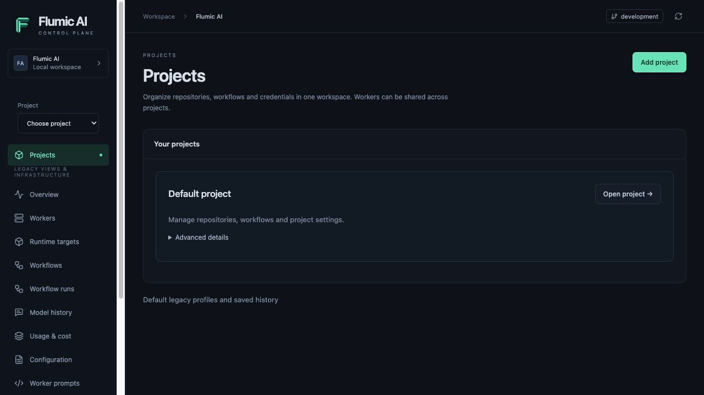

**Checkpoint:** you see existing projects and **Add project**, not an always-open
creation form. If the UI differs, confirm that the frontend and backend were
built from compatible current source and refresh the page.

## 2. Create your project

1. Click **Add project**.
2. Enter **Project name**: `Walkthrough`.
3. Expand **Advanced: project key** if needed. Use key `walkthrough`, or a unique
   key if it already exists. The key is generated from the name.
4. Click **Create project**.
5. Confirm **Walkthrough** is selected in the Project selector.

**Checkpoint:** the sidebar contains this project's Overview, Workflows, Workflow
runs, Model history, Usage & cost and setup pages. **All projects** returns to
workspace infrastructure navigation. The URL contains the project UUID,
not the human-readable key. The guided forms select the project and repository
without requiring you to copy that UUID.


The screenshot's populated Default project is illustrative; your overview should
start empty. If creation reports a duplicate key, choose a different key rather
than assuming an existing project is yours to change. Cancel discards the draft.

## 3. Save a source credential, or defer it for the echo test

**Milestone A can skip this step.** Echo does not contact GitHub. Milestone B must
complete it before saving a connection that will be used for repository actions.

1. In the selected project, open **Credentials → Add credential**.
2. Enter **Credential name**: `walkthrough-github`.
3. Set **Purpose** to `github` and **Credential repository** to **Whole project**.
   This lets you reference the credential while creating the connection next.
   It still belongs only to this project; use a provider token restricted to the
   disposable repository.
4. Paste the GitHub token into **Secret value**.
5. Click **Create credential**.

For the GitHub workflow, the token needs Contents, Issues and Pull requests
read/write, plus Checks and Commit statuses read access. Account/repository policy
may impose additional approval requirements; grant only the required repository.

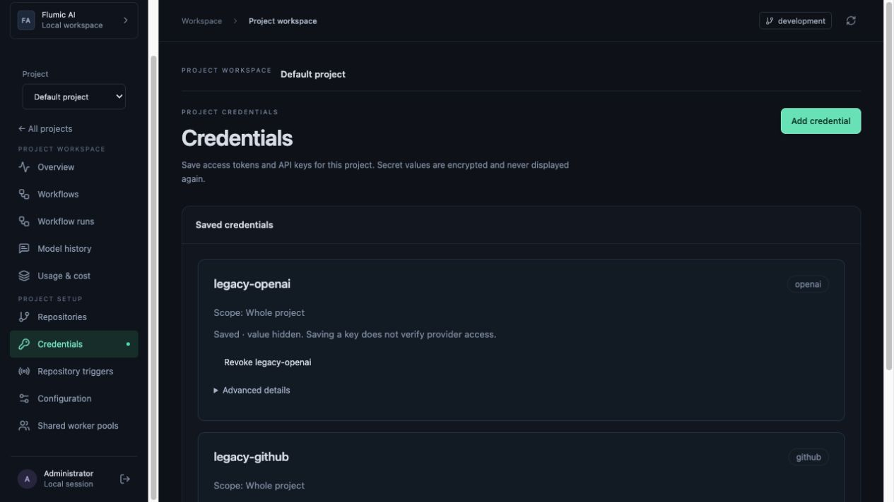

**Checkpoint:** a credential card appears; the secret value is not shown again.
Under **Advanced details**, its credential reference ID is available. Saving a
credential does not prove provider access. Cancel clears an unsaved secret.

## 4. Connect the repository

1. Open **Repositories → Add repository**.
2. Set **Source provider** to **GitHub.com**.
3. Enter **Repository alias**: `backend`.
4. Enter your actual **GitHub owner** and **Repository name**, separately.
5. Select `walkthrough-github` as the credential. For milestone A only, **No
   credential** is permitted; add one and edit/save this connection before B.
6. Leave **Advanced: behavior overrides** unchanged for now.
7. Click **Save repository**.

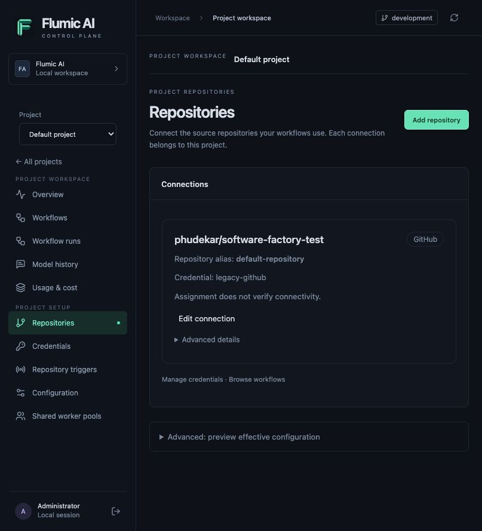

**Checkpoint:** the card shows your actual `OWNER/REPO` and alias `backend`.
Expand **Advanced details** to inspect the **Connection ID** if needed. This is not
its revision ID. Workflow stages use `backend`; guided forms resolve the connection IDs for you. Credential assignment does not verify access.

**If blocked:** check provider, owner/name and the credential's purpose/scope.
For GitLab, saving alone is insufficient: validate its saved numeric identity
using the provider-specific instructions. Do not rename the alias accidentally
while editing a credential or behavior override.

## 5. Review behavior settings before adding capacity

1. Open the project's **Configuration** page.
2. Review the existing configuration rather than replacing it with an empty JSON
   document. It includes worker behavior, tasks, labels and model settings.
3. For milestone A, leave it unchanged. Echo does not require provider models.
4. Before B, check the `simple` and `developer` profiles' models, coding backend,
   prompts, timeouts and output limits against your accounts and repository.

**Checkpoint:** know whether the developer profile uses direct API, Codex or
Claude. API/Codex require the appropriate OpenAI credential; Claude requires an
Anthropic credential. Planning/review use their configured adapters independently.
Do not paste a key into configuration JSON.

New runs resolve and pin saved settings. Saving does not hot-patch an existing
run or install code into a worker. Use the [configuration ownership map](configuration-control-plane.md)
and [prompt/adoption guide](prompt-quality.md) when making deliberate changes.

## 6. Review shared pool settings — UI

Open **Walkthrough → Shared worker pools**. A pool declares the role, action
versions and concurrency supported by its workers. A worker is a running process;
a project authorization grants access to a pool. These are three separate actions.

1. Review any existing pools before adding a duplicate. Pool names are unique
   across the workspace, and pools can serve several projects.
2. In **Configuration**, check the saved role profile's Hatchet transport setting.
   The Add pool form prefills it when available. Use the setting matching your
   deployment; do not disable TLS to resolve a connection failure.
3. Plan to use `simple` for echo/planning/review and `developer` for code changes.
   Each worker image must support the action/executor versions advertised by its
   pool. Selecting a capability does not install it.

**Checkpoint:** creating a pool will neither start workers nor authorize this
project. No Python or API session is needed for pool setup.

## 7. Create the simple worker pool — UI

1. In **Shared worker pools**, click **Add pool**.
2. Set **Pool name** to `walkthrough-simple` (or a unique name).
3. Select **Worker role → Simple — planning and review**.
4. Leave the role's built-in **Action versions** selected. Confirm `core.echo@1`,
   `issue.load@1`, `issue.plan@1`, `issue.triage@1`, `change.review@1`,
   `workflow.record@1` and `pull.verify@1` are included.
5. Leave **Normal slots per worker** at `2` and **Durable slots per worker** at
   `16`. These are per-worker concurrency limits, not worker counts.
6. Confirm **Hatchet transport** matches your saved deployment settings. Under
   **Advanced: executor versions**, keep `builtin@1` for this walkthrough.
7. Click **Create pool**. **Cancel** discards the form without creating anything.
8. On its new card, expand **Advanced pool details** and copy the **Pool ID** for
   the workflow YAML in step 10. Record the ID, rather than the pool name.

**Checkpoint:** the new pool appears with the expected role, actions, transport
and slots. It is not yet project-authorized and has no workers. If reusing an
existing pool instead, check all of these settings before authorizing it; a
matching name alone does not prove compatibility. A duplicate-name error leaves
the form open so you can choose a unique name. See the
[simple pool API example](examples/walkthrough/simple-pool.json) for the equivalent
request shape; it is reference material, not an additional setup step.

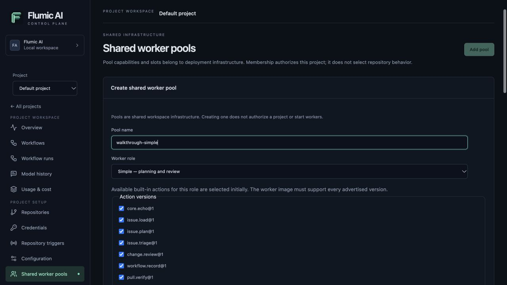

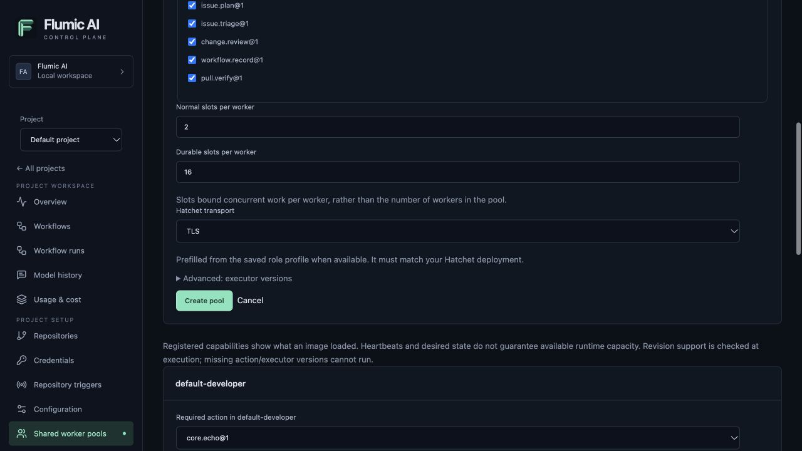

These show an unsubmitted example form in the existing Default project. They do
not indicate that a walkthrough pool was created or a worker started.

## 8. Authorize your project to use the pool — UI

1. In the Control Pane, select **Walkthrough → Shared worker pools**.
2. Find `walkthrough-simple` (refresh if necessary).
3. Click **Authorize project**, unless it already says **Project authorized**.
4. Check required action `core.echo@1` and executor `builtin@1`.

**Checkpoint:** the project is authorized. **No workers in this pool** is expected
until the next step. Eligible registered slots are a capability view, not proof
of free runtime capacity.

## 9. Create and start a shared worker — workspace UI

1. Click **All projects** to leave the project sidebar.
2. Open global **Workers → Add shared worker**.
3. Enter **Worker name**: `walkthrough-simple-1` (or a unique name).
4. Choose **Worker pool**: `walkthrough-simple`.
5. Choose the operator-approved Docker **Deployment target**, usually
   `local-docker`. Kubernetes requires its separate qualification guide.
6. Click **Create shared worker**. Wait for creation to finish.
7. On the new worker row, choose **Start worker**. Wait for its lifecycle
   operation and startup to finish.
8. Return to **Projects → Walkthrough → Shared worker pools**.

Use **Add shared worker** to provide capacity for the authorized pool.

**Checkpoint:** the shared worker has registered the required action/executor
versions, reports a recent heartbeat, and its runtime is running. A container can
be running without Hatchet registration; a stale registration does not prove a
live process. If the target or registration is unavailable, inspect startup logs,
Hatchet transport and image compatibility. Do not proceed on a missing-capability
warning. Missing target APIs can indicate mismatched frontend/backend versions.

## 10. Publish the deterministic two-stage workflow — UI

1. Return to **Walkthrough → Workflows → New workflow**.
2. Open [the echo workflow example](examples/walkthrough/echo-workflow.yaml).
3. Copy its complete YAML into **Workflow source** in the advanced editor.
4. Replace **both** `REPLACE_WITH_SIMPLE_POOL_ID` values with the ID copied in
   step 7. Keep repository alias `backend` and workflow name `onboarding-check`.
5. Click **Validate definition**. Correct any reported error before publishing.
6. Click **Publish revision**.
7. Open **View or run this saved revision**; inspect its stage summary.

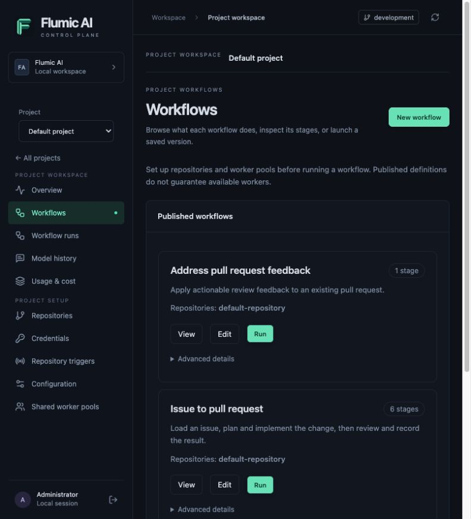

**Checkpoint:** validation reports two stages. `receive` has no dependencies;
`confirm` depends on `receive` and reads its `output.message`. `after` controls
ordering; `$ref` supplies data. Publishing creates an immutable saved revision;
it does not run the workflow. If `onboarding-check` already exists, edit that
workflow or choose a unique name instead of creating a duplicate.

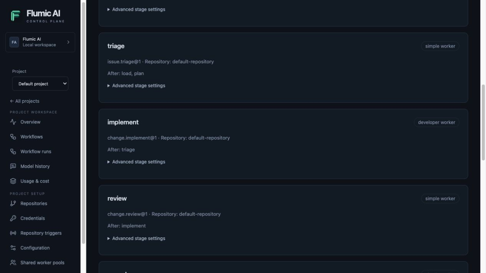

The screenshot shows a different installed six-stage recipe; your echo workflow
has exactly the two stages above. Inspect its aliases, pool IDs and dependencies,
not the screenshot's revision UUIDs.

## 11. Launch the saved echo revision — UI

1. From the `onboarding-check` card, click **Run**, or use its saved revision page.
2. Under **Run saved revision**, select `backend` in **Default repository**.
3. Set **Run input JSON** to the complete object below:

```json
{"message":"Hello from Flumic AI"}
```

4. Keep **Follow-up bindings JSON** as `{}` for this echo-only workflow.
5. Click **Run saved revision** once. The UI opens the new project run.

**Checkpoint:** you have a project run ID and a queued/dispatch receipt. This is
acceptance, not completion. Repeated submission from a newly opened form can
create another invocation; inspect the existing receipt before retrying after a
network error. Echo needs no source credential, repository execution activation or
model call. Do not infer that this qualifies repository mutations in B.

## 12. Verify milestone A and inspect an attempt — UI

1. Open **Workflow runs** and select this run if you navigated away.
2. Wait for canonical run/stage progress; refresh the project's data if needed.
3. Select `receive`, then `confirm`, in **Stage explorer**.
4. Use **Stage attempt** to inspect a retry generation. **Result** shows retained
   operation evidence, **Logs** shows stage/attempt activity, **Model calls**
   contains accounting and captured exchanges, and **Configuration** shows the
   pinned inputs/settings and technical identifiers. Use **Overview** for
   follow-up runs; **Run activity** and **All model calls** broaden the scope to
   the entire run without retaining stage filters.

**Checkpoint:** both stages and the run become `completed`. The data binding was
validated and the second stage consumed the first stage's message. The run view
primarily exposes state and pinned metadata; do not expect a full raw builtin
output viewer on every stage. Echo can have no captured model calls/logs and
requires no provider spending. Missing telemetry by itself is never proof of
success: canonical terminal state is the checkpoint.

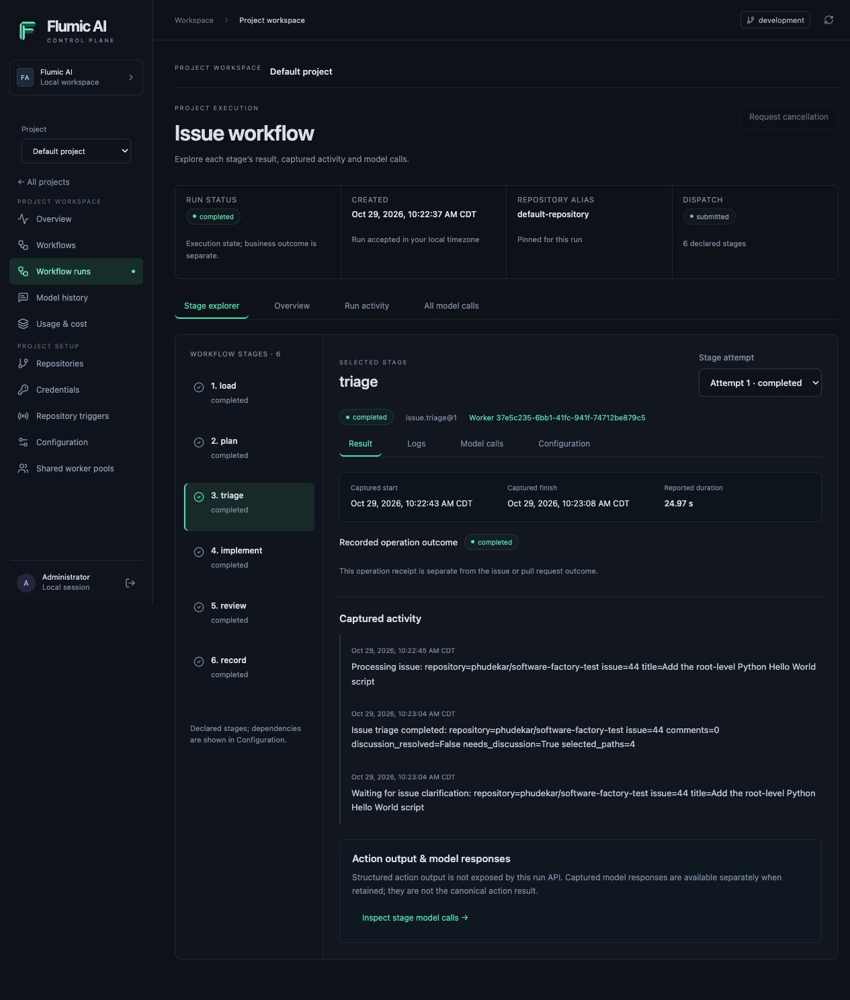

If a run remains queued, check `dynamic-runtime`, pool authorization, compatible
shared workers and dispatch error. If a stage fails, use its attempt and pinned
configuration to diagnose it; do not delete claims or force it to completed.

## 13. Prepare milestone B: provider credentials and developer capacity

Continue only when you intend to make real model requests and repository writes.
Use your disposable repository. Keep existing production work separate.

1. Complete steps 3–4 if you deferred the GitHub credential: **Credentials → Add
   credential**, then **Repositories → Edit connection**, select it and save.
2. Add an `openai` purpose credential named `walkthrough-openai` through the UI.
   Planning/review and API/Codex coding use their configured provider grants.
3. If the developer profile uses Claude, add an `anthropic` purpose credential as
   well. The template form selects saved credential names; never paste raw keys
   into a workflow definition.
4. Check configured model IDs, backend availability, prompts and the account's
   limits in **Configuration**. Use account-supported models; identifiers in
   checked-in examples are not guarantees of your provider access.
5. In **Shared worker pools → Add pool**, name the pool
   `walkthrough-developer` and choose **Developer — code changes**. Keep its
   built-in action selections, `2` normal/`16` durable slots and `builtin@1`
   executor; confirm the prefilled **Hatchet transport** matches your deployment.
   Click **Create pool**. Its **Pool ID** remains available under **Advanced pool details**;
   the template installer selects the pool by name.
   Reuse an existing compatible pool only after checking its capabilities.

6. Verify role `developer`, executor `builtin@1`, and actions
   `change.implement@1`/`pull.feedback@1`. Resolve any reused-pool mismatch.
7. In **Walkthrough → Shared worker pools**, authorize `walkthrough-developer`.
8. In workspace **Workers → Add shared worker**, create
   `walkthrough-developer-1` in that pool on the approved target, then start it.
9. Confirm registration/capabilities and runtime state as in step 9.

**Checkpoint:** both roles have authorized, compatible shared capacity. Merely
creating a developer pool does not install coding tools, credentials or models.
The saved project profile determines which installed coding backend is used.

## 14. Install issue, feedback and verification templates — UI

1. Open **Walkthrough → Workflows → Install templates**.
2. Set **Target repository** to `backend`. This selects the saved connection;
   you do not need to type its alias or connection UUID into a request.
3. Select `walkthrough-simple` in **Simple worker pool** and
   `walkthrough-developer` in **Developer worker pool**. Only project-authorized
   pools advertising the required built-in actions and executor are listed.
4. In **OpenAI credential grant**, select `walkthrough-openai`. If the configured
   developer backend uses Claude, also select the saved Anthropic credential.
   Select every provider required by your saved profiles. **No grant** deliberately
   omits access; it does not provide a default credential or guarantee execution.
   The form lists only active credentials scoped to the project or selected
   repository. GitHub/GitLab access comes from the repository connection.
5. Review the selections and click the form's **Install templates** button.
   The toolbar button stays disabled while the form is open. **Cancel** creates
   nothing.
6. Use the resulting `issue`, `feedback` and `verify` **view saved revision** links
   to inspect their stages, pools and grants. Click **Done** to return to the list.

**Checkpoint:** all three recipes appear in Workflows. Installation is create-only:
existing recipes retain their saved pools and credential grants even if you
selected new values in the form. Inspect the returned revisions; use **Edit** and
publish deliberate revisions if existing recipes need changes. Installation does
not enable repository execution or run any stage. You need no Python session,
copied credential IDs or manually assembled API JSON for this step.

**If blocked:** missing pools usually need project authorization, the correct
role, `builtin@1` and all required action versions. Missing credentials may have
the wrong purpose/scope or be revoked. Follow the form's server error rather than
creating duplicate resources. Templates do not install worker capabilities.

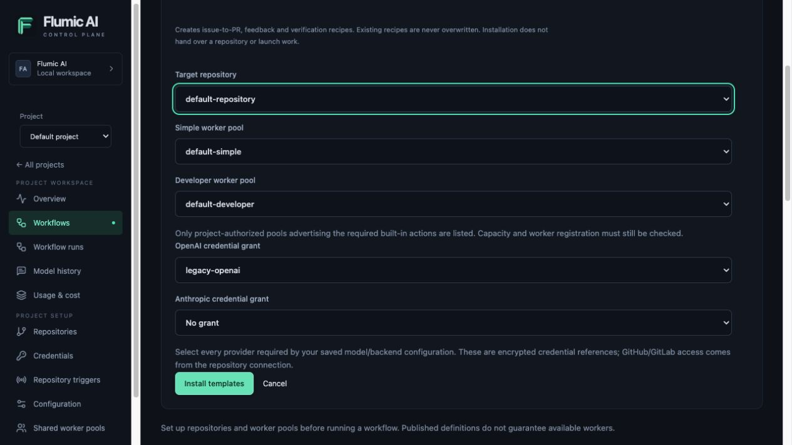

This unsubmitted example uses the existing Default project and its saved names.
For your Walkthrough project, use the `backend`, `walkthrough-simple`,
`walkthrough-developer` and `walkthrough-openai` selections listed above.

## 15. Enable repository execution — UI

The echo test did not need repository actions. Before the AI recipe can operate
on code and issues, enable project execution for its target connection.

1. Open **Walkthrough → Repositories** and find `backend`.
2. Under **Repository execution**, click **Review project execution for backend**.
3. Confirm the displayed owner/repository and alias are correct.
4. Review ownership, then check **I have reviewed repository ownership and
   confirmed it is ready for project execution.**
5. Click **Enable project execution**. **Cancel** leaves the connection unchanged.

**Checkpoint:** the form reports **Project execution enabled for backend** after
acceptance. This does not launch a workflow. If the server reports an existing
owner or conflicting operation, follow the
[migration guide](project-runtime-operations.md#roll-out-from-a-current-checkout)
before retrying. Keep all server checks enabled.

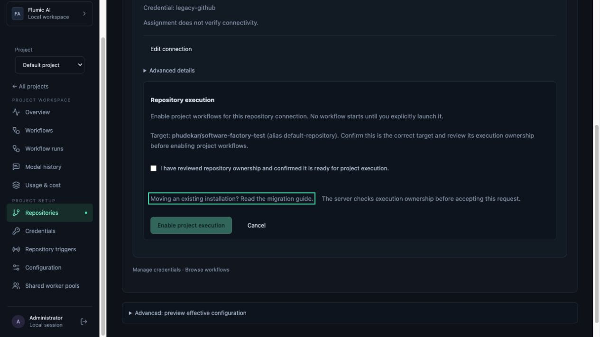

The screenshot shows the existing Default project's connection before confirmation;
it does not demonstrate a new execution-mode change.

## 16. Create a small issue and launch the issue recipe — UI

Follow the [GitHub issue and label instructions with screenshots](../README.md#3-create-and-label-an-issue-in-github) to create a focused issue and apply the default `ready-for-agent` label. This walkthrough uses manual launch; if a configured label trigger has already accepted the issue, inspect that run instead of launching it again.

1. In your disposable GitHub repository's UI, create a small, verifiable issue
   such as **Create a Hello World app in Python**: add `hello.py` at the repository
   root so `python3 hello.py` prints `Hello, world!` and exits successfully,
   without third-party dependencies. Use the complete issue text linked above.
2. Copy its actual issue number. For example, use `42` only if issue 42 is yours.
3. In **Walkthrough → Workflows**, choose **Run** on **Issue to pull request**.
4. Confirm **Default repository → backend**. Keep **Run setup → Guided issue launch**.
5. Enter your issue number in **Issue number**. Use a positive whole number;
   the form does not create the source-host issue for you.
6. Select the saved recipe in **Feedback workflow revision** and
   **Verification workflow revision**. Inspect the selected revisions using their
   links (which open separately so your draft remains available). Choose compatible
   standard feedback/verification recipes for this same repository.
7. Recheck the saved issue revision, follow-up revisions, credential grants and
   registered capacity. The issue follow-up uses the root revision you are viewing.
   The form constructs connection-UUID and revision-UUID bindings automatically;
   no Python helper or JSON editing is required.
8. Explicitly click **Run saved revision** once. This can incur provider charges
   and write to GitHub. It opens the new project's run after acceptance.

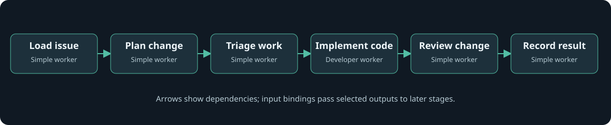

Dependencies control execution order; explicit input bindings pass selected
outputs. See the [stage input/output table](workflow-concepts.md#how-a-stage-works).

**Checkpoint:** a project run is accepted, then stages progress. `load` → `plan`
→ `triage` → `implement` → `review` → `record` is the installed recipe. Follow
step 12's run/stage/attempt inspection. A completed control run is not proof that
all child work was reviewed and merged. Missing or incompatible follow-up
selections keep the guided launch disabled; fix them before submitting.

For a customized workflow, multiple repositories, or an older revision not listed
in the standard selectors, choose **Run setup → Advanced JSON**. Other workflow
kinds retain their existing JSON inputs. The first switch seeds JSON from your
current guided values; after that, guided fields and advanced JSON are separate
drafts. Review the complete input and connection-ID-to-revision-ID binding object
before using that path. Server ownership and launch checks still apply.

If clarification is needed, answer the issue questions and use the configured
ready label. For PRs, review actual diffs and CI, request changes as appropriate,
and approve/merge through the repository's normal rules. Feedback and merge
verification can involve durable waits and separate follow-up runs; follow the
**Follow-up workflows** links and receipts. Do not launch an identical second run
just because human review is still pending. This guide uses explicit manual
launch, not automatic webhook/trigger setup.

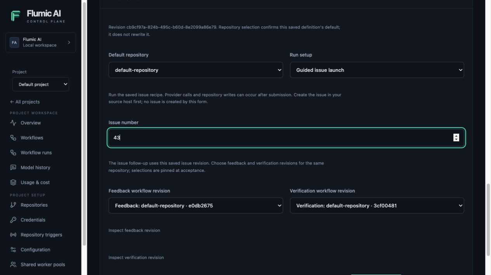

The screenshot is an unsent example in Default; issue `42` is illustrative. No
workflow was launched to capture it, and the example draft was discarded.

### Follow the issue through its actual states

The Hello World example moves from **parent issue #43 → child issue #44 → draft PR #45**.
The parent tracks the plan, the child tracks implementation, and the PR carries
review state. Check the object named in each step; all labels do not accumulate
on the parent issue.

| Step | Where to look | What changed and who did it |
| --- | --- | --- |
| 1. Ready | Parent issue #43 | You apply `ready-for-agent`; this signals readiness, not execution. |
| 2. Planned | Parent issue #43 | Planning adds `agent-plan-created` and consumes the readiness label. |
| 3. Task created | Child issue #44 | Planning creates a linked implementation issue with `agent-subtask`. |
| 4. Waiting for clarification | Child issue #44 | Triage adds `needs-discussion` instead of proceeding with an ambiguous change. |
| 5. Resumed | Child issue #44 timeline | You clarify the requirements and apply `ready-for-agent`; the stored follow-up resumes and the worker removes the discussion/readiness labels. |
| 6. Draft PR published | Child issue #44 and PR #45 | Implementation opens a draft PR and adds `agent-pr-open` to the child; `agent-subtask` remains. |
| 7. Review posted | PR #45 | Review posts findings and adds `agent-pr-reviewed` to the PR. Human approval and merge have not occurred. |

Each step pairs its GitHub state with the available Control Pane evidence.
**Control Pane evidence** beneath each step is expanded by default to show
its run, activity logs and model exchange. These Control Pane screenshots show retained runs after they finished, rather
than recreated in-progress states. Log images show retained stage activity;
model capture/retention may leave gaps. Use your own run IDs when following these
steps in another installation.

All steps and their run-output subsections are expanded by default. Collapse any section to focus on another step.

<details open>
<summary>1. Ready to process — parent issue</summary>

The parent initially had `ready-for-agent`. This is a readiness signal, not proof
of execution. The example was explicitly triggered; automatic launch depends on
configured repository triggers.


No run or model request has started at this point. The readiness label alone
is not execution evidence; there is no matching run/log screenshot to fabricate.


</details>

<details open>
<summary>2. Plan created — parent issue</summary>

The planner produced one implementation task. The parent acquired
`agent-plan-created`; its original readiness label was consumed. This does not
mean the implementation is finished.


<details open>
<summary>Control Pane evidence: planning model logs</summary>

The original planning call was recorded before this installation moved to
project execution. Its retained exchange is available in **Default → Model history**,
but it is not a canonical Default project run. Do not substitute the later
parent run that reused the existing plan for the original plan-creation run.


</details>

</details>

<details open>
<summary>3. Implementation work identified — child issue</summary>

The worker created #44 with `agent-subtask` and linked it to #43. Follow this
child for implementation progress; PR labels do not all accumulate on the parent.


Child creation belongs to the same planning result shown in step 2. It is
not a second model call or a separate charge inferred from a new GitHub issue.


</details>

<details open>
<summary>4. Clarification requested — child issue</summary>

The repository already contained `hello_world/`. Triage asked whether to preserve
that directory and added `needs-discussion`. The control run completed its stage
calls, but its business outcome was waiting for discussion, not a generated PR.


<details open>
<summary>Control Pane evidence: run, activity logs and model logs</summary>

**Run and stage:** `4b5d6351-5428-4d97-9dc1-537ec2d287ed`, filtered to `triage`.
The control run completed its invocations, while the business outcome was waiting
for clarification. No draft PR was produced by this run.


**Activity logs:** the messages identify issue #44, report `needs_discussion=True`
and say **Waiting for issue clarification**.


**Model logs:** the retained call is `729ca069-79ae-428f-bfb5-42777c4108fa`.
The accounting row is separate from its captured request/response. The response
sets `needs_discussion` to `true` and lists the questions later posted to the issue.


</details>

</details>

<details open>
<summary>5. Clarification resolved — child issue timeline</summary>

The reply confirmed a new root-level `hello.py`, preserving existing files with
no requested CI/documentation changes. Adding `ready-for-agent` resumed the
stored discussion follow-up. The agent then removed the discussion/readiness
labels as it continued. This screenshot shows GitHub's actual timeline event
because readiness was transient, rather than recreating the old state.


<details open>
<summary>Control Pane evidence: run, activity logs and model logs</summary>

**Resumed run and stage:** `7d53f1f2-ec3c-448a-80fd-f8e576a9fba7`, filtered to
`triage`. This is a new run created by the stored follow-up; the earlier run was
not rewritten. Screenshots inspect its retained state after completion.


**Activity logs:** issue #44 now has two comments; the log reports
`discussion_resolved=True`, `needs_discussion=False` and **Issue ready for patch generation**.


**Model logs:** call `64f60a0a-b3ee-49e7-a221-ad2a2382c72d` returned
`needs_discussion: false` and an empty questions list. Compare this with step 4.


</details>

</details>

<details open>
<summary>6. Draft PR created — child issue</summary>

Implementation created draft PR #45 and added `agent-pr-open` to #44. The PR
contains only `hello.py`. Its CI build checks passed. Independently checking
commit `7a49fda15eff5ba5abc8f13757a00be837e15bee` confirmed stdout exactly
`Hello, world!` plus a newline, exit code 0 and empty stderr.


<details open>
<summary>Control Pane evidence: run, activity logs and model logs</summary>

**Run and stage:** the same resumed run, `7d53f1f2-ec3c-448a-80fd-f8e576a9fba7`,
now filtered to `implement`. Selecting a stage narrows the evidence; it does not
launch another workflow.


**Activity logs:** the excerpt shows a single changed file, publishing draft PR #45,
its creation and registration of a review wait.


**Model logs:** call `e9f8d362-cbc0-4835-947a-7c2b4381eac1` records the coding
invocation's tokens and estimated cost. Coverage is `cli_prompt_and_result`,
not a transcript of every internal CLI/model interaction.


The returned artifact contains progress, a PR title and a detailed PR body with
acceptance criteria, validation and limitations. Those validation statements are
the model's report; the independent commit-specific check is described above.


</details>

</details>

<details open>
<summary>7. Automated review posted — pull request</summary>

The automated review added `agent-pr-reviewed` to **PR #45**, not the parent issue.
It posted concerns about import-time execution. This label means a review was
posted; it does not mean the findings were accepted, the PR was approved or the
change merged. At the end of this recorded example, the PR was a draft awaiting human review.


<details open>
<summary>Control Pane evidence: run, activity logs and model logs</summary>

**Run and stage:** the same resumed run, `7d53f1f2-ec3c-448a-80fd-f8e576a9fba7`,
filtered to `review`.


**Activity logs:** the post-creation review message identifies issue #44 and PR #45,
reports two findings including one suggestion, and records `agent-pr-reviewed`.
It does not record human approval or a merge.


**Model logs:** two retained calls are listed for this stage. The response opened
below is the later call, `d60fe46c-0fd5-4f64-8b57-cc1eb72c3372`.


The model raised import-time execution concerns and proposed a main guard.
Its severity labels are model judgments, not independently confirmed defects
or an approval decision. Review the findings against the actual issue requirements.


</details>

</details>

These are recorded screenshots from October 29, 2026; transient labels were not
reapplied to recreate earlier states. In this example, worker actions appear
under `phudekar`, the identity used by the repository credential. That username
alone does not distinguish a human action from an automated one.

`load` reads the issue and `record` persists the result; not every workflow stage
adds a GitHub label. A completed run can be waiting for clarification or review.
`agent-pr-reviewed` means findings were posted, not approval, merge or completion
of the overall issue. The screenshots stop at a reviewed draft PR.

## 17. Monitor execution, model exchanges and spend — project UI

Start from the project's sidebar so you keep the correct scope:

| Screen / action | What to check | How to interpret it |
| --- | --- | --- |
| Overview | Connections, definitions, recent project runs, known estimated spend | Counts are bounded views; published definitions do not prove live capacity |
| Workflow runs → run | Canonical state, dispatch, pinned revision and stage attempts | Accepted/queued is not completed; Hatchet receipt IDs are not project run IDs |
| Stage explorer / Stage attempt | Assigned worker, execution generation, logs and model accounting | Logical graph stage `plan` may execute operation `plan_issue` |
| Logs / Model calls | Evidence scoped to the selected stage and attempt | Use Run activity / All model calls for run-wide evidence |
| Model history | Captured exchanges and metadata for this project | Content is policy-controlled and expires; unavailable content is not an empty model response |
| Usage & cost | Input/output tokens, known estimated and separately reported spend, gaps | Missing usage/price is unknown, not zero; estimates are not provider invoices |

An existing project may contain historical accounting even if it has no
new dynamic runs. A newly created project starts with its own records. Do not add
gateway/CLI/provider observations together as independent charges for the same call.

Capture settings are `redacted`, `metadata_only` or `disabled`. They affect what
history is retained; disabled model capture also removes its usage history.
CLI captures do not contain every internal exchange. See [project history](project-observability.md)
for exact coverage, correlations and retention.

For an actual captured exchange, open **Model history → View exchange** and use
**View response** to jump to the returned artifact. The screenshot below comes
from the [Hello World live example](hello-world-live-example.md), not the echo
workflow in milestone A. It shows the returned task and testable acceptance criteria.
System guidance and source context can be expanded separately.


## 18. Add optional SigNoz monitoring — deployment step

Use the existing monitoring stack rather than starting another worker fleet:

```sh
just observability-up
```

1. Open `http://localhost:3301` and sign in using the private bootstrap/account
   instructions in the [observability guide](observability.md#start-and-open-the-dashboard).
2. Open **Dashboards → Software Factory — Workers and AI Usage**. The retained
   dashboard/service names still use `software-factory`.
3. Ensure the project action's effective `observer_factory` is
   `factory.adapters.otel:otel_observer`, with a worker-reachable OTLP/HTTP endpoint.
   Preserve the rest of the saved configuration and check for profile overrides;
   do not replace the complete JSON document just to change observation.
4. Follow [project telemetry configuration](project-observability.md) for shared
   worker infrastructure export (`FACTORY_SHARED_TELEMETRY_ENDPOINT`) and the
   separate action observer. Deployment transport edits need deliberate service/
   worker recreation; admitted actions retain their existing configuration pins.
5. Generate a **new explicitly authorized** run after telemetry is configured.
   Export does not retroactively create traces for earlier executions.
6. In SigNoz, choose the run's time range and filter service `software-factory`,
   environment and attributes such as `factory.project_id`, `factory.run_id`,
   `factory.stage_id` and `factory.execution_id` from the inspected run/attempt.


**Checkpoint:** new instrumented operations have correlated telemetry when capture,
transport and retention permit. Dashboard gaps do not prove a healthy idle worker.
Container CPU/memory and token/cost are different measurements. The resource
collector can include unrelated host containers; do not interpret its disk metric
as storage uniquely owned by each worker. See [monitoring setup](observability.md)
for collector access and [accounting coverage](project-observability.md).

Do not run `start-observed-workers.sh` alongside this shared fleet merely to get
charts: it starts additional workers and can duplicate processing.

## 19. Change configuration, recover safely and finish

- **Change behavior:** save a project/repository/workflow revision, then launch a
  new run. Active runs keep their pins. A code/image update requires an explicit
  compatible worker lifecycle action; a settings save does not install code.
- **Cancel:** open the run and choose its cancellation action. Intent can remain
  `cancelling` while an external effect is uncertain. Source cancellation does
  not recursively cancel already-launched follow-up runs.
- **Diagnose:** inspect attempt state, dispatch receipts, worker capability and
  recorded errors before retrying. Use [recovery procedures](project-runtime-operations.md)
  for uncertain actions; never force terminal state from absence of logs.
- **Stop this test capacity:** if no longer needed, use workspace Workers to stop
  only the specifically created walkthrough workers. Do not stop shared capacity
  that other projects use. Keep data/backups and credentials according to policy.
- **End your session:** sign out of the browser when
  done. Session variables are not a substitute for a private secret manager.

### Troubleshooting checkpoints

| Symptom | Check before proceeding |
| --- | --- |
| Project/sidebar looks different | Matching current frontend/backend versions, selected project and browser refresh |
| Missing guided controls | Update to a compatible frontend/backend version; pool creation, template installation and execution activation are distinct actions |
| No capacity after creating a worker | Correct **shared** worker, authorized pool, loaded action/executor versions, runtime and Hatchet registration |
| Echo validation fails | Both pool-ID replacements, declared alias `backend`, exact `$ref` and direct dependency |
| Echo run stays queued | Dynamic control runtime registered, dispatch receipt and available compatible worker |
| Builtin launch returns 409 | Execution ownership, current revision or an uncertain action; inspect the error and linked migration guidance |
| Builtin launch lacks bindings/grants | Select compatible follow-up revisions and provider grants; keep the source credential on the repository connection |
| UI shows old settings | Pinned run revision vs newly saved settings; compatible adoption/startup is separate |
| No model exchange/cost | Echo has none; for AI work inspect capture policy, retention, delivery and price/usage gaps |
| No SigNoz trace | Observer selection, reachable endpoint, network/time filters and new operation after configuration |

You have completed the walkthrough when you can explain which project owns a
connection, which pool supplies an action, which saved revision a run used, why a
stage is waiting/failed/completed, and where its reported usage and unknowns appear.

For an observed end-to-end example through draft publication, see [Hello World: live labels and model exchanges](hello-world-live-example.md).
