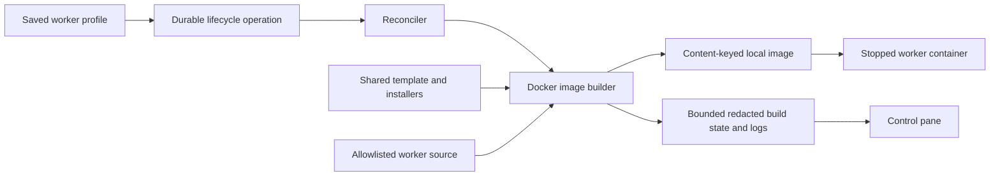

# Profile-driven worker image builds

## Purpose and boundaries

Operators choose a base OS image in a saved worker profile. Creating or restarting
an instance assembles the factory runtime into that base before creating the
container. Shared factory routing, credentials and workflow engine settings do
not become image layers. Existing profiles with an empty base_image retain their
prebuilt simple/developer image behavior. No database history is rewritten. Build-only fields are omitted from worker bootstrap
responses, preserving compatibility with existing protocol-3 worker processes.

## Profile contract

Worker-local settings include base_image, system_packages, image_setup_script,
codex_version and claude_version. A base image must expose /bin/sh, allow root
package installation, and identify as Debian/Ubuntu or Alpine in /etc/os-release.
The worker template resets inherited entrypoint, user, workdir and PATH as needed.
Package names and image references are validated before building. The setup script
is trusted administrator code, subject to the same credential checks as profiles.
It must not fetch credentials or secrets from external services into image layers.

The setup script runs once during image assembly, after Python requirements and
optional coding tools. startup_script runs on every container process start.
Model choices, prompts, runtime limits and startup scripts do not invalidate the
image cache. Changing build settings or factory source does.

## Component flow

## Build pipeline

1. Resolve the selected base image through Docker and obtain its content identity.
2. Construct an explicit in-memory tar allowlist: runtime Python/shell files,
   factory modules, requirements, image template and dependency installers.
   Exclude repository config, .env files, workspaces, credentials and user data.
3. Hash the resolved base identity, allowlisted contents and normalized build
   settings; use a factory-owned deterministic image tag.
4. Reuse a compatible cached image, or stream a Docker build through the shared
   Dockerfile template. Install OS prerequisites, create /opt/venv, install the
   versioned repository requirements, install pinned coding-tool versions, copy
   runtime code, and execute image_setup_script. Unsupported distributions fail
   explicitly. Python dependency ranges follow the repository requirements file;
   the resulting image is cached but dependency resolution is not fully locked.
5. Verify the resulting control-protocol label. Only then create a worker with
   its configuration mount and runtime credentials. Build failures create no
   container. New workers remain stopped until the operator starts them.

Build execution is a Docker adapter concern. The API records lifecycle operations
and exposes bounded redacted build progress/logs; it does not execute builds in an
HTTP request. A future Kubernetes runtime can replace the builder with a registry
and remote builder without changing the profile's runtime/build distinction.

## Progress, durability and failure handling

Per-worker build state and a bounded log tail live under data/control-plane/builds,
shared by API and reconciler. Files are atomically replaced and logs redacted.
The UI offers build logs even before a container exists. A reconciler heartbeat
renews the durable operation lease during long pulls/builds. Container revision
labels identify the configuration installed with an image. Start retries image
preparation when the desired revision differs from the installed revision, even
after an earlier failed replacement. Process bootstrap applies runtime-only
profile changes immediately, but defers build-recipe changes until replacement. Interrupted work is
retried with the same deterministic cache key; successful images can be reused.
The initial reconciler processes builds serially. No separate build queue, image
registry, garbage collector or build cancellation is introduced in this version.
Docker request timeout bounds inactive transport operations, not total build time.

## Security and compatibility

Only authenticated administrators can modify profiles. Custom bases and scripts
are trusted code with Docker build network access. No host directories, Docker
socket, runtime environment credentials, factory configuration or build secrets
are passed into the image build. Images supplied by operators may themselves
contain unsafe code; the builder does not sandbox or attest their contents.
Runtime credentials are injected only during container creation.

Existing standalone Dockerfiles remain supported; the new managed image template
is the assembly path for profiles opting into base_image. Existing local edits to
those Dockerfiles are preserved. CLI tooling on Alpine depends on upstream tool
support; an unsupported platform fails at build/verification time.

## Implementation and verification

- Add validated worker-local build settings and commented bootstrap examples.
- Implement an allowlisted build context, template/installers, deterministic cache,
  bounded progress store, and Docker runtime integration.
- Renew lifecycle leases and expose authenticated build status/logs.
- Add profile controls and worker build progress/log views.
- Verify invalid inputs, context exclusions, cache invalidation/reuse, build
  failure behavior, profile persistence and UI rendering. Run worker/backend/UI
  suites and frontend build. Exercise a real base-image build if Docker is available
  without registering a worker or triggering paid workflow tasks.

## Validation results

The worker and backend suites and React tests cover settings validation, profile
persistence, bootstrap compatibility, failed-build retries, lifecycle heartbeat,
context isolation, caching, build logs and editor behavior. Real Docker smoke
builds succeeded for `python:3.12-slim`, `python:3.12-alpine`, and
`node:24-bookworm-slim` with Codex `0.163.0`. Smoke containers only performed imports,
UID checks and CLI version checks with networking disabled; no factory workflows
or model calls were started. PostgreSQL tests use isolated disposable schemas.
