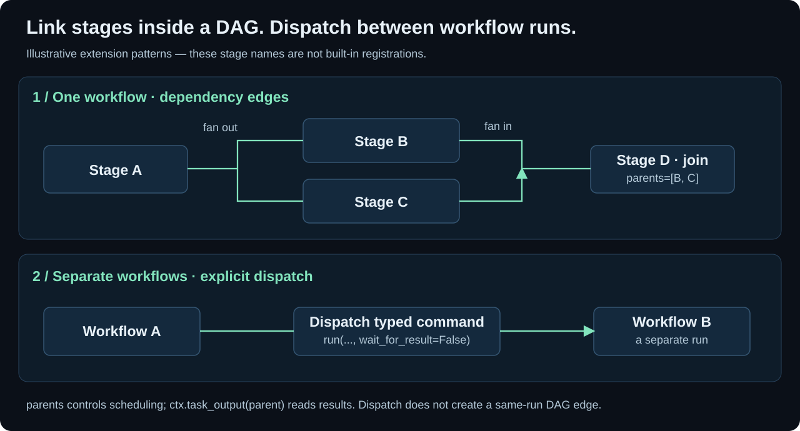

# Developing workflows and stages

This guide covers data-defined workflow revisions and code changes for a **new stage** or **new Python workflow**. The Python tutorials are illustrative additions and make no model calls. Editing legacy YAML cannot create a Python task or change its dependency graph.

For tuning existing stages, see [workflow configuration](configuration-workflows.md). For operating registered definitions, see [control-plane workflows](control-plane-workflows.md). The control UI offers configuration and workflow controls; it has no visual workflow designer.

## Data-defined workflow revisions

The project API now validates and publishes immutable workflow documents. Publishing
stores a graph; it does not start a run. Durable scheduling, the complete executable
builtin catalog, Docker job execution and the graph editor follow in issues #7–#11
and #14. Shared workers currently install only `core.echo@1`. The Python tutorials
below remain the guide for the existing deployed workflows.

### Create and link stages

First create a project repository connection with alias `app`, and enable a
`simple` worker pool for the project that allows `builtin@1` and `core.echo@1`.
Replace `POOL_ID` with its actual ID. This document passes values through two stages:

```json
{
  "schema_version": 1,
  "name": "echo-pipeline",
  "repositories": ["app"],
  "default_repository": "app",
  "stages": [
    {
      "id": "capture",
      "executor": "builtin",
      "action": "core.echo@1",
      "role": "simple",
      "pool_id": "POOL_ID",
      "inputs": {"message": {"$ref": "input.message"}}
    },
    {
      "id": "report",
      "executor": "builtin",
      "action": "core.echo@1",
      "role": "simple",
      "pool_id": "POOL_ID",
      "after": ["capture"],
      "inputs": {"message": {"$ref": "stages.capture.output.message"}},
      "when": {"ref": "input.enabled", "equals": true}
    }
  ]
}
```

An eventual run input would be `{"message":"Hello Flumic","enabled":true}`.
`after` creates dependency edges; each output producer referenced in `inputs` or
`when` must be a **direct** parent. A transitive dependency alone is insufficient.
Stages may have several parents. Duplicate IDs, duplicate edges, missing parents,
self-dependencies and cycles are rejected.

### Definition and stage configuration

Unknown fields and unsupported versions are rejected rather than ignored.

| Field | Values / default | Effect |
| --- | --- | --- |
| `schema_version` | Integer `1` | Selects the document contract. |
| `name`, stage `id`, repository alias | Lowercase letter followed by lowercase letters, digits or hyphens; at most 100 characters | Stable document, dependency and binding names. |
| `repositories` | 1–64 distinct project repository aliases | Bounds the graph's repository scope. Foreign or unknown aliases fail validation. |
| `default_repository` | One declared alias | Used by stages without a `repository`. |
| `defaults` | Behavior overrides, e.g. `{"openai_model":"gpt-4.1"}` | Applies workflow behavior over saved project/repository/profile configuration. Identity, credentials and infrastructure settings cannot be overridden here. See [configuration precedence](configuration-workflows.md). |
| `secrets` | Purpose to immutable secret-version ID | Project-wide grants inherited by stages; values are references, never plaintext credentials. |
| `stages` | 1–64 stages | Defines the DAG. |
| `executor` | `builtin` or `docker` | Selects the versioned execution contract. |
| `action` | Builtin only, e.g. `core.echo@1` | Selects a known typed action version. Publication metadata also recognizes issue/change/pull actions; their executable catalog is a later milestone. |
| `role` | Required `simple` or `developer` | Must match the pool and the action's required role. |
| `pool_id` | Required enabled project pool ID | Pool must permit the exact executor/action versions. Publication does not guarantee a worker is currently online. |
| `profile` | Saved behavior profile; defaults to the role | Selects project behavior; its effective worker type must match `role`. |
| `repository` | Declared alias; defaults to `default_repository` | Selects repository settings and credential scope for this stage. |
| `after` | Stage IDs; defaults to `[]` | Declares immediate prerequisites. |
| `inputs` | JSON mapping; defaults to `{}` | Typed action arguments, with optional bindings. |
| `when` | `{"ref":"input.enabled","equals":true}` | Scalar equality gate; no expression evaluation. Boolean `true` differs from number `1`; numeric `1` equals `1.0`. |
| `timeout_seconds` | 1–3600; default `300` | Execution timeout policy for the runtime scheduler. |
| `retries` | 0–3; default `0` | Additional attempts permitted after a failure. |
| `retry_delay_seconds` | 0–3600; default `0` | Delay between retry attempts. |
| `overrides` | Behavior-only settings | Applies stage-specific model, prompt and recognized behavior settings after workflow defaults. |
| Stage `secrets` | `github`, `openai`, `anthropic` to version IDs | Overrides inherited grants; repository-scoped grants must match this stage. GitHub grants must match the repository connection's pinned credential reference. |

The typed builtin commands omit repository, trace and assignment identity fields.
The runtime supplies those values from its trusted context. Workflow input cannot
impersonate another repository or execution. Model/prompt overrides affect only
operations that actually invoke those adapters; echo remains deterministic.

### Bindings and repository provenance

Only an object containing **exactly** `{"$ref":"path"}` is a binding. Other JSON
stays literal, including strings containing `$ref` and mappings with additional
keys. Values fetched from input or parent output remain inert data: they are not
interpreted a second time.

Supported paths are `input.<key>[.<key>...]`,
`stages.<stage-id>.output[.<key>...]`, and `context.<field>`. Public context fields
are `project_id`, `repository_id`, `repository`, `run_id`, `stage_id`, `execution_id`
and `attempt`. Settings and secrets are not available through context bindings.
Traversal uses mapping keys only: array indexing, attributes, dunder names,
imports and evaluated expressions are unsupported. Missing values fail resolution.

Builtin inputs other than echo are repository-affine: a stage for repository B
cannot consume repository A's output as its command/state. Generic echo and Docker
stages may consume several repositories' outputs within the same project. The
resolver returns `ResolvedInputs(data, origins)` so later execution layers retain
provenance instead of trusting an unlabelled JSON value.

### Docker stage schema

A Docker stage uses `image` pinned to `@sha256:` plus 64 lowercase hexadecimal
characters, and `command` as an argv array (1–128 strings, each at most 4096
characters). For example, an image-specific command might be
`["/app/run", "--format", "json"]`; the image must supply that executable.
No implicit shell is added. Tags alone, empty executables and NUL bytes are rejected.

| Setting | Default | Allowed range / effect |
| --- | --- | --- |
| `network` | `none` | `bridge` requires trusted deployment policy; the publication API currently denies it. |
| `limits.cpu` | `1.0` | 0.1–8 CPUs |
| `limits.memory_mib` | `512` | 64–4096 MiB |
| `limits.pids` | `128` | 16–512 processes |
| `limits.tmpfs_mib` | `64` | 16–256 MiB |

These are the contract for the upcoming broker, not evidence of container execution
today. Arbitrary Docker options, host mounts, privileged mode and socket access
cannot be supplied in the document.

### Publish, revise and pin

Send `{"document": <workflow>}` to the project's validation endpoint, then POST
it to the definitions collection. Save the returned definition ID and `revision_id`.
For an edit, PUT `{"document": <updated workflow>, "parent_id": "CURRENT_REVISION_ID"}`
to that definition. Stale parents return `409`; foreign definitions/revisions return
`404`. A successful edit appends a revision and preserves earlier documents.
See the [definition API routes](control-plane.md#workflow-definition-api).

Graph documents and launch snapshots are encrypted at rest because literal inputs
and prompts may contain private data. List responses contain metadata; the scoped
revision endpoint returns the document to authenticated operators.

The internal launch service revalidates a selected graph revision and pins exact
repository revisions, configuration, effective per-stage settings and secret-version
references in one persisted snapshot. Replays read that snapshot rather than latest
configuration. Rotation does not silently substitute a newer secret into an old
snapshot; revocation is checked when credentials are delivered. Publishing alone
neither resolves credential values nor launches actions.

| Bound | Limit | Validation boundary |
| --- | --- | --- |
| Workflow document | 256 KiB, including normalized defaults | Publication and launch |
| Stages | 1–64 | Publication |
| Run input | 64 KiB | Binding resolution |
| Resolved action input / parent output | 1 MiB each | Binding resolution / output envelope |
| JSON nesting | 64 | JSON and binding validation |

Known literal action fields are checked at publication even beside dynamic values.
Values supplied by references are checked against the full typed action schema at
resolution. A valid published graph therefore can still reject invalid run input;
it does not bypass runtime bounds or argument validation.


## Where the definition lives

The application owns business behavior; Hatchet owns scheduling, dependencies, retries, and durable waits.

| Responsibility | Source |
| --- | --- |
| Inputs and serializable stage outputs | [domain/models.py](../worker/factory/domain/models.py) |
| Business operations | [application/service.py](../worker/factory/application/service.py) |
| Operation observation, task context, repository guard, state claims | [application/operations.py](../worker/factory/application/operations.py) |
| Application dispatch contract | [application/ports.py](../worker/factory/application/ports.py) |
| Hatchet graph, routing, triggers, registration, dispatch | [orchestration/hatchet.py](../worker/factory/adapters/orchestration/hatchet.py) |
| Synchronous graph and captured dispatch requests | [orchestration/local.py](../worker/factory/adapters/orchestration/local.py) |
| Recognized task keys and compatibility defaults | [task_defaults.py](../worker/factory/task_defaults.py) |
| Configuration validation and merge rules | [configuration.py](../worker/factory/configuration.py) |
| Deployed task policy | [config/workflow.yaml](../config/workflow.yaml) |
| Operator visibility and manual input validation | [backend Hatchet adapter](../control-plane/backend/app/adapters/hatchet.py) |

Keep these three names distinct:

| Name | Existing example | Used by |
| --- | --- | --- |
| Python/configuration task key | `generate_and_open_draft_pr` | `TASK_DEFAULTS`, YAML, `settings.task(...)`, `@operation(...)` |
| Engine stage name | `generate-and-open-draft-pr` | Task decorator `name`, engine task display |
| Engine workflow name | `software-factory-issue-agent` | Workflow registration, dispatch, control-plane allowlist |

A Python function/task handle such as `triage_issue` is what `parents` and `ctx.task_output(...)` reference. A string display name is not a dependency handle. Standalone `@hatchet.task` and `@hatchet.durable_task` definitions are also registered as workflows; their task name is the workflow name used by the control plane.

Use YAML when changing worker routing, limits, retries, model selection, or prompts for an existing key. Use Python when adding logic, an output schema, a dependency, an event handler, a durable wait, or a separately runnable workflow. A prompt is consumed only if that operation actually invokes a model adapter; assigning a prompt to deterministic code does not turn it into an agent.

## Example 1: insert validation between triage and generation

The current issue graph is:

```text
load_issue ──► plan_issue
    │              │
    └──────┬───────┘
           ▼
      triage_issue
           ▼
generate_and_open_draft_pr
           ▼
review_opened_pull_request
           ▼
 record_workflow_result
```

More precisely, triage has **both** `load_issue` and `plan_issue` as direct parents. Add `validate_plan` after triage, then make generation consume its result. Here “plan” means the triaged selection of source paths, not the separate parent-issue decomposition model `IssueWorkPlan`.

### 1. Define a typed output and application operation

Add a model to `domain/models.py` (its existing `Field` import is available):

```python
class PlanValidationState(TriageState):
    validation_errors: list[str] = Field(default_factory=list)
```

This output deliberately extends `TriageState`, so the existing generation operation can consume it without losing status or selected paths. Add the following method **inside `FactoryService`** in `application/service.py`, and import `PlanValidationState` from the domain models:

```python
@operation("validate_plan", exclusive=False)
def validate_plan(
    self, input: IssueInput, triage: TriageState
) -> PlanValidationState:
    if triage.status != "ready":
        return PlanValidationState(**triage.model_dump())

    errors = []
    if len(triage.source_paths) != len(set(triage.source_paths)):
        errors.append("Selected source paths must be unique")
    return PlanValidationState(
        **{**triage.model_dump(), "status": "invalid-plan" if errors else "ready"},
        validation_errors=errors,
    )
```

The snippet uses the module's existing `IssueInput`, `TriageState`, and `operation` imports. This is a small deterministic example, not a substitute for the existing source inventory and patch safety checks.

A successful parent does not imply a business outcome of `ready`. Triage can return `waiting-for-discussion`, `not-pending`, `sub-issues-created`, or `already-planned`. Preserve those outcomes. Existing `generate_and_open_draft_pr` already returns `PublishState(status=triage.status, ...)` for every non-ready input, so `invalid-plan` also prevents generation. Downstream review and result recording must retain their appropriate non-published behavior. Do not raise an exception for an expected waiting or rejected business outcome merely to stop the graph; exceptions enter engine retry/failure handling.

`@operation("validate_plan")` uses the **configuration key**. It creates task-local settings and an observed application attempt, restores incoming trace context, validates repository scope, and optionally claims a work item. Use `exclusive=True` for operations that need the state-store claim around mutable work. Exclusive success also writes a progress record; it does not automatically skip future executions based on that record.

### 2. Register the key and deployed policy

Add a `validate_plan` entry to the `TASK_DEFAULTS` dictionary in `task_defaults.py`:

```python
"validate_plan": {
    "worker_type": "simple",
    "timeout_seconds": 30,
    "retries": 0,
    "additional_system_prompt": "",
},
```

This is a dictionary-entry fragment. Add the corresponding entry under the existing `tasks` mapping in `config/workflow.yaml`:

```yaml
tasks:
  validate_plan:
    worker_type: simple
    timeout_seconds: 30
    retries: 0
    additional_system_prompt: ""
```

Merge this into `tasks`; do not create a duplicate YAML key. Unknown task keys fail configuration validation. Adding only YAML is insufficient because `load_settings` recognizes keys from `TASK_DEFAULTS`. Adding only the registry can work through defaults but leaves deployed intent implicit.

Resolution is registry defaults → YAML `task_defaults` → selected task template → task entry → worker-local model/prompt overrides. Worker-local `tasks` may override only `model` and `additional_system_prompt`; routing and execution limits belong to shared factory policy.

For a managed factory, updating source YAML does not rewrite saved database configuration. Update the saved factory task policy and relevant linked profile task settings through the configuration workflow, and deploy backend/worker code that recognizes the key. The backend's [configuration service](../control-plane/backend/app/services.py) derives supported worker task overrides from the factory document. Existing saved profiles should be reviewed explicitly; do not assume a startup import overwrites prior edits. See [configuration control plane](configuration-control-plane.md).

### 3. Wire the dependency in `build_worker`

Import `PlanValidationState` in the Hatchet adapter. Insert this nested task after `triage_issue`, inside `build_worker`, where `issue_workflow`, `task_options`, and `service` already exist:

```python
@issue_workflow.task(
    **task_options("validate_plan", serialize_issue=True),
    name="validate-plan",
    parents=[triage_issue],
)
@engine_context
def validate_plan(input: IssueInput, ctx: Context) -> PlanValidationState:
    with correlation(input.factory_run_id):
        return service.validate_plan(input, ctx.task_output(triage_issue))
```

Then replace the existing generation wrapper with this version:

```python
@issue_workflow.task(
    **task_options("generate_and_open_draft_pr", serialize_issue=True),
    name="generate-and-open-draft-pr",
    parents=[validate_plan],
)
@engine_context
def generate_and_open_draft_pr(input: IssueInput, ctx: Context) -> PublishState:
    with correlation(input.factory_run_id):
        return service.generate_and_open_draft_pr(
            input, ctx.task_output(validate_plan)
        )
```

These wrappers use existing adapter imports, plus the new output import. Preserve the decorator order: Hatchet decorates the function wrapped by `engine_context`. That wrapper attaches engine workflow/task identifiers to control history; `correlation` associates logs and application attempts with `factory_run_id`. The application operation supplies task policy and observation. None replaces the others.

`task_options` converts task policy into required worker labels, execution/schedule timeouts, retries, backoff, and concurrency. `serialize_issue=True` adds the shared tenant-scoped per-issue concurrency group and, if configured, the task's numeric concurrency limit. Use it for issue work that must coordinate with existing issue/pull stages; do not copy the issue expression onto inputs without `repository` and `issue_number`.

No extra item goes in the final `workflows` list for this stage: it is part of the already registered `issue_workflow`. Update `LocalRunner.run_issue` too:

```python
triaged = self.service.triage_issue(command, loaded, planned)
validated = self.service.validate_plan(command, triaged)
published = self.service.generate_and_open_draft_pr(command, validated)
```

This replaces those corresponding lines inside the existing runner. Keep review and result recording afterward. Otherwise local execution silently runs a different graph.

## Dependency edges, fan-out, and fan-in



`parents=[a]` schedules a child after `a` succeeds. Two children with the same parent can run independently (fan-out). `parents=[left, right]` waits for both (fan-in), after which the child can read each with `ctx.task_output(left)` and `ctx.task_output(right)`.

Declare every parent whose output a task reads, even when another dependency already orders it transitively. If generation needs both the original triage output and validation output, use `parents=[triage_issue, validate_plan]`. Do not assume `ctx.task_output(load_issue)` is available merely because load is an ancestor. The current triage wrapper demonstrates the explicit-parent pattern.

A dependency creates scheduling order, not a shared transaction. Parent success also does not filter out a non-ready status: downstream application code implements that decision. Keep outputs small, typed, serializable, and free of secrets. Put durable business state behind the state port instead of passing live clients, SDK contexts, or handles as outputs.

## Example 2: add a separately runnable two-stage workflow

A new workflow needs its own input validator, task graph, registration entry, and a way to invoke it. This example reuses `IssueInput` so repository scope, trace context, and correlation fields have the same contract as issue processing. It performs no GitHub or model calls.

Add these domain output models:

```python
class AuditSelection(BaseModel):
    issue_number: int
    checks: list[str]


class AuditResult(BaseModel):
    issue_number: int
    status: str
    checks_count: int
```

`BaseModel` is already imported in the domain module. Add these methods to `FactoryService`, importing both outputs there:

```python
@operation("prepare_issue_audit")
def prepare_issue_audit(self, input: IssueInput) -> AuditSelection:
    return AuditSelection(issue_number=input.issue_number, checks=["input-valid"])


@operation("finish_issue_audit")
def finish_issue_audit(
    self, input: IssueInput, selection: AuditSelection
) -> AuditResult:
    return AuditResult(
        issue_number=input.issue_number,
        status="complete",
        checks_count=len(selection.checks),
    )
```

Add **both** `prepare_issue_audit` and `finish_issue_audit` to `TASK_DEFAULTS` and shared YAML `tasks`, each with simple routing, a short timeout, zero retries, and an empty prompt as in the validation example. Adopt those keys in saved managed configuration as well. The wrapper's operation decorator still validates the configured repository.

Inside `build_worker`, import the new output models and define:

```python
issue_audit = hatchet.workflow(
    name="software-factory-issue-audit",
    input_validator=IssueInput,
)

@issue_audit.task(
    **task_options("prepare_issue_audit"),
    name="prepare-issue-audit",
)
@engine_context
def prepare_issue_audit(input: IssueInput, ctx: Context) -> AuditSelection:
    with correlation(input.factory_run_id):
        return service.prepare_issue_audit(input)

@issue_audit.task(
    **task_options("finish_issue_audit"),
    name="finish-issue-audit",
    parents=[prepare_issue_audit],
)
@engine_context
def finish_issue_audit(input: IssueInput, ctx: Context) -> AuditResult:
    with correlation(input.factory_run_id):
        return service.finish_issue_audit(
            input, ctx.task_output(prepare_issue_audit)
        )
```

These nested snippets use the adapter's existing `Context`, `engine_context`, and `correlation` imports. The audit is pure, so it does not claim or serialize the issue. If later stages mutate the issue, revisit both operation claims and `serialize_issue=True`.

Add `issue_audit` to the final `hatchet.worker(..., workflows=[...])` list. Merely constructing the workflow is insufficient. This would increase the registered workflow count from 11 to 12; the existing main issue workflow would still have six stages unless example 1 was also implemented.

### Link workflows through dispatch

Calling `.run(command, wait_for_result=False)` submits a **separate run**. It is not a `parents` edge and does not wait for the new workflow to finish. Use stage dependencies within one graph when downstream work requires a completed result.

If application behavior should request the audit, extend `WorkflowDispatch` with:

```python
def enqueue_audit(self, issue: IssueInput) -> None: ...
```

Add this method inside `HatchetDispatch`:

```python
def enqueue_audit(self, issue):
    with self._prepare(issue) as issue:
        self.tasks.issue_audit.run(issue, wait_for_result=False)
```

Add `issue_audit=issue_audit` to the existing `SimpleNamespace` assigned to `dispatch.tasks`; preserve its other entries. The namespace exposes handles for dispatch, while the worker's `workflows` list registers execution definitions. Both are required for this path.

Implement the same port method inside `LocalDispatch`:

```python
def enqueue_audit(self, issue):
    self.requests.append(("audit", issue))
```

Add an explicit local runner method if local execution should actually run the audit; `LocalDispatch` records pending requests and does not execute them or run background timers. Tests using fake dispatch implementations need the new method too.

`HatchetDispatch._prepare` restores the command's incoming trace, observes dispatch, and propagates captured trace context on a copied command. Preserve `factory_run_id` when deriving commands, as existing issue-to-pull transitions do. Creating a fresh `IssueInput` without passing it creates a new UUID; that breaks a continuous factory correlation even if the issue number matches.

The existing issue submission catches `IdempotencyCollisionError` because its workflow has explicit status-based idempotency. The audit example has no such configuration and can be submitted repeatedly. Correlation IDs, `child_key`, and nonblocking submission do not provide exactly-once effects. Decide whether duplicate audit runs are acceptable before adding side effects; if not, design an appropriate idempotency expression and state recovery strategy rather than copying a key blindly.

## Make the workflow visible and triggerable in the control plane

Worker registration and control-plane visibility are separate. In the [backend Hatchet adapter](../control-plane/backend/app/adapters/hatchet.py):

1. Add `software-factory-issue-audit` to `HatchetEngine.allowed`.
2. Add it to the `IssueInput` branch of `input_model`.
3. Confirm `input_example` provides the correct shape and `validate_input` enforces factory scope.
4. Test list, detail, trigger, and rejection behavior through the existing backend test patterns.

Do not stop at the allowlist: unknown model mappings currently fall back to `GitHubWebhook`. For a new custom input schema, add an explicit `input_model` mapping and usually a dedicated `input_example` branch. The generic example helper understands issue/pull shapes, not arbitrary required fields.

For this audit, a valid manual input for a factory configured as `acme/widgets` is:

```json
{
  "repository": "acme/widgets",
  "issue_number": 42
}
```

Use the actual configured repository and a positive issue number. The UI's generated `issue_number: null` is a placeholder to fill in, not a runnable sample. `IssueInput` supplies an empty trace context and a UUID correlation ID by default. You may include an existing `factory_run_id` when intentionally associating a run with an existing factory operation.

A trigger resolves and validates the engine definition first, then validates input and repository scope, constructs a local typed run handle, and submits it. That handle does not register a worker or create executable stages. The definition must already exist from worker registration. Control-plane operation metadata records its action identity; that is separate from workflow business idempotency and from `factory_run_id`.

## Scheduled, event-driven, and waiting entry points

Follow the actual adapter patterns:

- `scan_pending_issues` and `scan_open_pr_feedback` use standalone `@hatchet.task`, `input_validator=EmptyModel`, and `on_crons=[settings.scan_cron]` through the local `SCAN_CRON` variable.
- GitHub handlers use `input_validator=GitHubWebhook` and explicit `on_events` names, normalize payloads, and call application event handling.
- `trigger_issue_from_sample_event` listens for `issue-agent:issue`, validates repository scope, and dispatches an `IssueInput`.
- Discussion/review waiters use `@hatchet.durable_task`, `DurableContext`, and `await ctx.aio_sleep_for(...)` between short status checks.

A cron/event decorator must also be in the worker registration list. An event subscription consumes events that reach Hatchet; setting `on_events` does not provision GitHub webhook delivery, credentials, a public endpoint, or event forwarding. Reuse the established transport and payload normalization or implement and test that integration separately.

For new durable waits, use engine sleep rather than a long `time.sleep` or an in-memory timer. Keep status checks bounded and release claims before sleeping. Distinguish terminal, waiting, and resumable states; preserve correlation when submitting follow-up work. Existing discussion logic retries submission while an issue run is still active rather than declaring the waiter complete after a deduplicated submission.

## Reliability and rollout

Execution timeout bounds a running task; schedule timeout bounds how long queued work can wait for a matching worker. Required labels must match a registered worker's label key/value. A task routed to `developer` remains queued if only `simple` workers exist. A concurrency limit is another possible reason for queued work.

Engine retries re-enter application code. Design mutations to recover after partial success: existing operations use stored plans, prepared patches, GitHub markers, feedback cursors, and existing-PR checks. A state claim prevents overlapping ownership; it does not make a network side effect atomic with local state. `operation_id` is an observed stable identifier, not an automatic deduplication transaction. `lock_wait_seconds` bounds claim acquisition, capped below the execution timeout; contention eventually raises `OperationBusy` so engine retry policy can apply.

The issue workflow combines workflow-local per-issue serialization, workflow-wide numeric concurrency, status-based active-run idempotency with a fallback TTL, and task-level tenant concurrency shared with standalone issue work. Preserve the distinction when editing it. Finishing normally releases active-run deduplication; a correlation ID is not the idempotency key.

Deploy the same graph definitions and shared task policy to all worker types that register this factory. Per-worker model/prompt overrides may differ, but dependency names, routing, and shared limits should agree. Rebuild/redeploy worker code for Python changes; changing a saved profile only changes configuration at the documented startup boundary. Deploy corresponding backend changes for new control-plane task/input support. Verify managed profile adoption before restarting linked workers. See [worker configuration](configuration-workers.md) and [worker image builds](worker-image-builds.md).

## Verification checklist

Use fakes; neither example requires provider credentials, real model requests, or GitHub writes. Extend the repository's existing tests rather than proving only that a decorator was called.

- Test the application operation's ready, non-ready, and rejected outcomes, repository rejection, and absence of unintended integration calls.
- Test local execution includes the new stage and propagates its outcome; captured dispatch requests remain explicit.
- Extend `test_hatchet_registration_serializes_without_a_live_server` in [test_factory.py](../tests/test_factory.py). It builds actual SDK objects with a fake client and calls `to_proto()`. Check serialized task names, parent edges, output handling, registration counts, and any idempotency/concurrency additions. Update the existing six-task/11-workflow assertions only for the example actually implemented.
- Extend `test_hatchet_receives_task_limits_labels_and_cron` and configuration rejection/precedence tests in [test_worker_config.py](../tests/test_worker_config.py). Confirm routing, timeouts, retries, and recognition of each new key.
- Extend [backend adapter tests](../control-plane/backend/tests/test_adapters.py), including `test_workflow_trigger_validates_input_and_returns_only_run_identity`, for the new allowlist entry/model, out-of-scope repositories, unknown fields, and unresolved definitions. Preserve duplicate-trigger behavior where applicable.
- Cover saved managed factory/profile adoption using the bootstrap/profile tests in [test_api.py](../control-plane/backend/tests/test_api.py), especially `test_shared_profile_updates_all_linked_workers_on_start` and `test_worker_authenticated_bootstrap_loads_latest_profile_on_process_restart`.

The existing test commands are:

```bash
.venv/bin/python -m unittest discover -s tests -q
PYTHONPATH=worker:control-plane/backend .venv/bin/python -m unittest discover -s control-plane/backend/tests -q
```

These checks establish local application/configuration/SDK serialization behavior. A deployed smoke test should additionally confirm the worker registered the expected definition and a deterministic run routes to the expected worker. Do not infer server registration or runtime scheduling from passing mock-based tests alone.

## Troubleshooting

| Symptom | Check |
| --- | --- |
| Unknown workflow task | Registry key exists; YAML key matches it; backend and worker code plus saved factory/profile task documents agree. |
| Stage never appears | Python decorator is inside `build_worker`; containing workflow is registered; workers run the new code. YAML alone cannot add it. |
| Separate workflow missing from UI | Engine registration exists and backend `allowed` contains the exact workflow name. |
| Manual input rejected as a webhook | Add the new workflow's explicit `input_model` mapping; inspect the generated input example. |
| Task waits indefinitely | Required label matches a running worker; check schedule timeout, queue/concurrency limits, and active issue ownership. |
| Parent output unavailable | Declare the producer as a direct parent and pass its task handle to `ctx.task_output`. |
| Model still runs after a validation rejection | Generation consumes validation output, and rejects every non-ready status before invoking adapters. |
| Local run behaves differently | Update the corresponding sequence in `LocalRunner` and the local dispatch implementation. |
| History lacks engine IDs or linked attempts | Preserve `@engine_context`, correlation scope, `@operation`, and command trace/correlation fields. |
| Duplicate external effects on retry | Check recovery markers/state and partial-failure tests; neither a lock nor progress logging is an exactly-once guarantee. |
| Saved settings appear unchanged | Confirm whether the worker uses standalone YAML or managed bootstrap and whether the linked saved profile was updated and loaded on restart. |
